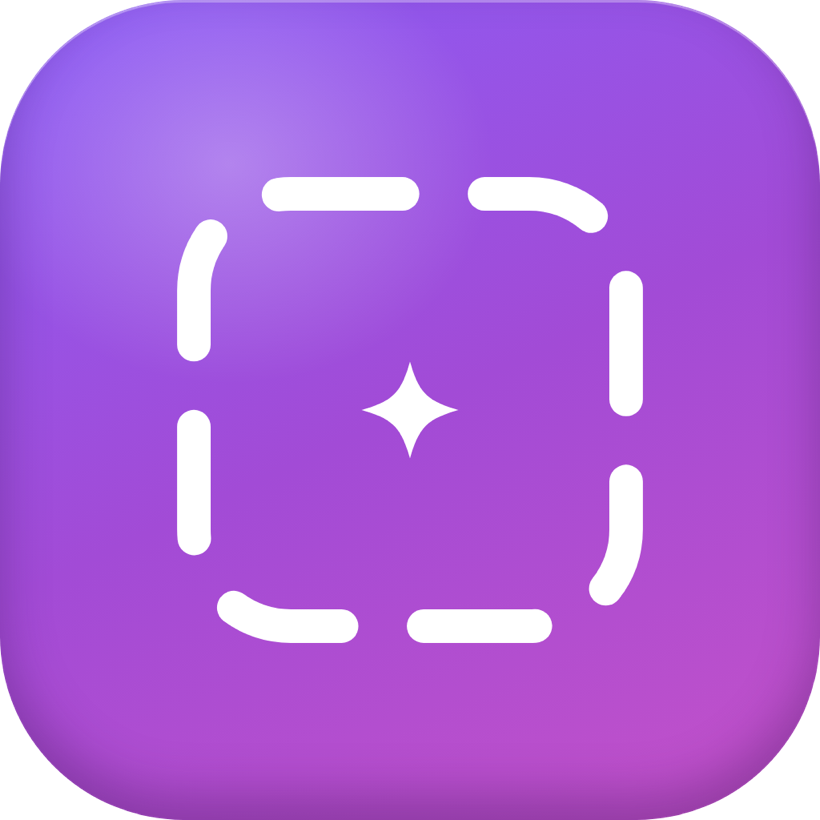
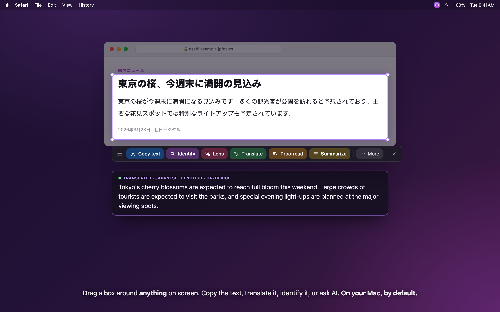
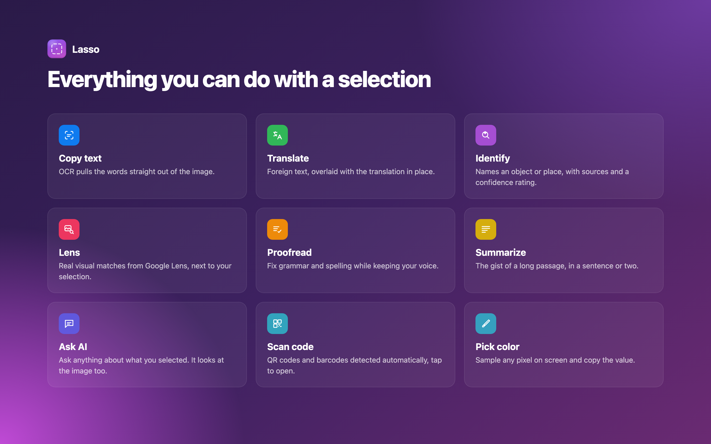
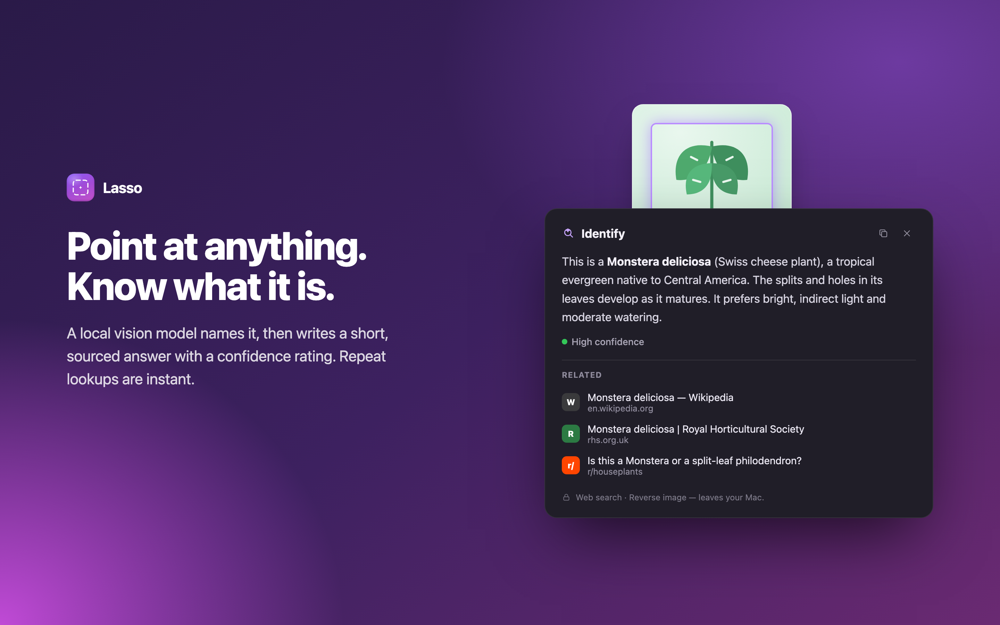
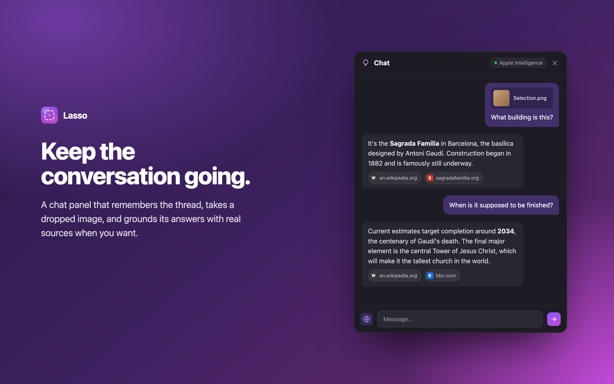
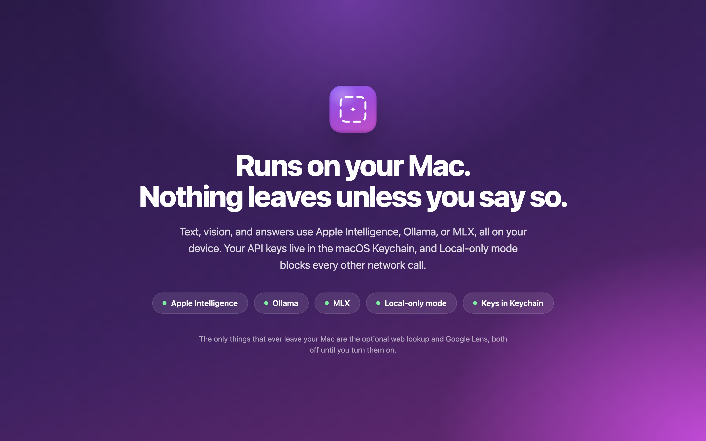

# Lasso

  
  
  

Lasso is a little menu-bar app for Apple Silicon Macs. Hit a hotkey, the screen
freezes, you drag a box around anything on it, and a small toolbar pops up with
things you can do — copy the text, translate it, ask an AI about it, figure out
what an object is, scan a QR code, grab a color.

Think screen search, but native to the Mac and **local by default** —
nothing leaves your machine unless you decide it should.

## What you can do with a selection

- **Copy text** — OCR pulls the words straight out of the image.
- **Translate in place** — each paragraph, label and list item gets its
  translation drawn right over it, coloured to match the page. A view mixing
  languages (English and Japanese, say) translates both. Apple's on-device
  translation appears first; an optional AI pass then retranslates the whole
  selection with context, Filipino included.
- **Summarize / Ask AI** — summarize the selection or ask anything about it; if
  it's a textless image, the AI actually looks at the picture.
- **Identify** — point it at an object, product, place, or screenshot and it
  tells you what it is, with sources and a confidence rating.
- **Scan QR / barcodes**, and **pick a color** from any pixel.
- **Search with Lens** — send the selection to Google Lens for a reverse image
  search. Opt-in, and hidden entirely in Local-only mode.

## Your toolbar, your keys

The toolbar follows the order you set, not what Lasso guesses is relevant, so the
two things you actually use stay where you expect them even when the selection
happens to contain a QR code or a color. Switch an action off and it moves into
the toolbar's "…" menu rather than disappearing.

Every action can also have its own hotkey that starts a capture and runs just
that action, skipping the toolbar entirely. Identify and Google Lens additionally
have a full-screen variant that grabs the whole display. Nothing is bound by
default; you pick the keys in Settings.

## Identify

A local vision model names it, then writes a short, sourced answer with a
confidence rating. Repeat lookups are instant.

## Chat

A persistent chat panel that remembers the thread, takes a dropped image, and
grounds its answers with real sources when you want. Click the mic to talk
instead of typing: English speech recognition on your Mac, with words appearing
as you speak.

## Privacy

Out of the box everything runs on your Mac — text via **Apple Intelligence**,
vision and ranking via a local **Ollama** model. The only things that leave your
Mac are the optional web lookup in Identify and the optional Google Lens search,
and both stay off until you turn them on.
There's a **Local-only mode** that forces a local model and blocks every
incidental network call. Cloud models (OpenAI, Groq, Anthropic, custom) are
supported too, but strictly opt-in; API keys live in the macOS Keychain.

## Install

1. Download the **`.dmg`** from the [Releases](../../releases) page.
2. Open it and drag **Lasso** to Applications.
3. First launch: open Lasso. macOS says it can't verify the developer, which is
   expected because the build isn't notarized. Click **Done**, then go to System
   Settings → Privacy & Security, click **Open Anyway** next to Lasso, and confirm.
   You only do this once.
4. Grant **Screen Recording** in System Settings → Privacy & Security, then
   relaunch. The capture shortcut defaults to **⌃⇧C** (changeable in Settings).

## Requirements

Apple Silicon Mac on **macOS 26+**. For the local AI paths, install
[Ollama](https://ollama.com) and pull a model or two
(`ollama pull qwen3:4b`, `ollama pull qwen3-vl:2b`). Apple Intelligence works
with no setup.

## AI providers

Settings → Intelligence lets you pick where the thinking happens:

- **Apple Intelligence** — on-device, no setup. The default.
- **Ollama** — a local model server. `ollama pull qwen3:4b` (or whatever you like) and Lasso
  auto-detects it. Still 100% on your Mac.
- **MLX** — on-device models that run on Apple Silicon directly. Browse, download, and manage them
  inside Settings; nothing leaves your Mac.
- **OpenAI-compatible** — OpenAI, Groq, OpenRouter, Google, LM Studio, or any custom base URL. Add as
  many connections as you like (name + base URL + key); they're all live at once, and Lasso fetches
  what each one serves. The Model dropdown is the union of every connection's models, grouped by
  connection, so picking a model is what decides where the request goes. Connections are managed in
  one place, under "Manage connections".
- **Google Gemini** — Google's native Gemini API. Add it as a connection with just a name and an API
  key; the endpoint is built in. Its models join the same dropdown as everything else. (You can still
  reach Gemini through the OpenAI-compatible route instead, using Google's compatibility layer at
  `https://generativelanguage.googleapis.com/v1beta/openai/` — both work, side by side.)
- **Anthropic** — Claude, via your API key.

**Free-model fallback** (off by default). Turn on *Fallback ▸ Free models* under a cloud language
model, and a request that fails before it starts answering (rate limited, provider down, model not
found) is retried on up to three free models, then on Apple's on-device model. A model that is only
slow gets company instead: if it hasn't started answering after the time you pick under *Slow model*
(15 seconds by default, or never), the best free model starts too and whichever answers first wins.
Your model isn't cut off, so if it was about to answer, you still get it. If it fails twice in a row,
Lasso stops waiting on it: the next messages go straight to the model that answered, and Chat shows
"Using X · Y isn't responding" with **Switch** (make it your model) and **Try again**. If it was only
slow rather than broken, it keeps every message and the free model simply starts alongside it, with
**Stop racing** to go back to waiting. Your selection
doesn't change, and Lasso gives your model another go after a few minutes, so it comes back on its own.
A model that is slow rather than broken keeps its place: the free model simply starts at the same time as
it, rather than after the wait. Apple's on-device model is the last resort, and only for conversations
small enough for it to hold and turns that do not need a search; when it answers, it is told which model
it is standing in for so it continues the chat instead of starting over. Racing means two requests, so a
slow turn spends one free-model request even when your own model wins, and a model cut off after it had
started generating may still bill for what it produced. Only connections you
set to **Use as fallback** in Manage connections are used, a server on your Mac included. Lasso tries
your own model on another connection first, then the free model closest to it that can handle the
request: it must read your images, fit the conversation, call web search when you asked for one, and
not be far smaller than the model you chose. A turn where you asked for a search is never handed to the
on-device model, which can't search. Chat's Activity, Ask AI, and Proofread (its result card and its
in-place popup) say which model answered, and your selected model doesn't change. Free means: models OpenRouter prices at
zero, a server on your Mac, and, once you turn on **Free tier** for a Groq or Google connection, the
models that provider documents as included in its free plan (unless your selected model on that key is
a paid-only one, which means the key is billed). Lasso never guesses that a model is free, and free plans
may use your requests to improve their models. A fallback sends the request to a different provider
than the one you picked, so it never starts from a model on your Mac or your own network (a private
address, a one-word host name like `mac-studio`, or a `.local`, `.lan`, `.home.arpa`, `.internal`, or
Tailscale `.ts.net` name), never runs for Chat's background memory summary, and is off entirely in
local-only mode. Identify only ever retries on-device. Free models carry a *free* tag (*free tier* for
plan-based ones, dropped when your selected model on that key is paid-only) in the Settings model picker
and the chat switcher. It doesn't cover the image model yet.

Image and Embedding are their own sections with the same layout as Language. Image starts out
**linked** to your language model (useful when that model is multimodal); turn the link off to give
images their own provider, key, and model.

Everything in Settings is staged and applied with one **Save & Apply** button.

## Build it yourself

Lasso is open source. Building your own copy needs an Apple Silicon Mac on macOS
26+, Xcode 26+ and XcodeGen, but no Apple developer account, and a copy you build
yourself skips the "can't verify the developer" step entirely. See
[BUILDING.md](BUILDING.md) for the steps.

## How it's put together

Each feature is a `CaptureAction` (see `Lasso/Actions/`) — adding one is a single file plus a line in
`ActionRegistry`. OCR, barcode, and data detection run as `actor`s; capture and UI stay on the main
actor. The AI side sits behind an `IntelligenceProvider` protocol so providers (Apple, Ollama, MLX,
OpenAI-compatible, Anthropic) are interchangeable, and optional web/reverse-image **connectors** are a
declarative catalog you can extend with one entry. There's a fuller writeup in
[`Lasso-macOS-Spec.md`](Lasso-macOS-Spec.md).

## Good to know

- **Reverse-image search** in Identify is opt-in and brings your own key (Google Cloud Vision). The
  **Google Lens** action is a separate, keyless way to get real visual matches — also opt-in, since it
  uploads to Google. (Google Lens shows results in whatever language it infers from your region.)
- **Apple Intelligence** has to be enabled on your Mac for the on-device path; if it's off, AI actions
  fall back to a local model (if one's set up) while OCR, translate, and the rest keep working.
- DRM/protected windows (Netflix, some banking apps) capture as blank by design — Lasso doesn't try
  to get around that.

## License

[Apache License 2.0](LICENSE). Copyright 2026 civarry. If you redistribute Lasso or a modified
version, keep the [NOTICE](NOTICE) file, which credits the original author, and note what you changed.
