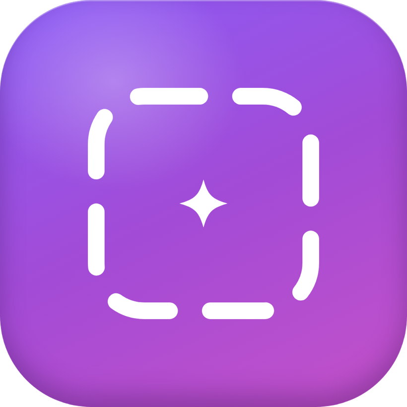
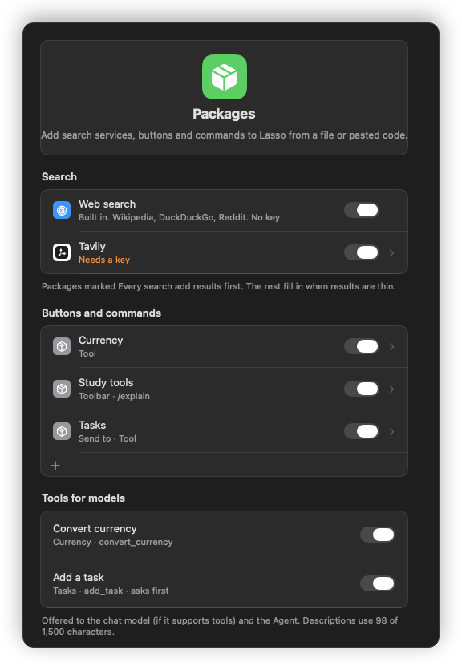
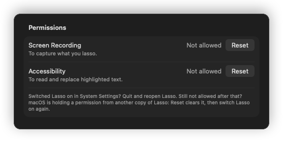
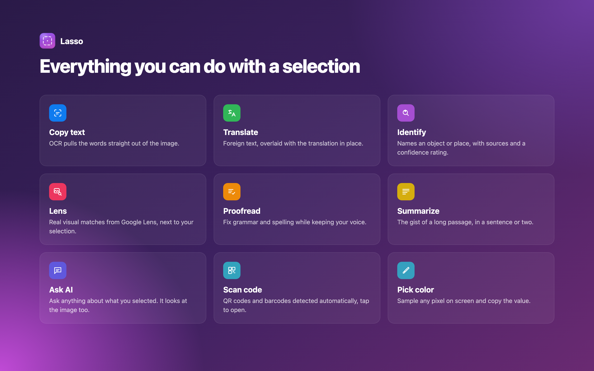
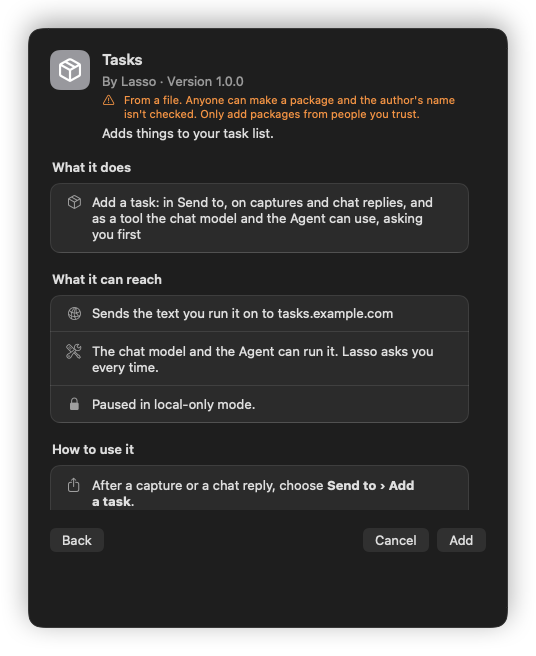

# Lasso

  
  
  
  

**Draw a box around anything on your screen, then copy it, translate it, or ask AI about it.**

- A menu-bar app for Apple Silicon Macs.
- **Local by default:** nothing leaves your Mac unless you turn it on.
- Open source ([Apache 2.0](LICENSE)). [Download it](../../releases/latest) or [build it yourself](BUILDING.md).

**Jump to:** [What's new](#whats-new-in-019) · [What it does](#what-it-does) · [Chat](#chat) ·
[Agent](#agent) · [Packages](#packages) · [Privacy](#privacy) · [Install](#install) ·
[Updates](#updates) · [AI models](#ai-models) · [Build it](#build-it-yourself)

## What's new in 0.19

**Packages can give the chat model and the Agent new tools.** A model can now look things up
or do things through a package, like converting money or adding a task.

- Tools that only look something up run straight away.
- Tools that **do** something (send data, copy, open a page) ask you first. Deny, and nothing runs.

**Choose which tools models get** in Settings › Packages › Tools for models.

**Stuck permission? One click.** If Lasso is switched on in Screen Recording but still can't
capture, Settings › Privacy › Permissions › **Reset** fixes it (0.19.1).

## What it does

Press **⌃⇧C**, drag a box, and pick what to do:

| Action | What happens |
|---|---|
| **Copy text** | Pulls the words out of the picture. |
| **Translate** | Draws the translation right over the original, in place. Mixed languages work. |
| **Summarize / Ask AI** | Summarizes it, or answers your question about it. Works on pictures too. |
| **Identify** | Tells you what an object, product or place is, with sources. |
| **Scan code** | Reads QR codes and barcodes. |
| **Pick color** | Grabs the color of any pixel. |
| **Search with Lens** | Sends it to Google Lens. Off until you turn it on. |

**Make it yours:**

- The toolbar keeps **your** order. Turned-off actions move to the "…" menu.
- Give any action its own hotkey to skip the toolbar. Nothing is bound until you choose.
- Identify and Lens can also grab the whole screen.

More about Translate and Identify

- **Translate:** Apple's on-device translation shows first. An optional AI pass then retranslates the
  whole selection with context (Filipino included).
- **Identify:** a local vision model names the thing, then writes a short answer with sources and a
  confidence rating. Repeat lookups are instant.

## Chat

A chat panel that stays open (**⌃⇧A**) and remembers the conversation.

- **Attach anything:** images, text, PDFs, code. Drop files in, or send a capture to chat.
- **Sources:** answers can be grounded in web results, with links.
- **Talk instead of type:** click the mic. Lasso stops listening when you finish, tidies the
  "ums" on your Mac, and one Undo restores exactly what you said.

## Agent

*Optional and experimental.* Turn on **Agent** in the chat box and the chat can **do things**:
search the web, read and write files, run commands. You see every step.

- **Asks before risky commands.** You allow once, allow for this chat, or deny.
- **Can see your screen:** it can look at the screen, ask you to drag around a part, or read an image.
- **Works in `~/LassoWorkspace`.** Its files go there (Settings › Agent › Show in Finder).
- **Uses only the model you picked in Lasso.** Not available in local-only mode.
- Needs [Hermes Agent](https://github.com/NousResearch/hermes-agent): `brew install hermes-agent`.
  Lasso sets it up for you.

How the Agent is set up

- Lasso gives Hermes a fresh profile of its own. Your own Hermes settings, keys and gateway aren't
  touched or used.
- Lasso starts it when you use Agent and stops it when Lasso quits.
- It gets only the Hermes tools useful here (commands, files, the web, memory), which roughly halves
  what a local model reads before its first reply.
- An MLX model is served to it by Lasso on your Mac. The first reply is slow while the model reads the
  setup; later ones are quick.
- Apple Intelligence can't drive the Agent. With it selected, Agent says so instead of switching models.
- Settings › Agent can let Hermes approve risky commands itself (every reply then says it's on), or use
  a Hermes you run yourself, which must have `approvals.mode: manual`.

## Packages

**Add features to Lasso with a small file, no coding in Lasso needed.** In Settings › Packages,
click **+** and drop the file in, choose it, or paste it.

A package can add:

- **Web search sources** (Tavily and SerpApi are built in).
- **Toolbar buttons** on captures, shown only when they fit (a tracking number, a flight, long text…).
- **`/commands`** in chat.
- **"Send to" targets** on captures and chat replies.
- **Hotkeys** for text you highlight in any app, with the result pasted back.
- **Tools** for the chat model and the Agent (new in 0.19).

**You stay in control:**

- Before adding, Lasso shows what it does and where it sends data.
- Keys stay in your Keychain and only go to that package's servers.
- A command uses **your** chosen model, never another one.
- Local-only mode pauses packages that reach off your Mac.

Make your own: [`docs/CONTRIBUTING-PACKAGES.md`](docs/CONTRIBUTING-PACKAGES.md) has an example and the
rules. The full design is in [`docs/PACKAGES.md`](docs/PACKAGES.md).

## Privacy

- **Runs on your Mac** out of the box: Apple Intelligence for text, a local Ollama model for images.
- **Leaves your Mac only if you turn it on:** Identify's web lookup, Google Lens, cloud models.
- **Update check:** asks GitHub for the latest version a few times a day. Sends only Lasso's version.
- **Local-only mode** blocks every network call except your local model.
- **Keys** are encrypted in your Keychain, all in one item. After an update, macOS asks for your
  password once (choose **Always Allow**).

## Install

1. Download the **`.dmg`** from [Releases](../../releases/latest).
2. Drag **Lasso** to Applications.
3. Open Lasso. macOS says it can't verify the developer (expected: it isn't notarized).
   Click **Done**, then System Settings › Privacy & Security › **Open Anyway**. Only once.
4. Turn on **Screen Recording** for Lasso in System Settings › Privacy & Security, then reopen Lasso.

Capture with **⌃⇧C** (change it in Settings).

**Needs:** an Apple Silicon Mac on **macOS 26+**. For local AI, install [Ollama](https://ollama.com)
and pull a model or two (`ollama pull qwen3:4b`, `ollama pull qwen3-vl:2b`). Apple Intelligence needs
no setup.

## Updates

Lasso **updates itself**: it downloads in the background and installs when you're not using it.
Change this in Settings › General › Software Update, or use **Check for Updates…** in the menu bar.

Updates and permissions, in detail

- An update installs only if it's signed with Lasso's update key, so a tampered download is rejected.
- Since 0.16.0 every release uses the same certificate, so macOS keeps your Screen Recording and
  microphone permissions across updates. Coming from 0.15.x or earlier? Install 0.16.0 or later from
  the DMG once and allow them again.
- On in Screen Recording but Lasso still asks? Another copy of Lasso holds the permission.
  Settings › Privacy › Permissions › **Reset** clears it.
- Local-only mode stops update checks.

## AI models

Pick in **Settings › Models**:

- **Apple Intelligence:** on your Mac, no setup. The default.
- **Ollama or MLX:** local models, still on your Mac. MLX models download in Settings or load from a
  folder you have (`~/models`, LM Studio).
- **Cloud:** OpenAI-compatible services (OpenAI, Groq, OpenRouter, your own URL), Google Gemini,
  Anthropic. Opt-in.

**Free-model fallback** (off by default): if your cloud model is rate limited or down, Lasso retries
on a free model you allowed, then on Apple's on-device model. Never in local-only mode.
Details: [docs/APP_FLOW.md](docs/APP_FLOW.md).

Good to know

- If Apple Intelligence is off on your Mac, AI actions use a local model if you set one up. Copy,
  translate and the rest keep working.
- Protected windows (Netflix, some banking apps) capture as blank on purpose. Lasso doesn't get around
  that.
- Google Lens picks its results' language from your region.
- Reverse-image search in Identify is opt-in and uses your own Google Cloud Vision key.

## Build it yourself

You need an Apple Silicon Mac on macOS 26+, Xcode 26+ and XcodeGen. No Apple developer account.
Steps: [BUILDING.md](BUILDING.md).

How it's put together

- Each feature is a `CaptureAction` (`Lasso/Actions/`): one file plus a line in `ActionRegistry`.
- OCR, barcodes and data detection run as `actor`s; capture and UI stay on the main actor.
- AI providers sit behind one `IntelligenceProvider` protocol, so Apple, Ollama, MLX,
  OpenAI-compatible and Anthropic are interchangeable.
- Search sources and commands are packages, not code.
- The README's app screenshots are rendered from the real views by `ReadmeScreenshotTests`.
- Fuller writeups: [`Lasso-macOS-Spec.md`](Lasso-macOS-Spec.md) and [docs/APP_FLOW.md](docs/APP_FLOW.md).

## License

[Apache License 2.0](LICENSE). Copyright 2026 civarry. If you redistribute Lasso or a modified
version, keep the [NOTICE](NOTICE) file, which credits the original author, and note what you changed.
