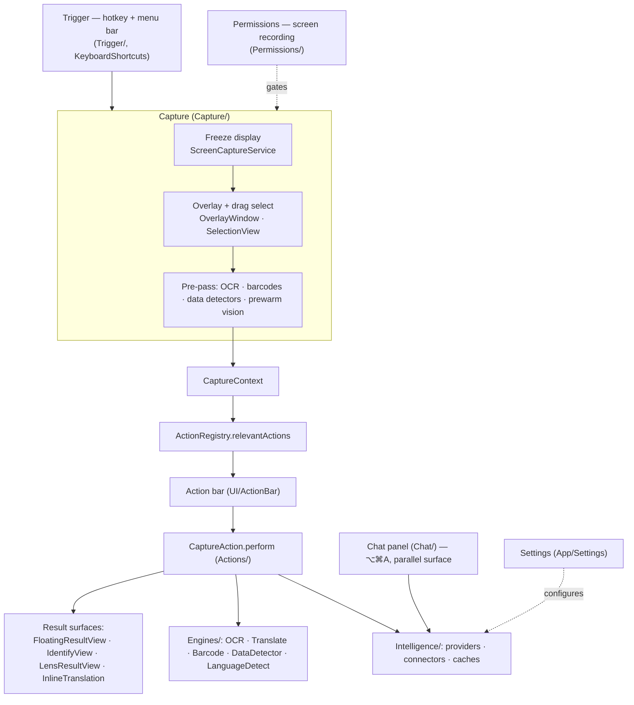
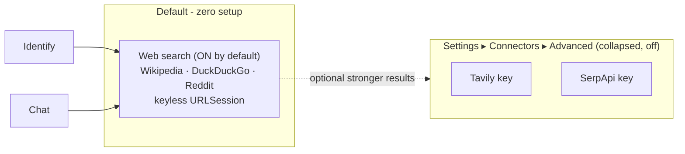

```mermaid
flowchart TD
  Start[Identify on selection] --> Cache{IdentifyCache hit?}
  Cache -->|yes| Replay[Replay cached summary + related]
  Cache -->|no| Route{"OCR text >= 40 letters<br/>&& not forceVisual?"}

  Route -->|"text-heavy (default)"| TextMode["TextActionsView:<br/>Detected text · N words<br/>Copy · Translate · Ask AI · Chat"]
  Route -->|visual| Vision[On-device vision model describes]

  Vision --> Web["Keyless web grounding (WebSearchSource):<br/>Wikipedia · DuckDuckGo · Reddit"]
  Web --> Synth[Synthesize summary + confidence + rank RELATED]
  Synth --> Card[Answer + confidence chip + RELATED links]
  Card --> LensBtn[["Search with Google Lens - one tap"]]

  %% Escape hatch: a text-heavy capture can still be a photo carrying text
  TextMode -->|"Actually a photo? · Identify anyway"| Vision
  TextMode -->|"Actually a photo? · Google Lens"| LensBtn

  LensBtn -.opt-in.-> LensWeb[Lens panel - WKWebView -> lens.google.com]

  style TextMode fill:#1e4a2e,stroke:#4b8
  style Card fill:#1e4a2e,stroke:#4b8
  style LensBtn fill:#1e3a5a,stroke:#48b
```

# Lasso — App Flow & Architecture (living document)

> **Keep this in sync with the code.** Every behavior/flow change updates the diagrams + notes here in
> the same pass. This is the canonical map of how the *whole* app works today — not a plan, the shipped
> reality. Product direction & rationale live in the planning notes; this file tracks *what is*.

Positioning: **"Screen search for your whole Mac, on-device by default."** Select anything on screen →
understand it or act on it. Zero-setup default path, privacy-preserving (local vision + keyless web),
with an opt-in Google Lens escalation for full reverse-image search.

---

## 1. Module map (layers)

---

## 2. Capture pipeline (`Capture/CaptureCoordinator.swift`)

1. **Trigger** — global hotkey (`Trigger/TriggerService`, KeyboardShortcuts) or menu bar
   (`MenuBarController`) starts a session. Screen-recording permission is gated by `PermissionsService`.
2. **Freeze** — `ScreenCaptureService` grabs the display; `OverlayWindow` shows it frozen so the user
   can drag a selection (`SelectionView`); `SubjectLift` supports object/subject lift.
3. **Pre-pass** (`runPrePass`) on the crop: `OCREngine` (text + per-line boxes), `BarcodeEngine`
   (QR/barcode), `DataDetector` (URLs/phones/emails/dates), and `prewarmVision()`. Results populate a
   `CaptureContext` (`Actions/CaptureAction.swift`).
4. **Route** — `ActionRegistry.relevantActions(for:)` filters + sorts actions by `relevancePriority`;
   the **action bar** renders them. Direct-shortcut actions can skip the bar.
5. **Perform** — `CaptureAction.perform` returns an `ActionResult`: `.text` / `.stream` →
   `FloatingResultView`; `.custom(AnyView)`; `.inlineTranslate`; `.copiedToPasteboard`; `.openedURL`;
   `.none`. The freeze drops once a result floats (or on `.none`).

---

## 3. Feature / action catalog (`Actions/`, registered in `ActionRegistry.makeDefault`)

| Action | id | Prio | Backend / engine | Output surface |
|---|---|---|---|---|
| **Copy text** | `ocr.copy` | — | `OCREngine` (pre-pass) | pasteboard |
| **Translate** | `translate` | 20 | Apple Translation framework (`TranslateEngine`) | inline overlay (`InlineTranslationView`) or `TranslationResultView` |
| **Grammar fix** | `grammar.fix` | — | text provider (`GrammarFixService`) | floating card |
| **Summarize** | (summarize) | — | text provider | `FloatingResultView` stream |
| **Ask AI** | `ai.ask` | 40 | text provider (+ vision for imageless text) | `AskAIView` inline |
| **QR / barcode** | `qr` | — | `BarcodeEngine` (pre-pass) | open URL / show payload |
| **Color picker** | `color` | — | pixel sample | swatch view |
| **Identify** | `identify` | 12 | vision + keyless web + text synth | `IdentifyView` card |
| **Google Lens** | `lens.search` | 13 | WKWebView → lens.google.com (opt-in) | `LensResultView` panel |
| **Chat** (separate) | — | ⌥⌘A | text provider (+ tools/web) | `ChatView` panel |

---

## 4. Intelligence system (`Intelligence/IntelligenceProvider.swift`)

Two independent **roles**, each chosen in Settings:

- **Text** (`ProviderKind`): `apple` on-device Foundation Models (default, text-only), `ollama` (local
  server), `mlx` (local Apple-Silicon), `openAICompatible` (cloud/local endpoint, e.g. Groq/LM Studio),
  `anthropic`. Streams deltas via `respond(prompt:context:)` / `respond(messages:)`; tool-capable
  providers also expose `respond(messages:tools:execute:)`.
- **Vision** (`VisionEngine`): `matchText` (route through the text provider if it's multimodal),
  `ollama`, `mlx`, `openAICompatible`, `anthropic`. **Apple on-device is text-only** → returns nil for
  vision (no silent fallback). Used to *describe* an image (Identify, Ask-AI-on-image, Chat attachments).
- **`isLocal`** drives the privacy badge; **local-only mode** (`PrivacyMode.localOnly`) forces on-device
  and pauses every off-device path (see §8).
- **Tools** (`Intelligence/Tools/`): a model-decided `web_search` tool for Chat on tool-capable
  backends; others fall back to heuristic grounding.

---

## 5. Identify pipeline (`UI/IdentifyView.swift`)

OCR-first routing decides text mode vs. the visual identify path; **neither is a dead-end**.

- **Routing signal:** `hasStrongText` = `ocrText` letters ≥ 40. Escape hatch "Identify anyway" sets
  `forceVisual` (`textHeavy = hasStrongText && !forceVisual`) so a photo-that-carries-text still gets
  the visual path (on-device / local-only).
- **Text mode** (`TextActionsView`): Copy · Translate (`TranslationResultView`) · Ask AI (`AskAIView`)
  · Chat, plus opt-in "Clean up misreads with AI" → single Cleaned column, changed lines highlighted
  (`OCRDiff.changedLines` + `OCRCleanedView`); verbatim source is never silently rewritten.
- **Models:** vision role describes on-device; the text provider synthesizes the final answer +
  `Confidence: High/Medium/Low`. Ranking/caching: `rankHits` (word overlap), `IdentifyCache`.

---

## 6. OCR & Translate

- **OCR** (`Engines/OCREngine.swift`) — Apple Vision `RecognizeTextRequest`, accurate, zh-Hant+en.
  `readingOrdered(_:)` reconstructs reading order geometrically (column-aware; verbatim, never
  rewrites/drops), fixing multi-column interleaving app-wide.
- **Translate** (`Engines/TranslateEngine`, Apple Translation framework) — on-device. Two surfaces:
  inline overlay translation over each OCR line (`InlineTranslationView`, needs line geometry) and the
  single-pane `TranslationResultView` (source/swap/target capsule). `LanguageDetect` picks the source.

---

## 7. Chat (`Chat/`)

Persistent top-right panel (⌥⌘A), independent of the capture overlay. Multi-turn, image attach
(button / ⌘V / capture "Continue in chat" seed), two-track memory (`ConversationMemory`,
`ChatContextBuilder`). Grounds via the same keyless web search; reverse-image is the one-tap Lens
escalation, not a silent per-turn API call.

---

## 8. Connectors, web grounding & privacy

Reverse-image via a keyed API was **removed** — Google Lens (zero-setup, opt-in) is the only
reverse-image path now.

Files: `Intelligence/Connectors.swift`, `WebSourcesProvider.swift` (`WebSearchSource`,
`IdentifySources`), `SearchCache`, `SearchQuota`, `DomainNoise`, `Keychain`.

**Privacy invariant:** `privacy.localOnly` (PrivacyMode) gates **every** off-device path at the source
— web connectors pause, the Lens button/action hides, favicons don't load. Local-only = zero
off-device network. See memory `lasso-localonly-egress-invariant`.

---

## 9. Design system (Liquid Glass / Tahoe)

Primitives in `UI/Theme.swift`:
- `.liquidGlassPanel()` — frosted `.ultraThinMaterial` fill, continuous 26pt squircle, hard-clipped +
  hairline border. **No SwiftUI shadow** — the panel *window* uses the native macOS shadow
  (`hasShadow = true`) so it's cast outside the card's silhouette, never *through* the translucent
  corners (a SwiftUI `.shadow` did → dark "double edge"). `.regularMaterial` under Reduce Transparency.
- `.glassWell()` — recessed content blocks (dark `black 0.18` tint, continuous 16pt); not glass.
- Action pills — compact inline (icon + label, ~34pt), equal-width flex; inactive translucent white,
  active tool solid accent. Language bar — one material capsule (plain-text names + accent-glass swap).
- Requires the panel window non-opaque + clear (`FloatingPanel`, chat panel).
- Applied to: Identify card, `FloatingResultView`, `ChatView`, `LensResultView`. Action bar / Grammar
  chip / inline-translate already used material.

---

## Change log
- Removed Google Vision (keyed reverse-image) connector + source; Lens is the reverse-image path.
- Web search defaults ON; Tavily/SerpApi demoted to collapsed "Advanced".
- Identify text-heavy captures show `TextActionsView` instead of a refusal; escape hatch "Google Lens"
  + "Identify anyway" (`forceVisual`).
- OCR reading-order reconstruction (`OCREngine.readingOrdered`) — geometric, verbatim.
- Opt-in AI "Clean up misreads" → single Cleaned column with changed lines highlighted.
- Translate: full width; source/swap/target as one material capsule; "already in target" hint instead
  of the framework error; shared with the standalone Translate action.
- Compact inline action pills (translucent white / solid-accent active).
- App-wide Liquid Glass rollout (`FloatingResultView`, `ChatView`, `LensResultView`).
- Corner-artifact fix: native window shadow (`hasShadow=true`) replaces SwiftUI panel shadows; material
  hard-clipped to the rounded shape.
- Expanded this doc from Identify-only to whole-app architecture (module map, capture pipeline, action
  catalog, intelligence system).
