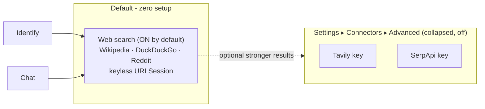

# Lasso — App Flow (living document)

> **Keep this in sync with the code.** Every behavior/flow change should update the diagrams and notes
> here in the same pass. This is the canonical map of how Lasso works today — not a plan, the shipped
> reality. Product direction & rationale live in the planning notes; this file tracks *what is*.

Positioning: **"Screen search for your whole Mac, on-device by default."** Zero-setup default path,
privacy-preserving (local vision + keyless web), with an opt-in Google Lens escalation for full
reverse-image search.

---

## 1. Top-level flow: capture → act

```mermaid
flowchart TD
  Shortcut[Global shortcut / menu bar] --> Cap[Capture: freeze display + drag selection]
  Cap --> PrePass["Pre-pass (CaptureCoordinator.runPrePass):<br/>OCR • barcodes/QR • data detectors • prewarm vision"]
  PrePass --> Bar[Action bar - situational + core actions]

  Bar --> OCRCopy[Copy text]
  Bar --> Translate[Translate - on-device Translation framework]
  Bar --> Ask[Ask AI - one-shot Q&A]
  Bar --> Summarize[Summarize]
  Bar --> Identify[Identify -> floating card]
  Bar --> Lens[Google Lens - opt-in]
  Bar --> Grammar[Grammar fix]
  Bar --> QR[Open QR / barcode]
  Bar --> Color[Color picker]

  Chat["Chat panel (⌥⌘A) - independent surface"]
  Bar -. Continue in chat .-> Chat

  style Identify fill:#1e4a2e,stroke:#4b8
  style Lens fill:#1e3a5a,stroke:#48b
```

Key files: `Capture/CaptureCoordinator.swift`, `Actions/ActionRegistry.swift`, `Actions/*Action.swift`.

**OCR reading order:** `OCREngine.readingOrdered(_:)` reorders recognized lines geometrically — when a
clean vertical gutter cleanly splits lines into two non-overlapping columns it reads left column then
right (fixes multi-column interleaving); otherwise plain top-to-bottom. Purely geometric: reorders
only, never rewrites or drops a line, so `ocrText` stays verbatim for Copy/Chat/Summarize.

---

## 2. Identify pipeline (the "what is this?" card)

`Actions/IdentifyAction.swift` → `UI/IdentifyView.swift`. OCR-first routing decides text mode vs. the
visual identify path; **neither is a dead-end**.

```mermaid
flowchart TD
  Start[Identify on selection] --> Cache{IdentifyCache hit?}
  Cache -->|yes| Replay[Replay cached summary + related]
  Cache -->|no| Route{"OCR text >= 40 letters<br/>&& not forceVisual?"}

  Route -->|"text-heavy (default)"| TextMode["TextActionsView:<br/>Detected text · N words<br/>Copy · Translate · Ask AI · Chat"]
  Route -->|visual| Vision[On-device vision model describes]

  Vision --> Web["Keyless web grounding (WebSearchSource):<br/>Wikipedia · DuckDuckGo · Reddit"]
  Web --> Synth[Synthesize summary + confidence + rank RELATED]
  Synth --> Card[Answer + confidence chip + RELATED links]
  Card --> LensBtn[["Search with Google Lens - one tap"]]

  %% Escape hatch: a text-heavy capture can still be a photo carrying text
  TextMode -->|"Actually a photo? · Identify anyway"| Vision
  TextMode -->|"Actually a photo? · Google Lens"| LensBtn

  LensBtn -.opt-in.-> LensWeb[Lens panel - WKWebView -> lens.google.com]

  style TextMode fill:#1e4a2e,stroke:#4b8
  style Card fill:#1e4a2e,stroke:#4b8
  style LensBtn fill:#1e3a5a,stroke:#48b
```

Notes:
- **Routing signal:** `hasStrongText` = `ocrText` letters ≥ 40 (`IdentifyView.swift`). Cheap, no model.
- **Escape hatch:** "Identify anyway" sets `forceVisual`, re-running with
  `textHeavy = hasStrongText && !forceVisual` so a photo-that-carries-text still gets the visual path
  (works on-device / in local-only). "Google Lens" opens the full reverse-image search.
- **Text mode reuse:** Translate → `UI/TranslationResultView.swift`; Ask AI → `AskAIView`
  (`Actions/AskAIAction.swift`); Chat → `ChatPanelController.shared.open(seedText:seedImage:)`.
- **Models:** vision role describes on-device (Ollama VL / MLX / multimodal cloud); the text provider
  synthesizes the final answer + `Confidence: High/Medium/Low`. See `Intelligence/IntelligenceProvider.swift`.

---

## 3. Web grounding & connectors

Reverse-image via a keyed API was **removed** — Google Lens (zero-setup, opt-in) is the only
reverse-image path now.

Key files: `Intelligence/Connectors.swift` (`Connectors.all` = webSearch/tavily/serpApi; `Connectors.advanced`),
`Intelligence/WebSourcesProvider.swift` (`WebSearchSource`, `IdentifySources`), `App/Settings/SettingsView.swift`.

---

## 4. Chat panel

`Chat/ChatController.swift` + `Chat/ChatPanelController.swift`. Persistent top-right window (⌥⌘A),
multi-turn, image attach (button / ⌘V / capture bridge), two-track memory. Grounds answers via the same
keyless web search; reverse-image is **not** a silent per-turn API call anymore — it's the Lens escalation.

---

## 5. Privacy invariant

`privacy.localOnly` (PrivacyMode) gates **every** off-device path at the source: web connectors pause,
the Lens button/action hides, favicons don't load. Local-only = zero off-device network. See memory
`lasso-localonly-egress-invariant`.

---

## Design system (Liquid Glass / Tahoe)

Primitives live in `UI/Theme.swift`:
- `.liquidGlassPanel()` — the floating panel surface: a single frosted `.ultraThinMaterial` fill in a
  continuous 26pt squircle + hairline border + soft shadow (a cohesive card on any desktop;
  `.glassEffect` on the whole panel is near-invisible over dark desktops). `.regularMaterial` under
  Reduce Transparency. **Glass is reserved for control pills**, never the whole panel or content.
- `.glassWell()` — recessed content blocks (detected-text / translation / cleaned) as a plain dark
  tint (`black 0.18`), continuous 16pt — deliberately not glass (Apple: don't sample glass with glass).
- Action pills — icon-over-label, `.glassEffect(.interactive())` in a `GlassEffectContainer`; the
  active tool gets `.regular.tint(.accentColor).interactive()`.
- Typography tiers: meta 11 / body 13 @ 0.85 / titles system-semibold.
- Requires the panel window to be non-opaque with a clear background (already true in `FloatingPanel`).
- Rollout: same primitives can dress Chat, the action bar, and other panels (not yet applied).

## Change log
- Removed Google Vision (keyed reverse-image) connector + source; Lens is the reverse-image path.
- Web search defaults ON; Tavily/SerpApi demoted to collapsed "Advanced".
- Identify text-heavy captures show `TextActionsView` (Copy/Translate/Ask AI/Chat) instead of a refusal.
- Added text-mode escape hatch: "Google Lens" + "Identify anyway" (`forceVisual`).
- Text-mode UI hierarchy pass: compact/de-emphasized detected-text box, one symmetric equal-width
  primary action row (Copy/Translate/Ask AI/Chat), escape hatch demoted to a quiet link line.
- OCR reading-order reconstruction (`OCREngine.readingOrdered`) — geometric column-aware ordering,
  verbatim (no rewrite/drop). Fixes multi-column interleaving app-wide.
- Opt-in AI "Clean up misreads" in text mode — streams a derived, clearly-labeled corrected version
  (tight non-creative prompt), separate from the verbatim Copy so nothing is silently rewritten.
- Cleanup result: **single Cleaned column** with corrected/added lines highlighted green
  (`OCRDiff.changedLines` via `CollectionDifference` + `OCRCleanedView`). The original is not repeated
  — the verbatim box above is the source to compare against (dropped the redundant two-column split).
- **Liquid Glass (Tahoe) restyle** of the Identify card: `.liquidGlassPanel()` surface, `.glassWell()`
  content blocks, icon-over-label glass action pills (active tool accent-tinted), typography tiers,
  Reduce-Transparency fallback. Primitives in `Theme.swift` for app-wide rollout.
- `TranslationResultView` fixes: fills container width (removed hardcoded 400pt) and gains the inline
  translator's full **language bar** — auto-detecting source picker, swap button, target picker
  (reuses `LanguageDetect.dominantNonTargetLanguage`). When the text is already in the target language
  it shows a hint instead of the framework's "Unable to Translate" error. Shared with the standalone
  Translate action.
