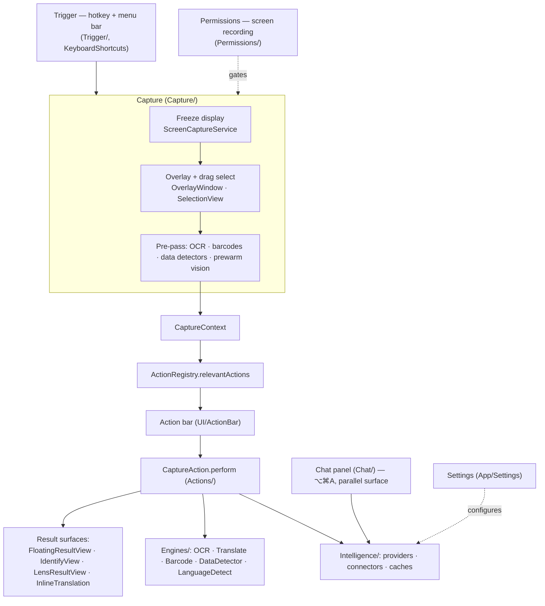
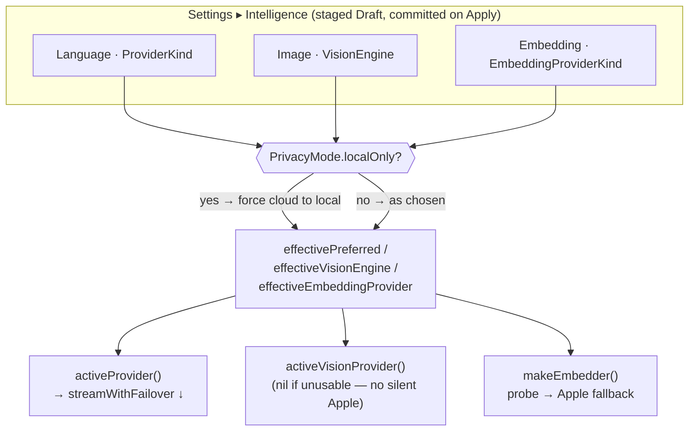
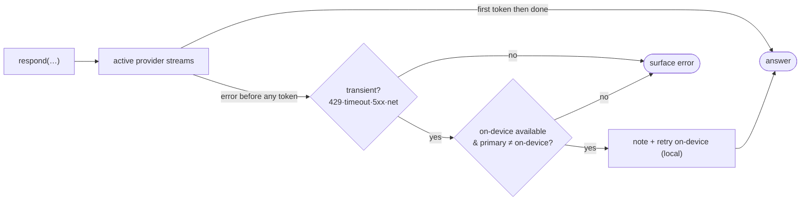
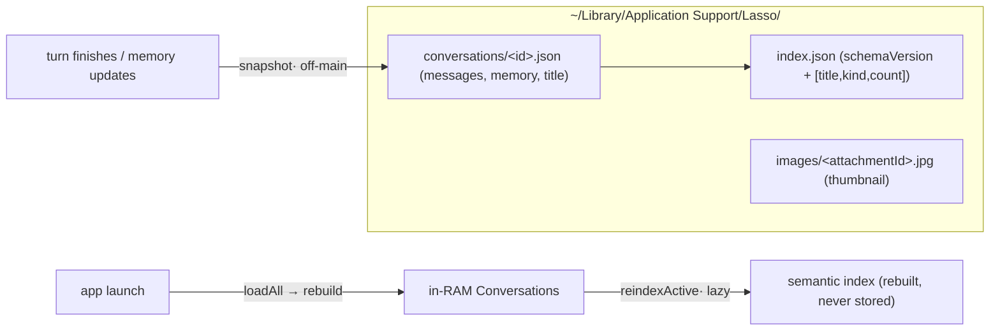
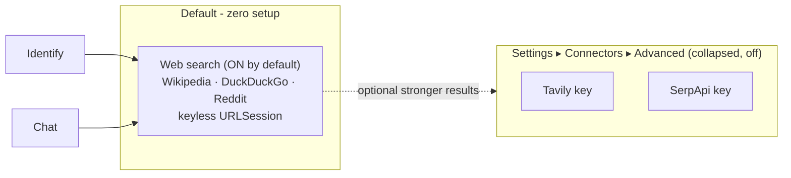

```mermaid
flowchart TD
  Start[Identify on selection] --> Cache{IdentifyCache hit?}
  Cache -->|yes| Replay[Replay cached summary + related]
  Cache -->|no| Route{"OCR text >= 40 letters<br/>&& not forceVisual?"}

  Route -->|"text-heavy (default)"| TextMode["TextActionsView:<br/>Detected text · N words<br/>Copy · Translate · Ask AI · Chat"]
  Route -->|visual| Vision[On-device vision model describes]

  Vision --> Web["Keyless web grounding (WebSearchSource):<br/>Wikipedia · DuckDuckGo · Reddit"]
  Web --> Synth[Synthesize summary + confidence + rank RELATED]
  Synth --> Card[Answer + confidence chip + RELATED links]
  Card --> LensBtn[["Search with Google Lens - one tap"]]

  %% Escape hatch: a text-heavy capture can still be a photo carrying text
  TextMode -->|"Actually a photo? · Identify anyway"| Vision
  TextMode -->|"Actually a photo? · Google Lens"| LensBtn

  LensBtn -.opt-in.-> LensWeb[Lens panel - WKWebView -> lens.google.com]

  style TextMode fill:#1e4a2e,stroke:#4b8
  style Card fill:#1e4a2e,stroke:#4b8
  style LensBtn fill:#1e3a5a,stroke:#48b
```

# Lasso — App Flow & Architecture (living document)

> **Keep this in sync with the code.** Every behavior/flow change updates the diagrams + notes here in
> the same pass. This is the canonical map of how the *whole* app works today — not a plan, the shipped
> reality. Product direction & rationale live in the planning notes; this file tracks *what is*.

Positioning: **"Screen search for your whole Mac, on-device by default."** Select anything on screen →
understand it or act on it. Zero-setup default path, privacy-preserving (local vision + keyless web),
with an opt-in Google Lens escalation for full reverse-image search.

---

## 1. Module map (layers)

---

## 2. Capture pipeline (`Capture/CaptureCoordinator.swift`)

1. **Trigger** — global hotkey (`Trigger/TriggerService`, KeyboardShortcuts) or menu bar
   (`MenuBarController`) starts a session. Screen-recording permission is gated by `PermissionsService`.
2. **Freeze** — `ScreenCaptureService` grabs the display; `OverlayWindow` shows it frozen so the user
   can drag a selection (`SelectionView`); `SubjectLift` supports object/subject lift.
3. **Pre-pass** (`runPrePass`) on the crop: `OCREngine` (text + per-line boxes), `BarcodeEngine`
   (QR/barcode), `DataDetector` (URLs/phones/emails/dates), and `prewarmVision()`. Results populate a
   `CaptureContext` (`Actions/CaptureAction.swift`).
4. **Route** — `ActionRegistry.relevantActions(for:)` filters + sorts actions by `relevancePriority`;
   the **action bar** renders them. Direct-shortcut actions can skip the bar.
5. **Perform** — `CaptureAction.perform` returns an `ActionResult`: `.text` / `.stream` →
   `FloatingResultView`; `.custom(AnyView)`; `.inlineTranslate`; `.copiedToPasteboard`; `.openedURL`;
   `.none`. The freeze drops once a result floats (or on `.none`).

---

## 3. Feature / action catalog (`Actions/`, registered in `ActionRegistry.makeDefault`)

| Action | id | Prio | Backend / engine | Output surface |
|---|---|---|---|---|
| **Copy text** | `ocr.copy` | — | `OCREngine` (pre-pass) | pasteboard |
| **Translate** | `translate` | 20 | Apple Translation framework (`TranslateEngine`) | inline overlay (`InlineTranslationView`) or `TranslationResultView` |
| **Grammar fix** | `grammar.fix` | — | text provider (`GrammarFixService`) | floating card |
| **Summarize** | (summarize) | — | text provider | `FloatingResultView` stream |
| **Ask AI** | `ai.ask` | 40 | text provider (+ vision for imageless text) | `AskAIView` inline |
| **QR / barcode** | `qr` | — | `BarcodeEngine` (pre-pass) | open URL / show payload |
| **Color picker** | `color` | — | pixel sample | swatch view |
| **Identify** | `identify` | 12 | vision + keyless web + text synth | `IdentifyView` card |
| **Google Lens** | `lens.search` | 13 | WKWebView → lens.google.com (opt-in) | `LensResultView` panel |
| **Chat** (separate) | — | ⌥⌘A | text provider (+ tools/web) | `ChatView` panel |

---

## 4. Intelligence system (`Intelligence/IntelligenceProvider.swift`)

**Three independent roles** (Settings ▸ Intelligence: **Language model**, **Image model**, **Embedding
model** — each a `Provider` picker + per-provider config), staged in a `Draft` and committed on Apply:

- **Language / Text** (`ProviderKind`): `apple` on-device Foundation Models (default, text-only), `ollama`
  (local server), `mlx` (local Apple-Silicon), `openAICompatible` (cloud/local endpoint, e.g. Groq/LM
  Studio), `anthropic`. Streams deltas via `respond(prompt:context:)` / `respond(messages:)`; tool-capable
  providers also expose `respond(messages:tools:execute:)`.
- **Image / Vision** (`VisionEngine`): `matchText` (route through the text provider if it's multimodal),
  `ollama`, `mlx`, `openAICompatible`, `anthropic`. **Apple on-device is text-only** → returns nil for
  vision (no silent fallback). Used to *describe* an image (Identify, Ask-AI-on-image, Chat attachments).
- **Embedding** (`EmbeddingProviderKind`, §7): `automatic` (Ollama embed model if reachable → Apple
  `NLEmbedding` → none), `apple`, `ollama`, `openAICompatible`. Powers Chat semantic memory only.
  Resolved by `makeEmbedder()` (probe → **always falls back to Apple**, so retrieval never breaks).
- **OpenAI-compatible services**: each cloud role picks a **Service** (OpenAI/Groq/OpenRouter/Custom) with
  its own Base URL + model; the **API key is shared per service** across roles (`openAIKeyByService`).
  Embedding has its own independent service (can differ from Language — e.g. embed on OpenAI while chatting
  on Groq).
- **`isLocal` / local-only**: `isLocal` drives the privacy badge; **local-only mode**
  (`PrivacyMode.localOnly`) forces every cloud choice back to local via the `effective*` getters
  (`effectivePreferred` / `effectiveVisionEngine` / `effectiveEmbeddingProvider`) — cloud options are also
  hidden in the pickers — so nothing leaves the Mac regardless of what's stored (see §8).
- **Tools** (`Intelligence/Tools/`): a model-decided `web_search` tool for Chat on tool-capable
  backends; others fall back to heuristic grounding.

**Settings → resolution** (how a stored choice becomes the backend that actually runs):

- **Transient-error failover** (`streamWithFailover`): every `respond(…)` streams through one wrapper.
  If the active provider throws a *transient* error (`isTransient`: 429/timeout/5xx/network) **before the
  first token**, it retries **once on the on-device Apple model** and prefixes a short honest note. Never
  swaps mid-answer (would splice two models); never falls back to a *cloud* provider — the only target is
  the always-local on-device model, so it can't leak (and local-only mode never reaches the network). Bad
  keys / oversized prompts / cancellation are not transient → surface as-is. `setLastProvider` updates the
  attribution + privacy badge to the model that actually answered.

---

## 5. Identify pipeline (`UI/IdentifyView.swift`)

OCR-first routing decides text mode vs. the visual identify path; **neither is a dead-end**.

- **Routing signal:** `hasStrongText` = `ocrText` letters ≥ 40. Escape hatch "Identify anyway" sets
  `forceVisual` (`textHeavy = hasStrongText && !forceVisual`) so a photo-that-carries-text still gets
  the visual path (on-device / local-only).
- **Text mode** (`TextActionsView`): Copy · Translate (`TranslationResultView`) · Ask AI (`AskAIView`)
  · Chat, plus opt-in "Clean up misreads with AI" → single Cleaned column, changed lines highlighted
  (`OCRDiff.changedLines` + `OCRCleanedView`); verbatim source is never silently rewritten.
- **Models:** vision role describes on-device; the text provider synthesizes the final answer +
  `Confidence: High/Medium/Low`. Ranking/caching: `rankHits` (word overlap), `IdentifyCache`.

---

## 6. OCR & Translate

- **OCR** (`Engines/OCREngine.swift`) — Apple Vision `RecognizeTextRequest`, accurate, zh-Hant+en.
  `readingOrdered(_:)` reconstructs reading order geometrically (column-aware; verbatim, never
  rewrites/drops), fixing multi-column interleaving app-wide.
- **Translate** (`Engines/TranslateEngine`, Apple Translation framework) — on-device. Two surfaces:
  inline overlay translation over each OCR line (`InlineTranslationView`, needs line geometry) and the
  single-pane `TranslationResultView` (source/swap/target capsule). `LanguageDetect` picks the source.

---

## 7. Chat (`Chat/`)

Persistent top-right panel (⌥⌘A), independent of the capture overlay. Multi-turn, **multi-image**
attach (button / ⌘V / drag / capture seed; up to `maxAttachments`), two-track memory
(`ConversationMemory`, `ChatContextBuilder`). Images: `Attachment` (structured, stable id) → native
models get an image array per turn; text-only models get per-image "Image N:" captions + OCR. Grounds via the same keyless web search; reverse-image is the one-tap Lens
escalation, not a silent per-turn API call.

**Context memory (three speeds):** recent 6 turns verbatim → two-track running summary (durable facts
+ topic trace) → **semantic retrieval** (`ChatMemoryIndex`, Phase 1). The index embeds completed
*exchanges* (user + assistant) in the background; at send it retrieves the top-K most relevant *older*
exchanges verbatim (query = current text + last 1–2 turns), deduped against the recent window, into a
bounded reserve in `ChatContextBuilder`. **Embedding backend is a user choice** (Settings ▸ Intelligence
▸ **Embedding model**, peer to Language/Image): `automatic` (Ollama `nomic-embed-text` if installed →
Apple `NLEmbedding` on-device → none), `apple`, `ollama` (any local embed model), or `openAICompatible`
(cloud, e.g. `text-embedding-3-small/-large`, with its **own** independent OpenAI-compatible service —
OpenAI/Groq/OpenRouter/Custom + Base URL + key, like the Image model; key shared per-service). Resolved by
`IntelligenceCoordinator.makeEmbedder()`; **local-only forces cloud→local** (`effectiveEmbeddingProvider`).
The **default (Automatic → Apple) needs no download** — works on any Mac immediately. Vectors from
different backends are incomparable, so changing the backend resets every session's index
(`ChatController.embeddingConfigChanged`) and it re-embeds lazily. See `docs/CHAT_MEMORY_DESIGN.md`.

**Persistence (`ConversationStore`):** conversations are saved to `~/Library/Application Support/Lasso/`
— **one JSON per conversation** + a lightweight `index.json`, so history survives app updates /
uninstall→reinstall (the data lives outside the `.app`, like `UserDefaults`/Keychain). **Source-of-truth
only:** messages, two-track memory, title, and the *textual* image representation (`promptText` already
folds in the vision description) + a small **thumbnail** per attachment (`images/<id>.jpg`). The semantic
index (embeddings) is **derived** — never stored; it rebuilds lazily on load/switch (`reindexActive`).
Every file carries `schemaVersion` for future migration. Saved on turn-finish / memory-update / session
lifecycle (disk I/O off the main actor); **Clear chat history** in Settings ▸ General wipes it. Restore
drops streaming/derived state and image-anchor pixels (selection anchors persist).

---

## 8. Connectors, web grounding & privacy

Reverse-image via a keyed API was **removed** — Google Lens (zero-setup, opt-in) is the only
reverse-image path now.

Files: `Intelligence/Connectors.swift`, `WebSourcesProvider.swift` (`WebSearchSource`,
`IdentifySources`), `SearchCache`, `SearchQuota`, `DomainNoise`, `Keychain`.

**Privacy invariant:** `privacy.localOnly` (PrivacyMode) gates **every** off-device path at the source
— web connectors pause, the Lens button/action hides, favicons don't load. Local-only = zero
off-device network. See memory `lasso-localonly-egress-invariant`.

---

## 9. Design system (Liquid Glass / Tahoe)

Primitives in `UI/Theme.swift`:
- `.liquidGlassPanel()` — frosted `.ultraThinMaterial` fill, continuous 26pt squircle, hard-clipped +
  hairline border. **No SwiftUI shadow** — the panel *window* uses the native macOS shadow
  (`hasShadow = true`) so it's cast outside the card's silhouette, never *through* the translucent
  corners (a SwiftUI `.shadow` did → dark "double edge"). `.regularMaterial` under Reduce Transparency.
- `.glassWell()` — recessed content blocks (dark `black 0.18` tint, continuous 16pt); not glass.
- Action pills — compact inline (icon + label, ~34pt), equal-width flex; inactive translucent white,
  active tool solid accent. Language bar — one material capsule (plain-text names + accent-glass swap).
- Requires the panel window non-opaque + clear (`FloatingPanel`, chat panel).
- Applied to: Identify card, `FloatingResultView`, `ChatView`, `LensResultView`. Action bar / Grammar
  chip / inline-translate already used material.

---

## Future improvements (deferred — not yet built)

Framed by the three "engineerings" — prompt / context / loop. **Prompt and context are mature**
(an external review scored the memory/context work ~9.7 and advised *freezing* it); **loop engineering is
the next frontier.**

**Loop engineering — highest leverage next** (what the app *can do*, beyond a single pass + one tool call):
- A lightweight **plan → act → check** loop for multi-step chat requests (builds on the `web_search` tool loop).
- **Self-verification** on grounded answers — does the answer actually follow from the retrieved evidence?
- Beyond the single `streamWithFailover` hop: retry-with-correction, a small planner / task queue, agentic workflows.

**Context — frozen (resist tuning):**
- Cross-session / **global memory** (search across all saved chats) → *then* a persisted vector store earns
  its keep; the per-conversation index stays in-RAM/derived. Pairs with a "forget me" privacy surface.
- Cross-turn image gallery + full-res image persistence (today: thumbnails + `promptText` descriptions).
- Reviewer nice-to-haves left deliberately unbuilt until real usage demands them: adaptive-K retrieval,
  IDF-weighted keyword gate, Fact-vs-Conversation memory split.

**Polish / infra:**
- In-app `ollama pull` for the embedding model (today: guided caption with the command).
- Skip the `huggingface.co` update check when an MLX model is already cached (offline-when-cached).
- A cloud-embedding connection **Test** button in Settings (today: the live `probeEmbedding` status row covers most of it).

## Change log
- **Slash-command palette**: typing `/` in the chat composer shows a filterable list of session commands
  (`/new`, `/clear`, `/copy`, `/web` when connectors exist). Arrow keys navigate, Enter/Tab runs, Esc
  dismisses, click/hover works too (`.onKeyPress` on the input; hidden once a space/non-slash text
  appears). Commands are session actions, not model prompts. `/reset` still works via the legacy path.
- **Per-message actions** (hover `⋯` menu on each bubble): Copy (folds the old standalone Copy button
  in), plus **Regenerate/Delete** (assistant) and **Edit/Resend/Delete** (user). Delete confirms; the
  rest are instant. `ChatController.deleteMessage/resendMessage/editMessage/regenerate` mutate history,
  then `historyDidChange` resets + rebuilds the semantic index and re-persists. No context-window meter
  (deliberately tokenizer-free; token counts aren't reliable across Apple/MLX/Ollama).
- **Chat UI polish pass** (`ChatView`, `MessageBubble`): assistant turns get a subtle contained card
  (was flush-left plain text); both roles get a bubble **tail** (`UnevenRoundedRectangle` — squared
  corner nearest the speaker). Header shows a **friendly** provider name (`friendlyModel`); the full
  model id moved into the model dropdown. Copy button is now **icon-only, on hover**. Attachments render
  as a **compact card** (thumbnail + dimensions) instead of a shrunken full-screenshot. Tighter
  inter-message spacing; send button is a **filled accent circle** when ready (dim when empty). Message
  text is drag-selectable + **Copy conversation** (whole transcript) in the menu.
- **§4 now tracks all three Intelligence roles** (Language / Image / Embedding) with a **Settings →
  resolution** mermaid (chosen `Provider` → `effective*` local-only enforcement → `activeProvider` /
  `activeVisionProvider` / `makeEmbedder`). Documents the per-service OpenAI-compatible key sharing and
  embedding's independent service. (Was "two roles", no resolution diagram.)
- **Embedding availability + graceful "no embedder"**: `AppleSentenceEmbedder` now falls back from
  sentence embeddings to **word-vector averaging** (bundled for ~50 languages) so Apple on-device
  resolves on nearly any Mac (no download). Settings shows a **live status row** (`probeEmbedding`) —
  Active / fell-back-to-Apple / off — so a missing embedder is visible, not silent. When truly no
  embedder exists, retrieval is a safe no-op (nothing indexed → chat falls back to the running summary).
- **Selectable embedding model** (Settings ▸ Intelligence ▸ Embedding model): `EmbeddingProviderKind`
  (automatic/apple/ollama/openAICompatible), peer to Language/Image. Cloud reuses the Language model's
  OpenAI endpoint+key (`OpenAIEmbedder`, `/embeddings`), **blocked in local-only** (forced to local via
  `effectiveEmbeddingProvider`). `IntelligenceCoordinator.makeEmbedder` owns resolution (probe →
  Apple fallback so retrieval never breaks). Default `automatic` needs no download (Apple on-device).
  Changing the backend resets all chat indexes (`embeddingConfigChanged`) — vectors are incomparable.
- **Chat persistence** (`ConversationStore`): conversations now survive app updates / reinstall — saved
  as one JSON per conversation + `index.json` in Application Support (outside the bundle). Source-of-truth
  only (messages, two-track memory, title, image thumbnails + `promptText` descriptions); the semantic
  index is derived and rebuilt lazily on load. `schemaVersion` on every file. Stable ids restored on
  `Conversation`/`Attachment`. `Kind` is now `String`-backed. Save hooks on turn-finish / memory-update /
  session lifecycle; **Clear chat history** in Settings ▸ General. See §7. (Deferred: full-res images,
  image-anchor pixels, cross-session shared memory.)
- **Provider reliability trio**: (1) transient-error **failover** — one `streamWithFailover` wrapper
  around all three coordinator `respond(…)` paths retries once on the on-device model when the active
  provider throws a transient error (429/timeout/5xx/network) before the first token; never mid-answer,
  never cloud (§4). (2) **Embedder-reason logging** + reachability-gated Ollama probe in
  `ChatMemoryIndex.pickEmbedder` — no more `api/embed` connection-refused spam when Ollama is down; logs
  why it picked Ollama/Apple/none. (3) `OllamaModels.installed` now short-circuits on cached
  reachability. (Grounding-route logging in `ChatController.runTurn` was already present.)
- Chat **multiple conversations**: `Conversation` holds one chat's state (messages, two-track memory,
  semantic index, attachments); `ChatController` is now a manager (`sessions: [Conversation]` + `active`,
  forwarding facade). "Continue in chat" / Ask AI / capture seed **spawn a new conversation instead of
  wiping** the current one; header conversations menu switches between them (in-session, cap 12).
  Background summary/index tasks capture their conversation so switching never crosses streams.
  Each `Conversation` has a `kind` (general/selection/image/askAI → menu icon), an `anchor` (the
  image/selection it's about, for future "open source" actions), and an `autoTitle` generated by the
  background summary pass (via a `TITLE:` line in the same call — no extra model call), so long chats
  read as "Trip Planning" instead of their first message.
- Chat **multi-image per turn** (Phase 2): `Attachment` model, `ChatTurn.imageBase64s` + array encoders
  in all providers, `runTurn` OCRs/encodes/describes each image (labeled), composer thumbnail row +
  multi-image bubble. Cap `maxAttachments=5`.
- Chat semantic retrieval memory (`ChatMemoryIndex`) — Phase 1: exchange-chunk index, embedder ladder
  (Ollama→NLEmbedding→none), retrieval reserve in `ChatContextBuilder`. In-session only.
- Retrieval **relevance gate** — **hybrid lexical + semantic**: a candidate must share a keyword with
  the question (or clear a high semantic bar only strong embedders reach); semantic just ranks. Fixes
  the case where NLEmbedding scored genuine recall (0.34) below topically-adjacent noise (0.36). Also
  makes retrieval work with no embedder (pure lexical). k=2. (Superseded the relative-outlier attempt.)
- Retrieval ranking/logging polish: normalized keyword signal + a single legible `final` score, and a
  glanceable log (`🧠 retrieve · kept N/M` + per-candidate `✓/•` with reason) so "why did it remember
  this?" is answerable at a glance. (Recency/importance-in-ranking deferred to persistent memory.)
- **Provider system-turn fix (latent bug):** MLX dropped ALL `.system` turns (used its own hardcoded
  prompt) and Anthropic used only the *first* — silently discarding the injected conversation-memory
  AND semantic-retrieval blocks AND the app's chat system prompt. Both now merge every system turn.
  (Ollama / OpenAI-compatible / on-device already propagated them.)
- Removed Google Vision (keyed reverse-image) connector + source; Lens is the reverse-image path.
- Web search defaults ON; Tavily/SerpApi demoted to collapsed "Advanced".
- Identify text-heavy captures show `TextActionsView` instead of a refusal; escape hatch "Google Lens"
  + "Identify anyway" (`forceVisual`).
- OCR reading-order reconstruction (`OCREngine.readingOrdered`) — geometric, verbatim.
- Opt-in AI "Clean up misreads" → single Cleaned column with changed lines highlighted.
- Translate: full width; source/swap/target as one material capsule; "already in target" hint instead
  of the framework error; shared with the standalone Translate action.
- Compact inline action pills (translucent white / solid-accent active).
- App-wide Liquid Glass rollout (`FloatingResultView`, `ChatView`, `LensResultView`).
- Corner-artifact fix: native window shadow (`hasShadow=true`) replaces SwiftUI panel shadows; material
  hard-clipped to the rounded shape.
- Expanded this doc from Identify-only to whole-app architecture (module map, capture pipeline, action
  catalog, intelligence system).
