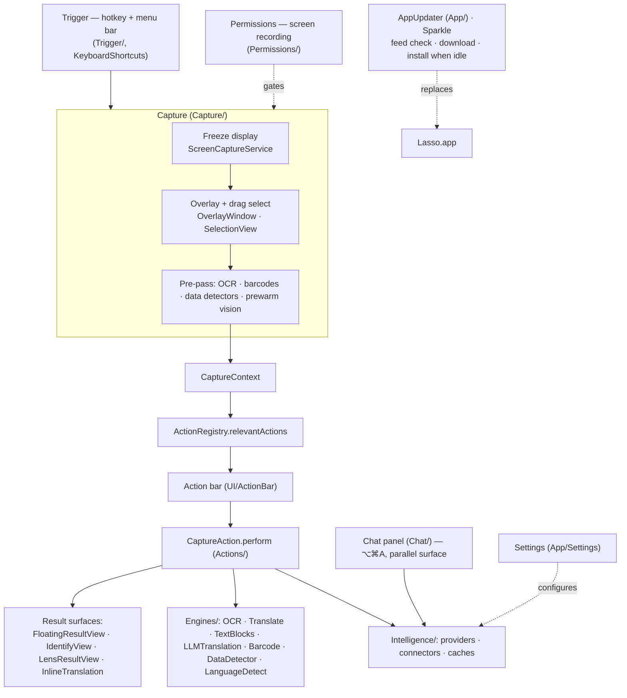
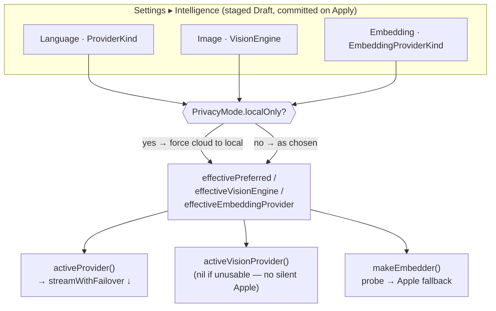
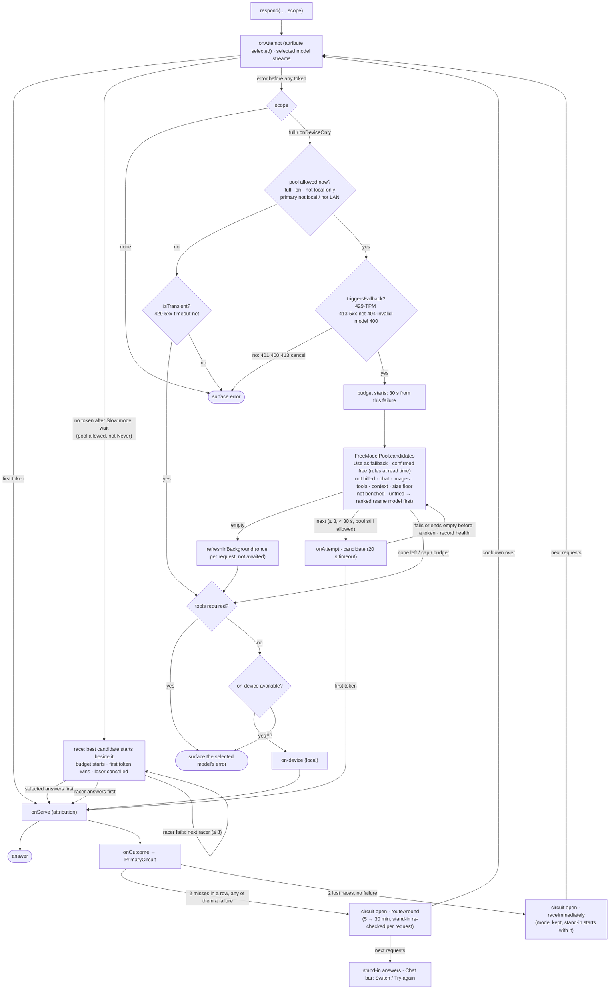
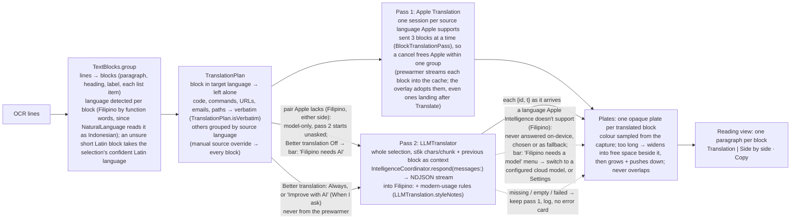
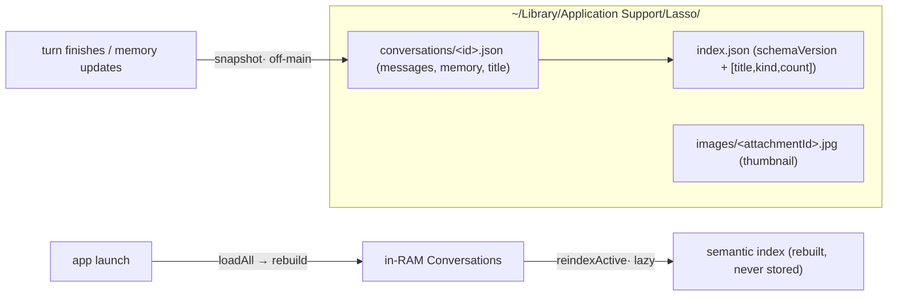
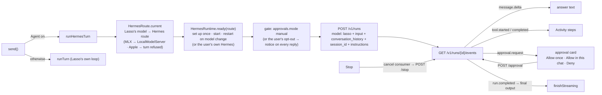
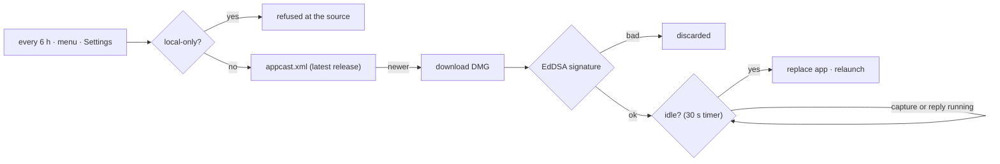

# Lasso — App Flow & Architecture (living document)

> **Keep this in sync with the code.** Every behavior/flow change updates the diagrams + notes here in
> the same pass. This is the canonical map of how the *whole* app works today — not a plan, the shipped
> reality. Product direction & rationale live in the planning notes; this file tracks *what is*.

Positioning: **"Screen search for your whole Mac, on-device by default."** Select anything on screen →
understand it or act on it. Zero-setup default path, privacy-preserving (local vision + keyless web),
with an opt-in Google Lens escalation for full reverse-image search.

---

## 1. Module map (layers)



---

## 2. Capture pipeline (`Capture/CaptureCoordinator.swift`)

1. **Trigger** — global hotkey (`Trigger/TriggerService`, KeyboardShortcuts) or menu bar
   (`MenuBarController`) starts a session. Screen-recording permission is gated by `PermissionsService`;
   when it's missing after the first ask, the alert offers Open Settings or Reset (`tccutil reset` of
   Lasso's own entry, then ask again), as does Settings › Privacy › Permissions.
2. **Freeze** — `ScreenCaptureService` grabs the display; `OverlayWindow` shows it frozen so the user
   can drag a selection (`SelectionView`); `SubjectLift` supports object/subject lift.
   The overlay's content view accepts the first click (`FirstClickHostingView`): a hotkey only asks
   macOS to activate Lasso, and until it does, a first click that isn't accepted just activates the app
   and the drag doesn't register.
3. **Pre-pass** (`runPrePass`) on the crop: `OCREngine` (text + per-line boxes), `BarcodeEngine`
   (QR/barcode), `DataDetector` (URLs/phones/emails/dates), and `prewarmVision()`. Results populate a
   `CaptureContext` (`Actions/CaptureAction.swift`).
4. **Route** — `ActionRegistry.relevantActions(for:)` filters + sorts actions by `relevancePriority`;
   the **action bar** renders them. Direct-shortcut actions can skip the bar.
5. **Perform** — `CaptureAction.perform` returns an `ActionResult`: `.text` / `.stream` →
   `FloatingResultView`; `.custom(AnyView)`; `.inlineTranslate`; `.copiedToPasteboard`; `.openedURL`;
   `.none`. The freeze drops once a result floats (or on `.none`).

---

## 3. Feature / action catalog (`Actions/`, registered in `ActionRegistry.makeDefault`)

| Action | id | Prio | Backend / engine | Output surface |
|---|---|---|---|---|
| **Copy text** | `ocr.copy` | — | `OCREngine` (pre-pass) | pasteboard |
| **Translate** | `translate` | 20 | Apple Translation framework (pass 1), then optionally the text model (pass 2, `LLMTranslation`) | inline overlay (`InlineTranslationView`) or `TranslationResultView` |
| **Grammar fix** | `ai.grammar` | — | text provider (`GrammarFixService`) | floating card |
| **Summarize** | `ai.summarize` | — | text provider | `FloatingResultView` stream |
| **Ask AI** | `ai.ask` | 40 | text provider (+ vision for imageless text) | `AskAIView` inline |
| **QR / barcode** | `qr.open` | — | `BarcodeEngine` (pre-pass) | open URL / show payload |
| **Color picker** | `color.pick` | — | pixel sample | swatch view |
| **Identify** | `identify` | 12 | vision + keyless web + text synth | `IdentifyView` card |
| **Google Lens** | `lens.search` | 13 | WKWebView → lens.google.com (opt-in) | `LensResultView` panel |
| **Chat** (separate) | — | ⌥⌘A | text provider (+ tools/web) | `ChatView` panel |

**The bar is the user's, not the priority column's** (`Actions/ActionBarLayout.swift`). `Prio` above is
only the shipped fallback: it orders ids the user has never placed, which is all of them on a fresh
install, so an untouched bar looks exactly as it always did. Once the user reorders in Settings ▸
General ▸ Toolbar actions, their order wins outright, including over a QR code or colour swatch that
would otherwise jump the queue. The complaint this answers: "I only use Copy text and Ask AI, it always
takes time to find those icons."
- **Hidden ≠ gone.** Switching an action off moves it into the bar's overflow menu, so it stays one
  click away; the overflow control only appears when something is actually behind it. `hideUnavailable`
  still drops greyed entries from both, and a Comfortable-style cap spills the tail into overflow ahead
  of the hidden entries.
- **Storage** (`ActionBarPreferences`): `actionBar.order` / `actionBar.hidden` string arrays, plus a
  `revision` integer the bar watches (`@AppStorage` can't bind an array). An id in storage that no
  longer exists is never matched; an action shipped later is unknown, so it lands by its `Prio` at the
  end of the user's order, visible.
- **Every action has a hotkey** (`Actions/ActionShortcuts.swift`): one `KeyboardShortcuts.Name` per id,
  none with a default binding, plus the two full-screen variants (Identify, Lens). `TriggerService`
  loops the table rather than listing handlers, and a coverage test fails if a registered action has no
  name, so "added an action, forgot the hotkey" is red rather than silently missing.
- **Recording one is a staged edit** (`ShortcutStaging`, `App/Settings/ShortcutRecorder.swift`).
  Shortcuts used to write straight to storage while every other control in that window waited for
  Save & Apply, so recording one left the panel claiming "All changes saved" and Revert could not undo
  it. They are now part of the draft: the unsaved bar appears, Revert puts them back, and storage (and
  the live hotkey) is written only on Save & Apply. Clearing is the case worth the pure function: an
  emptied shortcut is a *missing* key in the draft, and that still has to reach storage as a write of
  nil. The recorder itself is a button rather than the library's `NSSearchField`: in this window the
  field editor never handed over first responder from a click in the middle of the box, and forcing it
  jammed gestures for the whole window. A clash with another Lasso shortcut is compared against what is
  staged, not what is saved, since both sides may be unsaved edits.
- **One gate for every direct run** (`Actions/DirectActionGate.swift`). The direct path skips the bar,
  and with it `isRelevant`, which is where the Lens upload opt-in and local-only mode live: this app
  has shipped that hole twice. `CaptureCoordinator.passesDirectGate` is now the single chokepoint for
  both `beginDirect` and `beginFullScreen`, and a refusal is *shown* (local-only beats "Lens is off" as
  the reason given; AI actions refuse when no model is configured) rather than a hotkey that appears
  dead. The decision itself is pure, so the privacy rules are tested without a screenshot.

---

## 4. Intelligence system (`Intelligence/IntelligenceProvider.swift`)

**Three independent roles** (Settings ▸ Intelligence: **Language model**, **Image model**, **Embedding
model** — each a `Protocol` picker + per-protocol config), staged in a `Draft` and committed on Apply:

- **Language / Text** (`ProviderKind`): `apple` on-device Foundation Models (default, text-only), `ollama`
  (local server), `mlx` (local Apple-Silicon), `openAICompatible` (cloud/local endpoint, e.g. Groq/LM
  Studio), `anthropic`. Streams deltas via `respond(prompt:context:)` / `respond(messages:)`; tool-capable
  providers also expose `respond(messages:tools:execute:)`. An `mlx` model is found in the Hugging Face
  cache or, via `MLXLocalModels`, in a plain folder on the Mac (`~/models/<org>/<name>` from
  `huggingface-cli --local-dir`, LM Studio's `~/.lmstudio/models`, or a folder picked in Settings, whose
  path is the model id); a folder loads with `ModelConfiguration(directory:)`, so nothing is fetched.
- **Image / Vision** (`VisionEngine`): `matchText` (route through the text provider if it's multimodal),
  `ollama`, `mlx`, `openAICompatible`, `anthropic`. **Apple on-device is text-only** → returns nil for
  vision (no silent fallback). Used to *describe* an image (Identify, Ask-AI-on-image, Chat attachments).
- **Embedding** (`EmbeddingProviderKind`, §7): `automatic` (Ollama embed model if reachable → Apple
  `NLEmbedding` → none), `apple`, `ollama`, `openAICompatible`. Powers Chat semantic memory only.
  Resolved by `makeEmbedder()` (probe → **always falls back to Apple**, so retrieval never breaks).
- **OpenAI-compatible = one protocol, many simultaneous connections** (`Intelligence/KeysRegistry.swift`).
  A **protocol** is the API interface (`ProviderKind` / `VisionEngine` / `EmbeddingProviderKind`); a
  **connection** is a configured endpoint under it (`RegisteredKey`: stable UUID, name, base URL,
  `keyNotRequired`, discovered models), and secrets live in the Keychain under
  `keys.registry.<id>.key`, never in the Draft or the JSON. **There is no active connection.** Every
  switched-on connection is live at once and contributes its models to one merged, capability-filtered
  list (`groups(for:)`), the user picks a *model*, and the `ModelSelection` it stores carries the exact
  **key id** — so picking the model is what routes the request, and two connections serving the same
  model name still reach the right backend. `enabled` is the Connections sheet's per-row switch: off
  hides the connection's models from every picker (Settings, chat header, translate menu), and
  routing, the free-model fallback, the daily model refresh and "Test connections" skip it; its key
  and settings stay. A selection that used one of its models heals like a removal. Capabilities are inferred
  from the model id (`inferCapabilities`), which is what filters the one list into the Language / Image
  / Embedding pickers. Speech, image-generation and guard models (`isChatModel`: Whisper, TTS, Orpheus,
  `-image`, FLUX…) are never chat models; saved lists are corrected when loaded. Editing a connection keeps its id, so renames and rotated keys don't break
  selections.

      Protocol → many Connections → aggregated Models → the user selects a Model

  The UI must not read as Protocol → Connection → Model: that implies one connection can be current.
- **Hand-typed models are the removable kind.** "Manually added" entries have no connection behind them,
  so they never leave on a refresh: the picker gives each one an ✕ (`removeManualModel`), and any card
  pointing at it heals exactly as it would if a connection had dropped the model. `apply()` commits a
  manual selection's *model* while leaving the endpoint and key alone (it rides on whichever connection
  is configured, as the chat switcher's manual group does); requiring a connection there meant Save &
  Apply stored the choice and kept sending requests to the previous model.
- **A connection carries its own transport** (`ConnectionKind`): `.openAICompatible` or `.gemini`.
  This is the *wire format*, not a second model pool — both kinds live in the same registry and their
  models merge into the one picker, so choosing a model still chooses the endpoint. `KeysRegistry`
  centralises the two protocol-dependent operations (`discoverModels(for:apiKey:)`,
  `reachable(_:apiKey:)`) so adding a transport doesn't mean hunting call sites. `RegisteredKey`
  decodes `kind` leniently — a registry written before native Gemini has no such field, and a strict
  decode would fail the *whole* registry and drop every connection.
- **`GeminiProvider` is a real native implementation** (`Intelligence/GeminiProvider.swift`), not the
  OpenAI path aimed at Google: `:generateContent` / `:streamGenerateContent?alt=sse`,
  `contents`/`parts`, `x-goog-api-key`, system prompt hoisted to `systemInstruction`, assistant role
  named `model`, images as `inlineData`. `GeminiVisionProvider` and `GeminiEmbedder` cover the other
  two roles, because Gemini connections contribute vision- and embedding-capable models to the same
  shared pool and those roles would otherwise resolve to an OpenAI-shaped request. Google's **OpenAI
  compatibility layer stays a plain `.openAICompatible` connection** (base URL
  `…/v1beta/openai/`) — the native provider is an addition, never a redirect.
- **The transport travels with the flattened config.** `apply()` writes `openAIConnectionKind` (and
  the vision/embedding equivalents) alongside the effective URL + model + key, because that config
  alone can't say which format to speak — Google serves both from the same host. `buildProvider()`,
  `activeVisionProvider()` and `makeEmbedder()` branch on it.
- **Image ← Language is one explicit link**, not a duplicated block: `VisionEngine.matchText` *is* the
  Image section's **Inherit** switch. `ModelSelection.sameAsLanguage` still resolves (old stores decode),
  but nothing produces it any more — `healSelection` never falls back to it, the model picker doesn't
  offer it, and `load()` collapses a persisted one into a concrete `.model`/`.manual`. One intent, one
  control. Turning Inherit off seeds Image from Language's current value (macOS linked-value behaviour),
  so unlinking is a starting point rather than a reset.
- **`isLocal` / local-only**: `isLocal` drives the privacy badge; **local-only mode**
  (`PrivacyMode.localOnly`) forces every cloud choice back to local via the `effective*` getters
  (`effectivePreferred` / `effectiveVisionEngine` / `effectiveEmbeddingProvider`) — cloud options are also
  hidden in the pickers — so nothing leaves the Mac regardless of what's stored (see §8).
- **Tools** (`Intelligence/Tools/`): a model-decided `web_search` tool for Chat on tool-capable
  backends; others fall back to heuristic grounding. Which tools a turn actually *sees* is chosen by
  `Harness/Toolbelt` — registration and exposure are separate, and the menu is capped at
  `maxExposed` (3), because tool-choice accuracy falls off as the menu grows.
- **Harness** (`Intelligence/Harness/`) — the app's own reasoning, kept off the answer model:
  - **`UtilityModel`** (`utilityModel()`): the model the *harness* thinks with. Apple on-device when
    available, else the user's active provider (never a third-party endpoint they didn't choose).
    Utility calls bypass `streamWithFailover`, so they never touch the attribution footer or the
    privacy badge; a non-local fallback flags `noteOffDeviceUse()`.
  - **`StructuredOutput` + `StructuredRunner`**: one typed request, four rungs, tried in order —
    **guided** (Apple `@Generable`, constrained decoding, malformed output impossible) → **jsonSchema**
    (`respondJSON`: Ollama `format`, OpenAI `response_format` with a `json_object` downgrade,
    Anthropic forced tool use) → **lineFormat** (labeled lines, parsed leniently; MLX's only rung) →
    **none** (caller applies its own deterministic fallback). The runner never throws.
  - **`ModelText`**: shared lenient reading of model output (`<think>` stripping, first balanced JSON
    object, "NONE"-aware field reads).

**Settings → resolution** (how a stored choice becomes the backend that actually runs):

- **Failover** (`streamWithFailover` → `FallbackDriver`, `Intelligence/FreeModels/`): every `respond(…)`
  streams through one wrapper. A failure **before the first token** moves the request on: selected model
  → compatible free models → on-device → the selected model's error. Never after a token (no splicing),
  never back to the cloud once on-device. The request reaches each model unchanged. The stream is only
  ever the answering model's output: a fallback is reported beside it as a `FallbackNotice` (`onFallback`,
  delivered with the answering model's first token, so a candidate that also fails leaves no trace). The
  notice carries the selected model's own failure (`reason`): a 404 reads "X wasn't found (check the model
  name and base URL)", anything else "X was temporarily unavailable". The user's selected model is never
  written.
  - **Slow selected model → race.** If no token arrives within `raceAfter` (Settings ▸ Language ▸ Slow
    model; default 15 s, "Never" = off) and the pool is allowed, the best candidate starts *beside* the
    selected model. First token wins; the loser is cancelled and nothing is recorded for it. The pool
    budget starts at the race (or at the selected model's failure, whichever is first). A racer that
    fails is replaced while the selected model is still silent; the selected model failing mid-race
    leaves the racer running; a bad key or bad request from it ends the request. The notice then reads
    "X hadn't started answering after N s". `FallbackDriver` is an event loop over concurrent attempts
    (`delta` / `finished` / `failed` / `slow`), so only that loop makes decisions.
  - **A routed request is still filtered.** The stand-in is re-chosen per request through
    `FreeModelPool.substitute` (the full `exclusion` set) or `FallbackPolicy.onDeviceCanStandIn`
    (window + no required tools); nil falls through to the normal path. Skipping the user's model must
    not skip the checks that protect the answer.
  - **Slow is not down.** A miss carries `selectedFailed`. All-lost-races open the circuit in
    `.raceImmediately`: the selected model still gets every request, with the stand-in started beside it
    (`raceAfter = 0`), so the user stops paying the wait without losing their model. Any real failure
    opens (or upgrades to) `.routeAround`, which skips it. Chat's bar reads "Racing X · Y has been slow"
    with Stop racing, or "Using X · Y isn't responding" with Try again.
  - **Routed around a model that keeps missing** (`PrimaryCircuit`, in memory): a request whose selected
    model missed (a fallback-worthy failure, or losing the race) counts; 2 misses in a row within 10 min
    open the circuit, in `.routeAround` when any of them was a real failure (requests then go straight to
    what last answered, with no race wait) or `.raceImmediately` when they were only lost races (see
    "Slow is not down" above). The selection is never written. The stand-in is re-checked against each
    request (`FreeModelPool.substitute` / `onDeviceCanStandIn`) or the request takes the normal path. Cooldown 5 min, doubling to 30 while it keeps missing; when it
    passes, the next request tries the selected model again (`route` returns nil, "probing") and one
    answer closes the circuit. A routed request judges only the stand-in: if another free model has to
    answer, routing follows it. 401/400/cancelled never count. Picking a model resets it (the circuit is
    keyed by `activePrimaryKey`). Chat shows a bar: "Using X · Y isn't responding", with Switch
    (`switchToSubstitute`) and Try again (`retrySelectedModelNow`). The driver reports
    `RequestOutcome` (`onOutcome`) and takes `routedFrom` (whose name the notice uses) + `exclude` (the
    skipped model is never a candidate).
  - **On-device as the stand-in:** it is only offered when the request fits what it can hold
    (`FallbackPolicy.onDeviceCanHold`: `OnDeviceProvider.inputBudgetTokens` = 4,096 window minus the
    2,048-token reply reserve). The prompt was sized for the user's model, so a long chat is far past
    that: trying it only reaches `exceededContextWindowSize`. When it does answer, its instructions
    carry a stand-in note (`OnDeviceProvider.standingInFor`) saying which model it is covering and to
    continue from the conversation above: without it, a 3B model handed a conversation it never took
    part in answers as though the last message opened a new one. `lastResort` therefore takes the
    request's `FallbackNeeds`.
  - **Files, one concern each:** `FreeTierRules` (A: provider-specific discovery rules, the only code
    that knows provider names) → `KeysRegistry` (B: the cache, persisted with the connections; no
    second model database) → `FreeModelPool` (C/D: free status, per-request filtering, ranking,
    `FallbackPolicy`, badges) → `FallbackDriver` (E: the loop) → `ModelHealth` + `FreeModelRefresher` (F).
  - **Callers and scope** (`FallbackScope`, a `respond(…)` parameter, default `.full`): Chat records a
    fallback in Activity (a completed step with `notice.reasonText`; the answer step names the model that
    answered). Grammar Fix's in-place HUD says "Proofreading with X…" and "Proofread by X". Ask AI and the
    Proofread card show the answering model in their existing attribution footer. Identify (synthesis and
    OCR cleanup) has no surface for a notice, so it passes `.onDeviceOnly`: never another cloud provider,
    only the on-device retry, logged. The chat summarizer passes `.none`: no pool and no on-device retry,
    since it runs unseen.
  - **Attribution:** the driver calls `onAttempt(provider, isSelected)` before each provider is tried and
    `onServe` once, at the answering model's first token. The coordinator sets `usedOffDeviceThisSession`
    for any cloud attempt, attributes the selected model at its attempt (so the footer never shows the
    previous request's model), and re-attributes at `onServe`. A candidate or the on-device last resort
    is named only at its first token, so one that fails is never named. A selected model that finishes
    with no tokens is still attributed.
  - **Who may use the pool** (`FallbackPolicy.poolAllowed`, opt-in `intelligence.fallback.freeModels`,
    Settings ▸ Language ▸ Fallback): on, not local-only, and the primary **not local**. Local means
    `provider.isLocal` (loopback, `KeysRegistry.isLocalURL`) or an OpenAI-compatible base URL on the user's
    own network (`KeysRegistry.isPrivateNetworkURL`: 10/8, 172.16/12, 192.168/16, 169.254/16, 100.64/10,
    fc00::/7, fe80::/10, loopback, a dotless single-label host such as `mac-studio`, and `*.local`,
    `*.ts.net`, `*.home.arpa`, `*.lan`, `*.internal`), via `FallbackPolicy.primaryIsLocal`. Re-checked before
    every pool attempt, so turning on local-only mid-request stops the next cloud attempt. Triggers on
    429 (and Groq's tokens-per-minute 413), 5xx / timeout, unreachable host, 404 and OpenRouter's 400
    "is not a valid model ID" (`ModelFailure.triggersFallback`); not on 401/403 or other 400/413/422. With the pool off,
    `isTransient` (429 · 5xx · timeout · unreachable, from the same `ModelFailure.classify`) → on-device.
  - **Budget:** max 3 candidates; no new one once 30 s have passed **since the selected model failed**
    (not since the request started, so a primary that times out at 60 s still reaches a candidate). The
    selected model keeps the 60 s request timeout; candidates are built with 20 s
    (`FallbackDriver.candidateTimeout`, `requestTimeout` on the OpenAI-compatible and Gemini providers).
    A candidate stream that ends with no tokens is a failure (`IntelligenceError.emptyResponse` →
    unavailable) and the next one is tried. If the caller cancels, nothing new starts and no health is
    recorded.
  - **Consent per connection:** a connection contributes only with **Use as fallback** on
    (`RegisteredKey.useForFallback`, off by default, in Manage connections for every kind, a server on
    this Mac included). "Only models Lasso can confirm are free are used."
  - **Free detection** (`RegistryModel.freeOffer`: `always` / `freePlan` / `never` / nil). OpenRouter:
    `pricing` all "0" → `always`, anything else (incl. "-1") → `never`; `openrouter/*` routers flagged
    `isRouter`. Groq: billing FAQ says the Free tier has no usage charges → every model `freePlan`;
    Compound (`groq/compound*`, `compound-*`) flagged `isRouter` (an agentic system, not a model). Google
    (native and the `/v1beta/openai/` shim): the pricing page's per-model "Free of charge" / "Not
    available" table → `freePlan` / `never`, unlisted → nil. Checked 2026-09-15. Any other provider → nil.
    Hosts match the domain or a subdomain (`groq.com`, `*.groq.com`), never a suffix. The rules run at
    discovery **and every time the pool reads the registry** (`FreeTierRules.annotate` is idempotent and
    never overwrites OpenRouter's pricing), so a rule shipped in an update applies without a refresh.
    Only a rule sets `freePlan`, so on a connection with no rule (or OpenRouter) a leftover `freePlan`
    from the provider it pointed at before is cleared; `always` / `never` from pricing are kept. Saving a
    connection whose provider has no Free tier switch saves Free tier off.
    `FreeModelDetector`: `always` → confirmed; `never` → not_free; `freePlan` → confirmed only if the
    connection's **Free tier** switch is on, else unknown; nil → confirmed for a localhost server, else
    unknown. Unknown never enters the pool. Health never changes free status.
  - **Billed Free tier keys:** when the selected model sits on a Free tier connection and is documented
    as not on the free plan (`freeOffer == never`), the key is billed, so that connection's `freePlan`
    models are excluded (`FreeModelPool.billedConnections`, exclusion `.billedKey`), get no badge, and
    aren't counted in the Settings caption. OpenRouter's zero-priced models are unaffected.
  - **Chat eligibility:** `.language`, `outputsOnlyText != false`, not a router. Classifier/guard/safety
    models, speech, TTS, image and embedding models are marked non-chat.
  - **Per-request filters** (`FreeModelPool.exclusion`, counts logged at debug level): not tried, not
    benched, not billed; images → accepts images (reported, else inferred vision); tools `.required`
    (Chat turn whose web intent is an explicit search) → excludes candidates known unable to call tools,
    including every native-Gemini candidate (no tool loop); context → estimated tokens +
    `outputReserveTokens` must fit the reported window, else the name-inferred one, else the 32K default;
    quality floor → skip a candidate two size bands below the primary (small for large).
  - **Tools:** a `.required` turn never falls back to on-device (no tool loop there): the selected
    model's error surfaces instead. A candidate whose list reports no tool support is built with
    `supportsToolCalls = false` and answers without tools. Chat memoizes the `web_search` executor per turn
    on `name + argumentsJSON` (`ChatController.ToolCallMemo`), so a retried candidate reuses the evidence
    without a second search or a duplicate "Searching…" step. Arguments are compared as JSON (re-encoded
    with sorted keys), so spacing or key order from another model still matches.
  - **Ranking** (no invented scores): the selected model itself on another connection first (ids
    normalized: lowercase, no `models/`, no vendor path, no `:free`); then size band large > medium >
    unknown > small (`ModelSize`: the parameter count in the id, else a known large family without one:
    DeepSeek V3/R1 (not distills)/chat, Kimi K2, GLM-4.5/4.6 (not Air), Qwen3 Coder, MiniMax-M1, else the
    family suffix); within a band a published parameter count before a name signal; tool support when
    tools are in play; connections not yet tried in this request; more parameters first; then alternate
    connections. Quality outranks diversity.
  - **Health** (`ModelHealth`, in memory, `availability(of:)`): 429 → model 60 s; 429s from two models on a
    connection within 2 min → connection 10 min (the selected model's own 429 doesn't count toward this:
    `countsTowardSharedCap: false`); 5xx → model 2 min; other 400 → model 2 min; unreachable → connection
    2 min; 404 or OpenRouter's 400 "is not a valid model ID" (verified live) → model, and 401/403 →
    connection, until the next refresh (Settings ▸ Refresh clears these too).
  - **Refresh** (`FreeModelRefresher`): Settings on open / add / edit / Refresh (stamps
    `modelsCheckedAt`); at launch when on and any list is >24 h old; in the background when a request
    reads a stale registry; in the background, once per request, when the pool is empty or 3 candidates
    have failed. Never awaited by a request: an empty pool goes on-device at once. Automatic refreshes
    start at most every 10 min; concurrent callers share one in-flight task. Each connection's list is
    replaced (models no longer free leave), re-read after the network so connections removed, repointed,
    or re-keyed meanwhile and the Free tier switch are untouched, and a failed fetch keeps the old list.
  - **Visible:** Settings caption "N free models across M connections · checked X ago", then which
    switches to turn on ("Turn on Use as fallback for A, and Free tier for B in Manage connections"),
    providers without a rule, and a billed Free tier key; `free` / `free tier` tags in the Settings picker
    and chat switcher from `FreeModelPool.badge(s)(…, primary:)` (describe the model regardless of Use as
    fallback, but none for a billed key's plan models);
    "N free" in each connection's subtitle.
  - **Verified:** `FreeModelFallbackTests` (63, fake providers; the key rules, including most review
    fixes, were broken on purpose to confirm their test fails) and `FreeModelLiveTests` (8, opt-in
    `TEST_RUNNER_LASSO_LIVE=1`; real
    OpenRouter free models only, plus free `/models` calls to every configured connection).
  - **Not covered:** `activeVisionProvider` (Identify's image model) and harness `respondJSON` calls;
    Anthropic is a possible primary but never a candidate; structured-output requirements.



---

## 5. Identify pipeline (`UI/IdentifyView.swift`)

OCR-first routing decides text mode vs. the visual identify path; **neither is a dead-end**.

```mermaid
flowchart TD
  Start[Identify on selection] --> Cache{IdentifyCache hit?}
  Cache -->|yes| Replay[Replay cached summary + related]
  Cache -->|no| Route{"OCR text >= 40 letters<br/>&& not forceVisual?"}

  Route -->|"text-heavy (default)"| TextMode["TextActionsView:<br/>Detected text · N words<br/>Copy · Translate · Ask AI · Chat"]
  Route -->|visual| Vision[On-device vision model describes]

  Vision --> Web["Keyless web grounding (WebSearchSource):<br/>Wikipedia · DuckDuckGo · Reddit"]
  Web --> Synth[Synthesize summary + confidence + rank RELATED]
  Synth --> Card[Answer + confidence chip + RELATED links]
  Card --> LensBtn[["Search with Google Lens - one tap"]]

  TextMode -->|"Actually a photo? · Identify anyway"| Vision
  TextMode -->|"Actually a photo? · Google Lens"| LensBtn
  LensBtn -.opt-in.-> LensWeb[Lens panel - WKWebView -> lens.google.com]

  style TextMode fill:#1e4a2e,stroke:#4b8
  style Card fill:#1e4a2e,stroke:#4b8
  style LensBtn fill:#1e3a5a,stroke:#48b
```



- **Routing signal:** `hasStrongText` = `ocrText` letters ≥ 40. Escape hatch "Identify anyway" sets
  `forceVisual` (`textHeavy = hasStrongText && !forceVisual`) so a photo-that-carries-text still gets
  the visual path (on-device / local-only).
- **Text mode** (`TextActionsView`): Copy · Translate (`TranslationResultView`) · Ask AI (`AskAIView`)
  · Chat, plus opt-in "Clean up misreads with AI" → single Cleaned column, changed lines highlighted
  (`OCRDiff.changedLines` + `OCRCleanedView`); verbatim source is never silently rewritten.
- **Models:** vision role describes on-device; the text provider synthesizes the final answer +
  `Confidence: High/Medium/Low`. Ranking/caching: `rankHits` (word overlap), `IdentifyCache`.

---

## 6. OCR & Translate

- **OCR** (`Engines/OCREngine.swift`) — Apple Vision `RecognizeTextRequest`, accurate, zh-Hant+en.
  `readingOrdered(_:)` reconstructs reading order geometrically (column-aware; verbatim, never
  rewrites/drops), fixing multi-column interleaving app-wide.
- **Translate** — two surfaces: the inline overlay (`InlineTranslationView`, needs line geometry) and
  the single-pane `TranslationResultView` (source/swap/target capsule, unchanged). The overlay
  (docs/TRANSLATE_LLM.md):



  The source chip reads `Detected · X`, `Mixed · X, Y, Z +N` or `Unknown source`; the status reads
  `On-device · N blocks` (with a ✦ `sparkles` "Improve with AI" button under When I ask), then, while the
  model works, an animated ✦ `Improving n/N` and a sweep over each plate it hasn't reached yet, then
  `✦ Improved`, the answering model named in its tooltip. A failed pass shows an orange ✦ to retry. Pass 2 goes through the coordinator, so routing,
  the free-model fallback and local-only mode apply as they do for Chat.

---

## 7. Chat (`Chat/`)

Persistent top-right panel (⌥⌘A), independent of the capture overlay. The system prompt carries the
device date/time as background ("use it only when the question needs it"); calling it authoritative made
a local Qwen3.5 answer greetings with the date (`ChatDatePromptLiveTests`). **Voice input** (`Chat/Voice/`):
English speech-to-text on this Mac with Apple's `SpeechTranscriber`, no model or connection involved.
The mic in the composer streams into the message box at the caret (replacing a selection, like system
dictation; text typed before or after is kept), stops itself when you've finished (`SpeechActivity`: 1.3 s after a sentence ending in . ? !, 3.5 s
after a comma or a word a sentence doesn't end on, "and", "the", "um", 2.2 s otherwise; more words from
the recognizer count as speech, capitals and a full stop added to the same words don't; loud sound with
no new words holds it open at most 3 s past the last word), and
never sends; Send finishes the dictation first, and a session number keeps late recognizer updates out of
the box. The box is an `NSTextView` (`ComposerTextView`): it grows to 6 lines then scrolls, keeps the
newest word in view unless you scroll up, and greys the recognizer's unconfirmed words. **Cleanup**
(Settings ▸ General ▸ Voice input, on by default): the raw words go in the moment you stop, then
`DictationCleaner` runs plain-code rules (`DictationCleanup.tidy`: ums, accidental repeats) and one
on-device Apple Foundation Models pass (`.permissiveContentTransformations`, greedy, plain-text reply,
~220-word sentence chunks). Every model edit must pass `DictationCleanup.problems`: only hesitations,
fillers, repeats and a/an/the/that may go; only articles and auxiliaries may be added; one-word grammar
swaps within a budget; numbers, negations and a trailing "?" must survive. A failed check gets one retry
told what was wrong, then that chunk keeps the speaker's words. The swap is one Cmd-Z step (a small
"Undo" under the box does the same, its tooltip shows what you said), and it's skipped if you edited
inside the dictation or sent the message first; a 15 s timeout leaves the raw text. Known v1 gap: a
meaningful "like" may be dropped as a filler (pinned by `aMeaningfulLikeCanStillBeDropped`). Without
Apple Intelligence only the rules run. Needs the `com.apple.security.device.audio-input` entitlement.

```mermaid
flowchart LR
  MIC["mic tap"] --> ST["SpeechTranscriber (live)"]
  ST -->|confirmed + grey tail| BOX["message box at caret"]
  ST -->|stop / pause: 1.3–3.5 s by how the words end| RAW["raw text in box"]
  RAW -->|cleanup off| DONE["you edit and send"]
  RAW -->|cleanup on| R["tidy: ums, repeats"]
  R -->|no Apple Intelligence| SW
  R --> FM["on-device model, per chunk"]
  FM --> CK{"word check"}
  CK -->|fail| FM2["one retry with the reason"] --> CK2{"check"}
  CK2 -->|fail| KEEP["chunk keeps your words"] --> SW
  CK -->|pass| SW["swap in, if box unchanged"]
  CK2 -->|pass| SW
  SW --> DONE
  SW -.->|Cmd-Z or Undo| RAW
``` Resizable down to 340×360
(set in the SwiftUI root and passed to the window via `sizingOptions = [.minSize]`; a plain
`panel.minSize` is wiped by AppKit's first layout pass). Opening it, a result card, Lens or a capture
goes through `AppActivation.bringForward`: the window becomes key *and main* before the app activates,
because activation brings the app's main window forward and an open Settings window used to jump in
front of every other app. The card is pinned to the window's size and
the header's title and model chip truncate, so nothing pushes the card past the window. Multi-turn, **multi-image**
attach (button / ⌘V / drag / capture seed; up to `maxAttachments`), two-track memory
(`ConversationMemory`, `ChatContextBuilder`). Images: `Attachment` (structured, stable id) → native
models get an image array per turn; text-only models get per-image "Image N:" captions + OCR. Grounds via the same keyless web search; reverse-image is the one-tap Lens
escalation, not a silent per-turn API call.

**Search planning:** on the heuristic route (Apple / MLX / tool-less Ollama), `planSearch` rewrites
the turn into one self-contained query with references resolved. It runs on the **utility model**, not
the chat model, through the structured ladder — so the plan is a typed `SearchPlan` on every backend,
and an MLX chat model no longer serializes a planning pass ahead of the answer it is about to stream.
`SearchPlan` (`Chat/Harness/SearchPlan.swift`) owns its own parsing for all rungs; `ChatController`
keeps `repair` / `fallbackSearchPlan` (the deterministic floor) and the entity guardrails.

**Context memory (three speeds):** recent 6 turns verbatim → two-track running summary (durable facts
+ topic trace) → **semantic retrieval** (`ChatMemoryIndex`, Phase 1). The index embeds completed
*exchanges* (user + assistant) in the background; at send it retrieves the top-K most relevant *older*
exchanges verbatim (query = current text + last 1–2 turns), deduped against the recent window, into a
bounded reserve in `ChatContextBuilder`. **Embedding backend is a user choice** (Settings ▸ Intelligence
▸ **Embedding model**, peer to Language/Image): `automatic` (Ollama `nomic-embed-text` if installed →
Apple `NLEmbedding` on-device → none), `apple`, `ollama` (any local embed model), or `openAICompatible`
(cloud, e.g. `text-embedding-3-small/-large`, with its **own** independent OpenAI-compatible service —
OpenAI/Groq/OpenRouter/Custom + Base URL + key, like the Image model; key shared per-service). Resolved by
`IntelligenceCoordinator.makeEmbedder()`; **local-only forces cloud→local** (`effectiveEmbeddingProvider`).
The **default (Automatic → Apple) needs no download** — works on any Mac immediately. Vectors from
different backends are incomparable, so changing the backend resets every session's index
(`ChatController.embeddingConfigChanged`) and it re-embeds lazily. See `docs/CHAT_MEMORY_DESIGN.md`.

**Response formatting (prompt) → rendering (`UI/MarkdownDocument.swift` + `MarkdownView.swift`):**
one contract at each end. The system prompt carries an explicit **format policy**
(`ChatController.formatRules`): prose by default, and an admission test per construct — a table only
to compare **≥2 things across ≥2 shared attributes**, ≤4 columns, never for a single thing's
properties, steps, or term/definition pairs. It also states what the surface can draw (no LaTeX, HTML,
images or footnotes), so models stop emitting syntax that renders literally. Models with a tiny window
get the `.compact` variant, picked from `contextBuilder.budget.total` rather than a model name.

**Math** (`UI/MathText.swift`): models emit `\[ … \]` and `\( … \)` for any formula question whatever
the prompt says, and the raw commands used to reach the screen. Typesetting would need a math engine —
KaTeX means a WebView (ruled out: the app avoids WebViews), a native typesetter is a large dependency — so LaTeX is
**converted to Unicode text** instead: `\frac{\mathbf{A} \cdot \mathbf{B}}{\|\mathbf{A}\| \|\mathbf{B}\|}`
becomes `(A · B)/(‖A‖ ‖B‖)`, `\sum_{i=1}^{n}` becomes `Σᵢ₌₁ⁿ`. Display regions become a centred
`.math` block; inline spans are rewritten in paragraphs, headings, list items and table cells, never
inside code. An unknown command degrades to its own name (`\coth{x}` → `coth(x)`) rather than
vanishing, and `$…$` is claimed only for real math, so currency (`$5-$10`) survives.

The renderer's rule is **repair, not rejection** — a strict GFM parser turns a small model's near-miss
into a wall of raw pipes. It recovers tables with no separator row, pads ragged rows, honours
`|--:|` alignment, and handles nested/task lists at any indent step, blockquotes, setext and
space-less headings, `~~~` fences, `---` rules, and `\|` escapes. A table with one row or one column
carries nothing to compare, so `MarkdownTable.isDegenerate` renders it as label/value lines instead of
a grid — the main cure for tables that appear out of habit. **Streaming stability**: while
`isStreaming`, `StreamStabilizer` withholds the unstable trailing line (a pipe row that has no
separator yet would draw as prose, then snap into a grid) and speculatively closes half-typed emphasis,
never inside an open code fence and never once the stream is finished. Publishes are coalesced to
~20/s in `runTurn`, since re-splitting and re-parsing the whole buffer per token is quadratic work
whose only visible effect is faster flicker. Covered by `MarkdownRenderingTests` (each case verified to
fail against the un-repaired parser).

```mermaid
flowchart LR
  P["system prompt · formatRules(.full/.compact)"] --> M["model output (Markdown)"]
  M -->|deltas, coalesced 50ms| S["StreamStabilizer (streaming only)"]
  S --> PR["MarkdownParser · repair pass"]
  PR --> MT["MathText · LaTeX → Unicode"]
  MT --> B["blocks: paragraph/heading/list/code/table/quote/math/rule"]
  B --> V["MarkdownBlockView"]
  B -->|1 row or 1 column| D["label/value lines, not a grid"]
  B -->|display equation| MB["centred .math block"]
```

**Persistence (`ConversationStore`):** conversations are saved to `~/Library/Application Support/Lasso/`
— **one JSON per conversation** + a lightweight `index.json`, so history survives app updates /
uninstall→reinstall (the data lives outside the `.app`, like `UserDefaults`/Keychain). **Source-of-truth
only:** messages, two-track memory, title, and the *textual* image representation (`promptText` already
folds in the vision description) + a small **thumbnail** per attachment (`images/<id>.jpg`). The semantic
index (embeddings) is **derived** — never stored; it rebuilds lazily on load/switch (`reindexActive`).
Every file carries `schemaVersion` for future migration. Saved on turn-finish / memory-update / session
lifecycle (disk I/O off the main actor); **Clear chat history** in Settings ▸ General wipes it. Restore
drops streaming/derived state and image-anchor pixels (selection anchors persist).



---

### Agent (optional, powered by Hermes Agent: `Intelligence/Hermes/`, `Chat/HermesTurn.swift`)

The **Agent** button in the message box (next to the web globe) hands each turn to Hermes Agent, which
plans, uses its own tools and answers. It is a mode of the same chat, not another model: the header
still shows the Lasso model, and the agent thinks with it.

**Lasso's tools for the agent** (`LassoAgentTools`, `LassoToolServer`, `HermesLassoPlugin`). Two tools,
on purpose: `look_at_screen` (`area: select` opens Lasso's capture overlay with a "the agent wants to see
part of your screen" hint and returns the dragged area, Esc returns "cancelled"; `area: screen` grabs
the display with the key window) and `look_at_image` (a path, relative ones in the workspace). Both
return Apple's on-device text recognition plus a description from the image model in Settings (what
the user has; nothing new is downloaded), and screen grabs are saved to `~/LassoWorkspace/Screenshots`.
They're served MCP-style on loopback (fresh port and token per launch); Hermes reaches them through a
plugin Lasso writes into its own profile on every start (`plugins/lasso`, the address and token in an
owner-only `access.json`), because the Homebrew Hermes lacks the `mcp` package. Anything a command
already does (clipboard via pbcopy/pbpaste, `open`) is left to the terminal and named in the
instructions instead of costing a tool. **Context budget**: the managed block lists the API server's
toolsets (`platform_toolsets.api_server: terminal, file, web, memory, lasso`); delegation,
code_execution, session_search, skills, todo, cronjob, browser, image_gen and vision are left out.
Measured on Qwen3.5-9B MLX: the agent's fixed setup went from 12.7k tokens (38 s cold) to 6.7k with
Lasso's tools (about 20 s).

**Lasso's own Hermes** (`HermesRuntime`, the default). Hermes is the user's install (Homebrew; ~500 MB
with Python and Node, so never bundled). Set up (Settings ▸ Intelligence ▸ Agent, or the first time
Agent is turned on) runs `hermes profile create lasso-app` (fresh, not `--clone`: nothing of the
user's own Hermes setup, model, keys or memory, is used; an older cloned profile, whose sentinel lacks
`profile: fresh`, is deleted and recreated), then Lasso owns two things in that profile: `.env` loses every messaging-platform credential (a second gateway on the user's bot would take
their messages) and gets Lasso's own API key (Keychain `hermes.managedKey`); `config.yaml` gets a block
at the end, between `HermesProfileFiles` markers, with the API server on loopback, `approvals.mode:
manual`, every messaging platform off, `terminal.cwd` set to `~/LassoWorkspace` (where the agent's
commands start and its files go), and the model, as the top-level `model:` (Hermes's side tasks,
titles and history summaries, follow it rather than the request's route; a fresh profile otherwise
defaults to a cloud Claude) and as the route. Hermes reads YAML with PyYAML, where a repeated top-level
key replaces the earlier one, so the block wins (checked with Hermes's own `load_config`). The user's
own profiles and running gateway are never touched (`--replace` acts on this profile's `gateway.pid`
only; checked by `HermesRuntimeLiveTests`). Lasso starts the gateway when Agent is turned on (so the first
turn doesn't wait) or at the first agent turn, restarts it when the Lasso model changes, and stops it
when Agent is turned off, local-only is turned on, or Lasso quits. Stop targets the logging wrapper, its
children and the recorded gateway, then waits for the port to close. Each start takes the first port in
8653–8662 that can be bound now: Hermes binds without address reuse, and a port a gateway just closed
stays unbindable for ~30 s (TIME_WAIT), which made an immediate restart on the same port fail.

**Model route** (`HermesRoute.current`): Anthropic → `anthropic` + model (+ key); an OpenAI-compatible
connection → `custom` + base URL + key; Gemini → `gemini`; Ollama → `custom` + its `/v1` endpoint, with
`OllamaAgentModel`'s `lasso-agent/<model>` variant (num_ctx 65,536) instead of the model itself.
Written as `platforms.api_server.extra.model_routes.lasso` and selected per run with `"model": "lasso"`
(verified in Hermes's session store: the routed turn ran on the routed model). MLX → `custom` + Lasso's
own `LocalModelServer` (below). Apple Intelligence can't be served to another program: no route, and the
turn ends with `HermesRoute.unavailableReason` rather than running on any other model. A model switch
costs one restart (~1 s measured).

**MLX for the agent** (`Intelligence/Hermes/LocalModelServer.swift`, `MLXProvider.serve`,
`MLXPromptCache`). A minimal OpenAI-compatible server on 127.0.0.1 (new port and bearer token per
launch): `GET /v1/models` with the model's real context window (Hermes refuses under 64K) and
`POST /v1/chat/completions`, streamed or not, with tool calls (MLX parses the model's own format; Qwen3.5
is XML function calls), one generation at a time. The model loads through the text-model factory even
for a vision checkpoint: the vision Qwen3.5 resets its position state per request, which would restart
positions at 0 when continuing from a saved state. Hermes sends ~14K tokens of instructions per request,
which a 9B mxfp4 model reads at ~180 tok/s (Release; `MLXPrefillBenchmark`), so each request is read in
two parts: up to its last message (state saved, up to three, longest-prefix match), then the rest. Measured
on Qwen3.5-9B mxfp4, M4 Pro, Debug: first Agent reply 46.7 s (13,769 tokens read), the next turn with a
tool call 3.4 s (13,748 reused, 52 read); before, 226 s per turn. Thinking is off for served requests.
Later system messages are folded into the first (Qwen's template refuses them elsewhere).

**A Hermes the user runs** (Settings ▸ Agent ▸ "Use a Hermes I run"): address + key, as before.



## 8. Search sources, packages & privacy

Reverse-image via a keyed API was **removed** — Google Lens (zero-setup, opt-in) is the only
reverse-image path now.

```mermaid
flowchart LR
  subgraph Default[Default - zero setup]
    WebSearch["Web search (ON by default)<br/>Wikipedia · DuckDuckGo · Reddit<br/>keyless URLSession"]
  end
  subgraph Pkgs["Search packages (Settings ▸ Packages)"]
    Primary["primary: every search,<br/>started alongside the free sources,<br/>results first"]
    Reserve["reserve: only when<br/>fewer than 5 results"]
  end
  Add["+ : file · folder · pasted JSON ·<br/>built in (Tavily, SerpApi)"] --> Review["Review: hosts, keys, limits"] --> Pkgs
  Identify[Identify] --> WebSearch
  ChatP[Chat] --> WebSearch
  WebSearch --> Pkgs
  Pkgs -->|"PackageHTTP: declared hosts only,<br/>no undeclared redirects, local-only gate,<br/>2 MB, limits, secrets redacted"| Hits[results labelled by package]
  subgraph Tools["Package tools (surface: tool)"]
    List["PackageRegistry.tools: offered = enabled, set up,<br/>not paused, not switched off, inside 1,500 chars"]
  end
  List -->|"chat model that calls tools<br/>(Toolbelt, after web_search)"| ChatP
  List -->|"LassoToolServer tools/list<br/>(Agent restarts when the list changes)"| Agent[Agent]
  ChatP & Agent -->|"PackageToolCall"| Ask{"acts? (not markdown,<br/>or http not GET)"}
  Ask -->|no| Run[run, answer fenced, 4,000 chars]
  Ask -->|yes| Card["Lasso's card in the reply:<br/>Allow / Deny (Stop, 280 s = Deny)"] -->|Allow| Run
  subgraph Patches["Package patches (Lasso's own content)"]
    Apply["AppliedPatches.apply: enabled packages in patch order<br/>(newest last, Use This One moves one last);<br/>later set wins, adds accumulate; nothing saved"]
  end
  Review --> Apply
  Apply -->|"PatchState: prompts, titles"| Actions["Summarize / Proofread prompts,<br/>action names everywhere"]
  Apply -->|"defaults only: the user's<br/>Settings › Toolbar choices win"| Bar[capture toolbar order and … menu]
  Apply -->|"suggestions; instructions after Lasso's own"| ChatP
  subgraph Code["Code runners (step 4)"]
    Short["shortcut: /usr/bin/shortcuts run <name><br/>(exists? shortcuts list, 10 s cache)<br/>local-only: only if offline"]
    Script["script: posix_spawn, own process group,<br/>sandbox-exec profile (read system + package + picked folders;<br/>write data/TMPDIR/workspace; network only if declared<br/>and not local-only), env = PATH HOME TMPDIR LANG LASSO_SECRET_*,<br/>stdin JSON, killpg at timeout"]
  end
  Req["requires: checked, never installed"] --> Short & Script
  Script -->|"text · file (→ ~/LassoWorkspace/id) · results"| Hits
  CodeBtn["code block in a reply:<br/>the package's button (Run, Preview),<br/>only on the user's click"] --> Script
  Script -->|"console: text · picture · page · ≤ 3 buttons"| Console["the block's console (CodeRunner)"]
  Console -->|".html / .svg"| Walls["HTMLPreview: WKWebView walled in:<br/>no network but cdnjs (none local-only),<br/>its own folder, no popups, nothing kept"]
  Script -.->|"Full access (user's switch,<br/>off when a script changes)"| NoSandbox[no sandbox]
  subgraph Cat["Catalog (step 6)"]
    Index["index.json from raw.githubusercontent.com<br/>(Browse opened, ≥ 10 s since last; read at main's<br/>newest commit; never local-only)"]
    Dl[".lassopkg download: SHA-256 must match"]
  end
  Browse["Settings ▸ Packages ▸ Browse…<br/>(updates first; lasso://install?id= opens it)"] --> Index --> Dl --> Review
  Dev["Developer mode: New Package (starters) · Load Folder<br/>(polled every 2 s, reloaded without review;<br/>problems shown, last good copy kept)"] --> Pkgs
  subgraph Src["Sources on this Mac (search package, no network)"]
    Pick["@ chip (forced, sticks) · or SourcePicker:<br/>shares words with What's in it, ≤ 2, relative margin;<br/>no model call (empty What's in it: filled from the folder)"]
    Gate["SourceSearch.look: user's own words, 5 s each,<br/>gate ≥ 2 words (skipped if it ranks its own),<br/>3 passages / 1,200 chars total incl. notes, fenced"]
    Hook["source/1 package: whole turn in (message, previous,<br/>today); status · results · searched · ask · note out"]
    Consent{"cloud model?<br/>allowed for this source + company?"}
  end
  ChatP --> Pick --> Gate --> Consent
  Pick -->|"follow-up: gave passages last turn"| Hook --> Gate
  Hook -->|"ask: Did you mean …? (a link, never to the model)"| ChatP
  Consent -->|"local, or allowed"| Answer["passages with the turn's evidence<br/>(fallback scope on-device only if cloud)"]
  Consent -->|"ask: Allow for · This time · Don't send"| Answer
  Gate -->|"nothing matched"| Nothing["the model is told: found nothing,<br/>say so, don't invent"]
```



Files: `Intelligence/Connectors.swift` (built-in Web search only), `WebSourcesProvider.swift`
(`WebSearchSource`, `IdentifySources`), `Packages/` (`PackageManifest` validator, `PackageTemplate`,
`PackageHTTP`, `PackageStore` + `PackageRegistry`, `PackageSearch`, `PackageMigration`, `Bundled/`),
`App/Settings/PackagesSettings.swift`, `SearchCache`, `SearchQuota`, `DomainNoise`, `Keychain`. The
format is `docs/PACKAGES.md` (all 6 build steps are built; the catalog in `PackageCatalog.swift` and
`App/Settings/PackageBrowse.swift`, bundles and starters in `PackageStarters.swift`, the CLI in
`Tools/lasso-pkg/`; scripts in `PackageScript.swift`,
Shortcuts in `PackageShortcut.swift`, requirements in `PackageRequirements.swift`; tools in `PackageTools.swift`,
patches in `PackagePatches.swift` with `App/Settings/PackageChangesCard.swift`); authors use
`docs/CONTRIBUTING-PACKAGES.md`, `docs/packages/schema-v1.json` and `docs/patch-targets.md` (generated).

**Privacy invariant:** `privacy.localOnly` (PrivacyMode) gates **every** off-device path at the source
— web connectors pause, the Lens button/action hides, favicons don't load. Local-only = zero
off-device network. See memory `lasso-localonly-egress-invariant`.

### Updates (`App/AppUpdater.swift`, Sparkle 2.10.1 vendored in `Vendor/`)

Every 6 h (`SUScheduledCheckInterval`) Sparkle reads `appcast.xml` from the latest GitHub release of
lasso-app, downloads a newer DMG in the background, and verifies it against `SUPublicEDKey` (EdDSA; the
private key is in the maintainer's Keychain, account `lasso-app`). That key is what an update is trusted
by, not the Apple code signature. Sparkle would install at quit; a menu bar app rarely quits, so
`updater(_:willInstallUpdateOnQuit:immediateInstallationBlock:)` hands the install to Lasso, which runs it
the first moment `AppUpdater.isIdle` (no capture overlay, no chat reply or Agent turn streaming; checked
every 30 s) and relaunches. Release notes are plain text in the feed (`sparkle:format="plain-text"`), so
Sparkle never opens a web view. Local-only mode refuses every check in `updater(_:mayPerform:)`, whatever
starts it. Settings ▸ General ▸ Updates: automatic checks, automatic install, Check Now; the menu bar
has Check for Updates….

Releases are signed with a self-signed "Lasso Release" certificate (20 years) instead of an Apple
Development one: a free account's certificates expire or get revoked, and each new one changes the app's
identity, which drops Screen Recording and microphone grants. `Tools/release.sh <version> <notes.txt>`
builds from a clean checkout of origin/main, signs, makes the DMG, signs the feed, and publishes.



---

## 9. Design system (Liquid Glass / Tahoe)

Primitives in `UI/Theme.swift`:
- `.liquidGlassPanel()` — frosted `.ultraThinMaterial` fill, continuous 26pt squircle, hard-clipped +
  hairline border. **No SwiftUI shadow** — the panel *window* uses the native macOS shadow
  (`hasShadow = true`) so it's cast outside the card's silhouette, never *through* the translucent
  corners (a SwiftUI `.shadow` did → dark "double edge"). `.regularMaterial` under Reduce Transparency.
- `.glassWell()` — recessed content blocks (dark `black 0.18` tint, continuous 16pt); not glass.
- Action pills — compact inline (icon + label, ~34pt), equal-width flex; inactive translucent white,
  active tool solid accent. Language bar — one material capsule (plain-text names + accent-glass swap).
- Requires the panel window non-opaque + clear (`FloatingPanel`, chat panel).
- Applied to: Identify card, `FloatingResultView`, `ChatView`, `LensResultView`. Action bar / Grammar
  chip / inline-translate already used material.

**Settings ▸ Intelligence — one section template** (`App/Settings/SettingsKit.swift`,
`App/Settings/ModelProviderSection.swift`, `App/Settings/ConnectionsSheet.swift`). The panel follows
macOS HIG grouped inset lists rather than `Form(.grouped)`, because the grid has to be identical
across sections:
- `SettingsMetrics` is the only place layout numbers exist (row padding 16/14, 22pt controls, 26pt
  between sections). `SettingsFont` gives three ranks — section header (13 semibold) ▸ row label
  (13 primary) ▸ sub-label (11 secondary) — so headers, labels and helper text are never confusable.
- `SettingsRow` is **space-between**: the label is pinned leading, the control trailing, with the
  sub-label directly under the label. The control is sized by its own content and takes
  `layoutPriority(1)`; the label half absorbs the slack. So control *widths* vary — a pop-up button is
  as wide as its widest option — but every control's **right edge lands on the container edge**, which
  is the alignment that actually reads. Only text inputs carry a width (`settingsFieldWidth()`, 240pt),
  because an empty field can't size to its content. Rows own their padding and draw a hairline below;
  `SettingsCard` clips, so the last one lands on the border.
- `SettingsPalette` carries the grouped-list colours, because the semantic ones don't work here:
  measured, `NSColor.controlBackgroundColor` resolves to **exactly** `windowBackgroundColor` in both
  appearances (#1E1E1E dark, #FFFFFF light), so a card painted with it is invisible against the page.
  The palette separates them explicitly — a 6% white lift on the card in dark (#1E1E1E → #2B2B2B), and
  in light a dropped page (#F2F2F2) under a white card, since a card can't get lighter than white.
  Both land at ~0.05 luminance delta, matching what `Form(.grouped)` gives the other tabs.
- `ModelProviderSection` owns the **row order** — Inherit → Protocol → Model → protocol extras →
  Context window → API Key → Connections → and is instantiated three times (Language / Image /
  Embedding). A section supplies its protocol list and the contents of the variable slots; it never
  declares spacing, widths or order. `MLXModelManager` builds from the same `SettingsRow`.
- **Connections are configuration; models are selection.** The card carries only a Connections
  *summary* row (count, models available, Test connections) plus a "Manage connections" link; adding,
  editing, removing and inspecting endpoints happens in `ConnectionsSheet`. There is deliberately no
  connection picker anywhere, and no API-key row for OpenAI-compatible — a key belongs to a connection.
  The model picker groups by connection name, which is what shows where a model will be routed.
  "Test connections" tests **every** configured endpoint, since all of them serve models.
- Anthropic is the single-endpoint protocol, so it keeps an inline **API Key** row (`SettingsKeyField`:
  masked, revealable, replaceable) and a one-shot Test row instead.
- The window's one **Unsaved changes / Revert / Save & Apply** bar stays the only commit surface; no
  section or sheet has a save of its own (`isDirty` = `draft != saved || registryKeyValues != savedRegistryKeyValues`).

---

## Future improvements (deferred — not yet built)

Framed by the three "engineerings" — prompt / context / loop. **Prompt and context are mature**
(an external review scored the memory/context work ~9.7 and advised *freezing* it); **loop engineering is
the next frontier.**

**Loop engineering — highest leverage next** (what the app *can do*, beyond a single pass + one tool call).
**Full design + phasing now lives in [`docs/HARNESS.md`](HARNESS.md)** (utility model, structured-output
ladder, toolbelt exposure policy, plan→act→check, verification, skills):
- A lightweight **plan → act → check** loop for multi-step chat requests (builds on the `web_search` tool loop).
- **Self-verification** on grounded answers — does the answer actually follow from the retrieved evidence?
- Beyond the single `streamWithFailover` hop: retry-with-correction, a small planner / task queue, agentic workflows.

**Context — frozen (resist tuning):**
- Cross-session / **global memory** (search across all saved chats) → *then* a persisted vector store earns
  its keep; the per-conversation index stays in-RAM/derived. Pairs with a "forget me" privacy surface.
- Cross-turn image gallery + full-res image persistence (today: thumbnails + `promptText` descriptions).
- Reviewer nice-to-haves left deliberately unbuilt until real usage demands them: adaptive-K retrieval,
  IDF-weighted keyword gate, Fact-vs-Conversation memory split.
- **Calibration-independent retrieval** (would let *any* embedder in, incl. BGE-base): replace the fixed
  `highSemanticBar` cosine gate with **Top-K + margin** (admit only candidates within a delta of the top
  score) or a **reranker**. Fixed cosine thresholds assume calibrated scores across models, which doesn't
  hold (BGE-base/GTE cluster ~0.9 for everything though their *ranking* is still correct). Pair with a
  **ranking benchmark** ("is the right memory ranked #1 in the top-20?") instead of the current
  above-threshold pass/fail — that measures the embedder, not the threshold fit.

**Polish / infra:**
- In-app `ollama pull` for the embedding model (today: guided caption with the command).
- Skip the `huggingface.co` update check when an MLX model is already cached (offline-when-cached).
- A cloud-embedding connection **Test** button in Settings (today: the live `probeEmbedding` status row covers most of it).

## Change log
- **Chat catches up with the big chat apps (0.30).** From a side-by-side with ChatGPT, Claude and Gemini:
  - **Regenerate keeps the earlier answers.** `regenerate` carries the replaced answer
    (`Conversation.carriedVersions`; an error reply is dropped) into the new reply's `ChatMessage.versions`;
    the action row shows ‹ n/N › and `ChatController.showVersion` swaps the shown answer (the model's
    history follows it; derived memory is reset). Saved in `MessageDTO.versions`/`versionIndex`
    (optional, older files decode). Later turns of a middle reply are still dropped, and edits don't branch.
  - **Search chats** (⌘K, or the conversations menu with 2+ chats): `ChatSearch.results` matches every
    word, accent- and case-insensitive, titles first then message text with a snippet; `ChatSearchView`
    replaces the chat area until a result is opened or Esc.
  - **Stop with ⌘. or Esc** while a reply streams (Esc only when no / or @ list is open).
  - **QA pass, 15 bugs fixed** (each with a regression test in `ChatFlowRegressionTests` /
    `ChatUIRegressionTests`): search's snippet crashed on text that folds longer ("ß"); Regenerate's
    earlier answers are taken at the top of `send` (no leak into a later reply; package replies keep them
    too); versions carry `isError`, caption, Agent flag, steps and passages; Regenerate only on a reply to
    the message right before it (`canRegenerate`, not /help); a closed chat is never saved again
    (`persist` checks `sessions`); a stopped package command isn't an error and its task no longer clears
    a newer turn's busy flag (`turnToken`); `finishStreaming`/`finishError` skip cancelled turns; Esc in
    the chat closes the chat, not an open result card; "thanks @bob" sends (a word naming no source isn't
    a mention); a finished reply's unclosed fence counts as complete (Copy/Run show); code runs are keyed
    by block position and answer too; Regenerate/Resend/Edit keep the composer's draft and staged files
    (`sendKeepingDraft`); search is an overlay (an edit survives ⌘K) and ⌘. works anywhere in the panel.
  - **QA round 2, 17 more** (`ChatRound2RegressionTests`, `MarkdownRound2RegressionTests`): the model's
    history skips errors, "(Stopped.)" and Lasso's own notes (`ChatMessage.isAnswer`, `isLocalNote`, both
    saved, with `isError`); a bare /command never runs on them (`lastReplyText`); deleting every message
    deletes the file; /clear resets the title, staged files and source state; Ask AI chats save at once;
    a staged file counts for New chat; Regenerate of a /command keeps the draft. Rendering: a `<think>`
    inside code isn't reasoning (`splitReasoning`, `nextThoughtOpen`); `$`/`\(` inside `inline code`
    aren't math; a fence under a list item drops the item's indent; streaming adds no stray `*` after
    a bullet or "4 * 5"; text after `$$…$$` on its line is kept; "## Learning C#" keeps its #; CRLF text
    parses; text copied from Pages/Word pastes as text, not its PDF picture. The edit box: Return sends,
    Shift-Return newline, Esc cancels the edit.
  - **QA round 3, 7 more** (`ChatRound3RegressionTests`): saves and deletes of conversations run on one
    serial queue (`ConversationStore.enqueue`), so a save queued before Close can't bring a closed chat
    back; closing or clearing a chat denies its waiting tool cards at once (`denyWaitingTools`, not after
    280 s); chat may call the over-budget tools it's offered (`PackageToolCall.call(agent:)`); the Agent's
    history follows the same skip rule as the model's; an image-only Agent reply is an answer
    ("(Showed an image.)"); only the newest image turn's images are re-sent, each counted
    (`ChatContextBuilder.imageCost`); with your own Hermes, @-source passages always ask first.
  - **Memory and speed checks** (`LassoTests/Memory`, `LassoTests/Performance`): a closed or stopped
    conversation is freed; a closed, cleared or evicted chat's code-run outputs are dropped
    (`CodeRunner.forget`, they stayed for the whole session before); budgets for parsing a long reply,
    searching 12,000 messages and building the model's context. Regression tests live in
    `LassoTests/Regression`, one file per area.
  - **Opening the chat or a card no longer hands focus to Settings.** Lasso is rarely the active app, so
    its key/main requests were ignored until activation finished, and AppKit then gave key and main to
    an open Settings window. `AppActivation.bringForward` asks again once `didBecomeActive` arrives
    (the last window asked for, if still visible). `PanelActivationTests` had been failing locally for
    this reason, read as a test-environment quirk; it fails without the fix and passes with it.
  - **QA round 4, capture side, 8 fixed** (`Regression/CaptureRegressionTests`): closing a result card
    stops its work: `FloatingPanelController.close` drops the window's content (ordering out kept the
    SwiftUI views and their `.task`s running: a Summarize stream, Identify's web search) and ends the
    card's `CardLifetime`, which the stream reader is adopted into; the capture overlay drops its
    content too. The pre-pass is one cancellable task per selection with a generation check (an older
    OCR can't overwrite a newer selection, or reach a torn-down session); a second hotkey press before
    the screen grab finishes can't start a second session (`isStarting`) or leak an Esc monitor; Esc
    while an action runs shows no card and no "Error: cancelled"; a new selection leaves inline
    translate; Lens checks its opt-in and local-only mode where the upload starts. Translate: Spanish
    into English is no longer "already in English" (same-script languages are told apart), and
    Traditional into Simplified Chinese translates when the text actually differs.
  - **QA round 5, packages, 5 fixed** (`Regression/PackageSecurityRegressionTests`): two sandbox
    escapes closed. A script's result could link to a program it wrote (`notes.command`), and a click
    ran it in Terminal outside the sandbox: file links must be in a folder the user picked and not a
    program (`PackageSearch.openableFile`). A console picture named `chart.command` opened in Terminal
    from "Open in Preview": pictures must be named as pictures, and Open in Preview opens Preview
    (`ImageViewer.openInPreviewApp`). A `.lassopkg` can't carry `.`/hidden names or case twins (one
    could swap the reviewed manifest). Turn On after a review approves only the manifest the review
    showed (`approveChange(reviewed:)`). Remove forgets every setting, secret and hotkey of every
    version (current, approved, previous), so a later package with the id starts empty. Go back clears
    an old error. `PanelActivationTests` skip, saying why, while the screen is locked.
  - **QA round 6, models and providers, 8 fixed** (`Regression/IntelligenceRegressionTests`): an Ollama
    "-cloud" model (relayed to ollama.com) or a remote Ollama server isn't "on this Mac": `isLocal` is
    false, Auto never picks one, and local-only refuses it in the provider. Anthropic: an `error`
    event mid-stream throws (so the fallback tries another model) instead of ending empty; the last
    tool round still sends `tools` with `tool_choice: none`, and a model that keeps calling tools
    fails clearly. Gemini gets every system turn (memory, retrieval). Context windows: only the
    selected model's own `/models` entry counts; the detected value resets when the provider or model
    changes and is never used for Anthropic; MLX chat models read their real window
    (`MLXProvider.chatContextTokens`, local folders too, 8,192 if unknown, not the embedding helper's
    512). The updater waits for a result card's answer, Ask AI and an MLX download (`Busy`).
  - **QA round 7, app shell and Settings, 7 fixed** (`Regression/AppShellRegressionTests`): recording a
    shortcut in Settings turned Esc into a global hotkey (it re-enabled `.cancelCapture`); now only
    the shortcuts it paused come back. Dictation: a cancel during start (Esc, closing the chat, Send)
    wins over the start's awaits, so the mic doesn't come on anyway, and a cancel while finishing
    isn't overwritten (session tokens); cleanup keeps acronyms (ER, UM, HM), names said twice ("Bora
    Bora") and "is is". Keychain: a key that isn't saved is looked up once per launch, not on every
    draw. Settings no longer puts back a model switched from the chat header when any other setting
    changes (untouched fields adopt the live value). Not yet tested: the dictation and Settings fixes
    (need a microphone or the Settings view's state); and a key typed in Settings after the vault
    prompt was declined is still dropped silently.
- **The chat's MLX menu lists the models you have (0.29.1).** It read only the Hugging Face cache, so a
  model in `~/models` or LM Studio's folder (the one chosen in Settings) was missing, and an embedding
  model downloaded for memory (bge) was offered as a chat model. `ChatController.mlxModels` now joins the
  cache, `MLXLocalModels.discovered()` and the chosen model, and drops any whose `config.json`
  architectures aren't a text generator (`MLXLocalModels.isLanguageModel`).
- **Pages in code blocks (0.29).** A code command's console answer can name a page (`"html"`: an
  .html or .svg file in its own folders, checked like `image`). The block shows it live in a WKWebView
  (`HTMLPreview.swift`), sized to its content (80 to 460 pt), with **Open larger** for a window
  (`HTMLPreviewWindow`: Show in Finder, Open in Browser unless local-only). The page is the model's code,
  so it's walled in: the page is served from its folder under Lasso's own `lasso-page:` scheme
  (`HTMLPreview.Folder`: nothing outside it, no `..`, no links out; never file://, whose pages have no origin
  and get their script errors hidden); WebKit content rules block every load except that scheme,
  data/blob/about URLs and `https://cdnjs.cloudflare.com/` (not even that in local-only mode);
  navigation is cancelled (a clicked web link opens the browser, not in local-only mode); no popups; a
  non-persistent data store; the only message it can send Lasso is its script's first error (shown under the page). Pages draw on white; scrolling passes to the chat while the page fits. If the rules can't compile, the page isn't shown.
  `HTMLPreviewTests` loads a page against a real local server: with the walls nothing reaches it, without
  them it does. A page-only answer hides the run's steps and timing; Copy copies the code. Packages:
  Preview HTML 1.0 (Preview on html/svg blocks) and Run Python 1.3 (shows a .png or .html/.svg the code
  saved; the headless turtle and /draw are gone).
- **Code blocks: a package's Run button (0.28).** New `code` surface: a command with `languages` gets its
  button in the header of finished code blocks of those languages in chat replies (`CodeRunner`, the
  `codeBlockContext` environment set by `ChatView`, `CodeBlockView` in `MarkdownView.swift`). Clicking runs
  it with the block's code, language and the whole reply; the block becomes a console (`CodeConsoleView`):
  "Run started", the script's `progress:` lines (`PackageCommandRunner.run(progress:)`), its answer
  (`PackageScript.Output.console`: text, an image from its own folders, up to 3 buttons), and the time,
  with Code to switch back. A button runs another command of the same package (with `action` input, then
  optionally the block again) or sends a chat message. Commands may have `"surfaces": []` (script only):
  run only by those buttons, so a package can keep the network to one step (Run Python's `install`).
- **Updates on the package's page (0.27.1).** The page and the Packages list read the catalog when they
  open (at most every 10 s, never in local-only mode). A newer version shows as a row under the
  package's header: **Update…** downloads it and opens the same review as Browse, or, when its
  `minLasso` is newer than this Lasso, "It needs Lasso X" with **Check for Lasso Updates**. The list row
  says "Version X available".
- **Package hooks (0.27, `docs/PACKAGE-HOOKS.md`):** a step a package can take over, with one shape:
  the turn in, a status out, Lasso's limits after. `source/1` on a search command gets the message as
  typed, the previous turn, `today`, the locale and an `intent` (`about` for "what's in my notes"), and
  answers `found | nothing | inventory | irrelevant | cant` with results, `searched` (step: "for
  “frozendict”"), `ask` (a "Did you mean …?" link for the user, never sent to the model) and a `note`
  (fenced, in the budget; for a cloud model it follows the source's Allow). `"ranks": true` skips Lasso's
  2-word gate; budget, fencing and consent stay. A `source/1` source that gave passages last turn is asked
  again on the next message that has words to search (`Conversation.recentSources`). `describe/1` writes
  What's in it (only over an automatic line, `SourcePreferences.setAutomaticAbout`) and picking words the
  picker uses (`SourcePreferences.words`), on folder choice and at most daily (`SourceDescribe`). Steps
  count what reached the model ("· sent 2 passages"). The shared core (`SourceCore.swift`: turn, gate,
  budget, evidence) is compiled into `lasso-pkg`, whose new `replay` runs saved turns through it. An
  update keeps the version it replaced (`Packages/.previous/<id>`), and the page offers **Go back**.
- **Settings: Manage connections opens again (0.26.1).** The connections sheet hung off the Models page,
  which the Language model page is pushed over; it's on the Settings window now.
- **Sources: what a live test on a 9B local model showed.** Lasso's chat was run end to end on Qwen3.5
  9B (MLX) against a notes folder with the Python 3.15 docs next to personal notes. Four fixes: when the
  sources Lasso looked in find nothing, the turn tells the model so (`SourceSearch.nothingFound`: say it
  plainly, nothing "from your notes", no buttons or menus, say an unfamiliar word is unknown), since it
  had invented a Keychain feature and a "frozendcit" tool; `SourceWords.stem` runs until nothing changes,
  so "meetings" and "meeting" match (My notes 1.3.0 stems the same way); an empty **What's in it** is
  filled from the folder once it has notes (`SourceAbout.fillIfEmpty`, folder and file names first),
  since a folder chosen while empty was never searched by itself; and "what's in my notes" lists folders
  with their file counts and subfolders, the loose notes and the newest few (`SourceSearch.inventory`),
  so 551 doc pages no longer hide the user's own notes. My notes 1.3.0 (catalog) ranks by BM25 scaled
  by how much of the question it covers, picks passages that cover different words of it, and boosts a
  note's title, file and folder names.
- **Packages: the capture image, text positions, events, more patches.** New inputs, both from a capture
  (toolbar and the capture event only): `image` (a PNG: written into a script's `TMPDIR` before it starts,
  its path in `image`; a Shortcut's input file; sent with a prompt to a model that sees images, never to
  `http`) and `lines` (each OCR line with its box, 0 to 1 from the top-left). New `event` surface with
  `on: capture | reply`, output `notify` or `file`: `PackageEvents.fire` runs after a capture is read
  (`CaptureCoordinator`) and when a chat reply finishes (`finishStreaming`), only for packages whose
  **Run automatically** the user turned on (page card behind a confirmation, off by default, off again
  when an update changes its event commands or scripts, off on remove); each run is a click's (sandbox,
  local-only, keys, limits). Patch targets `chat.greeting`, `chat.placeholder` and
  `action.<id>.symbol` (built-in icons moved to `BuiltInContent.Symbol`). `lasso-pkg run` takes
  `--image` and `--table`.
- **The catalog shows a new version right away.** GitHub's file server kept serving `main`'s old
  `index.json` for minutes after a publish (even with a cache-busting query), so Browse showed Table to CSV
  1.0.0 after 1.1.0 was published. `PackageCatalog` now asks `api.github.com` for `main`'s newest commit
  and reads the index at that exact commit (falling back to the branch), and Browse reads it each time
  it opens (at most every 10 seconds), showing the list it has meanwhile.
- **One Lasso, and tables for packages.** Updates replace the copy that's running, and launch at login
  opens whichever copy registered it, so a copy run from elsewhere (an Xcode build folder that once had
  the release app ID, Downloads, the disk image) took the update and the login item, and the next login
  or Xcode build brought back an older Lasso. `AppLocation.check` at launch (the release ID only): from
  Applications, it re-registers the login item for itself once per version; from elsewhere, it says so
  once per copy and version and offers Use the One in Applications / Replace the One in Applications
  (when this copy is newer) / Move to Applications, then opens that copy and quits. Settings, keys, chats
  and packages are outside the app, so nothing else changes. Tables: OCR reads every cell as its own
  line, so a package couldn't see a table (Table to CSV's `\t|\S\s{2,}\S` pattern never matched a
  capture, so its button never showed). `TableText.tsv` rebuilds rows (cells at the same height) and
  columns (left edges that line up across rows) from the OCR boxes; a capture with one gets
  `tableText` and the `table` detection kind. Vision often joins neighbouring cells into one line
  ("28 Engineering", "ID Name"), and its word boxes are too loose to show the gap, so lines are split
  where the captured image has a blank strip wider than a space (over 0.55 of the line's height), each
  word going to the side under its middle; columns are where most rows have text. Checked on a real
  screenshot of a 7-column table (`LassoTests/Fixtures/dataset-table.png`). New `table` input (toolbar only) and an optional `howTo`
  line per command, shown first in How to use it. Checked with a rendered table through Lasso's own OCR.
- **Sources: "list all my notes", and the Agent knowing what a source is.** A message with no words left
  once the source's own name is out ("can you list all my notes?") gets the source's files instead of a
  search: Lasso reads the chosen folder itself (`SourceSearch.inventory`; by folder since the live-test fixes),
  step "Listed the files in My notes". An Agent turn with an @-mentioned source is told what it is ("My
  notes is the folder ~/Development/_docs on this Mac, not Apple Notes or another app") along with the
  passages, so it no longer reaches for Apple Notes; and the source's step stays above the Agent's own.
- **Sources: `@` and Lasso deciding, apart from web search** (`docs/LOCAL-SOURCES.md`, designed by a
  four-person panel over five rounds). A search package that can't reach the internet (script without
  `network`, loopback http) is a source on this Mac: `PackageRegistry.searchCommands` (web search) no
  longer includes it, so the globe means the web only, and it works in local-only mode. In chat it runs
  when `@Name` is typed or picked (a chip that sticks per conversation, `Conversation.mentions`; the sent
  message shows "@Name"), or when `SourcePicker.automatic` finds it: a word of its user-editable "What's
  in it" (suggested from its folder's file names and headings) in the message, at most 2, within 60% of
  the best score, Apple's sentence embedding only ordering. No model call. `SourceSearch.look` runs them
  in parallel (5 s each) with the user's whole words minus the source's name, gates hits (≥ 2 query
  words, stemmed), keeps 3 passages / 1,200 characters in all (one per matching source first), fences
  them into the turn's evidence. Steps: "Looked in X · n matches" / "Searched X · nothing matched"; under
  the reply "From X" with the files (click opens, ⌥-click reveals), **Answer without it** (regenerates
  with `excludedOnce`) and "Only when I @ it" (with Undo). A message naming a source or "my notes"
  without one running gets "Look in X for this". With a cloud model (`textRecipient`: company by domain;
  loopback custom endpoints are local), the Allow card asks first (Allow for X / This time / Don't send),
  remembered per source and company (`SourcePreferences`), revocable on the package page; such turns
  fall back on-device only. The system prompt lists sources. Agent turns get @-mentioned sources'
  passages. Package tools for chat: all when 3 or fewer, else the 3 that fit the message (+ last turn's);
  the 1,500-character budget stays for the Agent. Settings › Packages: "On this Mac" and "Web search"
  cards, an "@ / /" line; a source's page: How to use it (every package), Use it, What's in it,
  allowed companies + Reset, a Test card that takes the user's words and says whether Lasso would look
  (with words to add). Fixed: the search Test card ran script packages without their folders (always 0
  results). An 80-message labelled set checks automatic picks (wrong ≤ 5%, missed ≤ 20%).
- **Packages, build step 6: the catalog and tools for authors.** `civarry/lasso-packages` is public:
  `packages/<id>/`, CI (macOS) that builds `lasso-pkg` from this repo's source, runs `validate
  --catalog`, checks versions went up and runs keyless script tests (`Tools/check.py`), and on main
  writes `index.json` and `dist/<id>-<version>.lassopkg`. A `.lassopkg` is JSON (`manifest` and `files`
  as base64), so the manifest's bytes and hash survive and nothing needs unzipping; **+** takes one.
  `PackageCatalog` reads the index only when Browse opens (if older than 5 minutes), never in local-only
  mode, accepts download URLs only on raw.githubusercontent.com, refuses a download whose SHA-256
  differs, and hands the files to the normal review (origin `catalog`). Browse lists the linked package
  first, then updates, then the rest, with tags from the index's permissions ("Uses your model" for a
  prompt, "Stays on your Mac" only when nothing can leave). `lasso://install?id=` (Info.plist URL type;
  `AppDelegate.application(_:open:)` → `PackageLinks`) opens Settings › Packages › Browse and never
  installs; the menu bar view keeps `openWindow` for it. Developer mode: `PackageStarters` (5 templates,
  also `lasso-pkg new`), Load Folder (origin `developer`, any version, its folder polled every 2 s and
  reloaded without review; problems kept on its page, last good copy runs), a Test card for any command.
  `lasso-pkg` (`Tools/lasso-pkg/`, `swiftc` over the shared engine files with two shims) does new,
  validate, run, pack and index; Lasso's CI builds it and runs it on every starter. To share the engine,
  built-in action names and prompts moved to `BuiltInContent`, file hashing to `PackageFiles`. UI
  reviewed separately (one list with updates first, one Browse button, Open for installed packages,
  Developer mode on its own card).
- **Packages, build step 4: Shortcuts and scripts.** Two new runners. `shortcut` runs one of the user's
  Shortcuts by name through `/usr/bin/shortcuts run` (text in with `--input-path`, plain text out; it
  must be in `shortcuts list`, cached 10 s; the page offers the package's `get` link while it's missing;
  paused in local-only mode unless the author marked it `offline`). `script` runs a `#!` file from the
  package's `scripts/` (`PackageScript`): `posix_spawn` in its own process group, under a `sandbox-exec`
  profile that reads the system, its package folder and the folders picked in `folder` settings,
  writes only its data folder (`…/PackageData/<id>/`, also `HOME`), a fresh `TMPDIR` and
  `~/LassoWorkspace/<id>/`, and has the network only with `network: true` and local-only off; the
  environment is only `PATH`, `HOME`, `TMPDIR`, `LANG` and `LASSO_SECRET_<ID>` per secret; standard input
  is one JSON object of the declared inputs and non-secret settings; the answer is text or JSON (`text`,
  `path`, `results`), `progress:` lines on standard error show in the HUD; at its timeout the whole group
  is killed (and anything left running after a normal exit). Paths go through `realpath`, since
  Foundation drops `/private` and the sandbox wouldn't match. A package can now be a folder: **+** reads
  every file (no links, 5 MB), the record hashes each, so a script edited on disk turns the package off
  like a manifest edit, and an update replaces the folder whole. `file`/`image` output (toolbar, chat
  commands, hotkeys) lands in the workspace and is shown in Finder or Lasso's image viewer; a script can
  be a search source (on every search, its `url` may be a file). `requires` is checked, never installed
  ("Needs pandoc. Install it with: …"). **Full access** is a per-package switch on its page behind a
  warning, never set by a manifest, kept through an update only when no script changed. Models always
  ask first for a script or Shortcut tool. Reviewed with a separate UI/UX pass.
- **Packages, build step 5: patches** (ahead of step 4, which it doesn't need). A package's `patches`
  (up to 50; a package can be only patches) change Lasso's own content: the Summarize and Proofread
  prompts (instructions only: the selected text still follows, so no `{{…}}`), the nine built-in action
  names (`title` is now computed from `PatchState`, so the bar, menus, Settings and hotkey lists all
  follow), `toolbar.order` and `toolbar.hidden`, `chat.suggestions` (at most 6 show; built-in ones keep
  their actions by title) and `chat.instructions` (≤ 500 characters, appended after the chat system
  prompt under "Added by packages the user installed"). `PackageStore.reload` applies every enabled
  package's patches in the patch order (preferences `packages.patchOrder`, newest install last;
  **Use This One** on a package's page moves it last) into `AppliedPatches`, mirrored into the
  thread-safe `PatchState`. Nothing is written into the user's settings, so off or remove is an exact
  undo. Toolbar patches are defaults only: `ActionBarPreferences.effectiveOrder` uses a package's order
  only while the user has none, and `hidden` uses a package's set until the user saves one (saving
  Settings › Toolbar with the hidden set untouched doesn't save it). The review and the package page
  show "What it changes in Lasso" (prompts with Before and After on request, chat instructions in full,
  New/Changed/No longer on updates, who's used where two packages set the same thing); a package row
  says "Partly replaced by …". Not patchable, and why, in `docs/PACKAGES.md` (sounds, theme colours,
  wording, the Translate, Identify and Ask AI prompts). `docs/patch-targets.md` is generated from
  `PatchTargets` and a test fails when it's stale; another validates every package in the authors' guide.
- **README screenshots for every release.** `ReadmeScreenshotTests` (opt-in, `LASSO_README_SHOTS`) renders
  the real chat, Agent, Packages, package review and Permissions views in staged states into
  `screenshots/app/`, with no data from the Mac running it. The README leads with a "What's new in X.Y"
  section using them, and `Tools/release.sh` refuses a release whose minor version has no such section
  with a screenshot. README restructured for scanning: bullets, tables, details folded away.
- **Stuck permissions: Reset, and Xcode builds as their own app.** macOS keeps one Screen Recording
  and one Accessibility permission per app ID, tied to the signature of the copy that was allowed. A
  copy signed differently with the same ID (an Xcode build, an older version) no longer matches: the
  switch stays on in System Settings, Lasso isn't allowed, and asking again does nothing (tccd logs
  "Failed to match existing code requirement"). Two fixes. `PermissionsService.reset` runs
  `tccutil reset <service> <own bundle ID>` (no admin password; Launch Services must know the app, so
  it registers itself first, and it ignores apps in /tmp), asks again and opens the pane; offered in
  the capture alert and in Settings › Privacy › Permissions, which shows each permission's state. And
  the Debug configuration is now `com.cjcarito.Lasso.dev`, shown as "Lasso Dev", so Xcode runs and
  tests stop taking the installed app's permissions. `DevSettingsImport` copies the installed app's
  settings into it once; `Keychain.service` stays `com.cjcarito.Lasso`, so keys are shared; chats and
  packages already share a folder. Logs from a Debug build are under subsystem `com.cjcarito.Lasso.dev`.
- **Packages, build step 3: tools for the chat model and the Agent.** A command with the `tool` surface
  (`tool`: name, description up to 200, up to 6 typed args, all required; the `args` input only on
  tool-only commands; a `text` input needs a `text` arg) is offered to the chat model when it calls tools
  (now with or without web search on: `Toolbelt` adds package tools after `web_search`; before, the
  tool path only existed for web search) and to the Agent through `LassoToolServer`'s `tools/list`.
  `PackageRegistry.tools` is the one list: names that clash or are Lasso's or Hermes's get the package
  prefix; tools missing a key or paused in local-only aren't offered; descriptions count against
  1,500 characters in Settings order, and Settings › Packages › Tools for models shows each with a
  switch (separate from the command's own) and what's over; the review says when a package won't fit.
  `PackageToolCall` checks the arguments' types, then asks first for anything that acts (output other
  than `markdown`, or http other than `GET`) on a card in the reply, the same for the chat model and the
  Agent (whose call is held by the plugin's 320 s wait; Lasso answers no at 280 s, on Stop, or with no
  Agent reply being written). Deny returns "The user didn't allow this" and runs nothing; local-only
  is checked again after Allow. Answers go back fenced, at most 4,000 characters. Hermes reads its
  tools at start, so `HermesRuntime.Launch` now includes the offered tools' signature: a change
  restarts the Agent before its next turn. Arguments in a `prompt` are fenced like `{{text}}`.
- **Keychain deadlock fixed.** The full test run hung for hours. A sample showed `Keychain.delete`, on a
  background thread, holding the Keychain lock while removing a UserDefaults value: the change
  notification waited on the main thread, which was drawing the chat header and waiting in
  `Keychain.get` for the same lock. The app could freeze the same way. UserDefaults writes now happen
  after the lock is released; `KeychainTests` reproduces the shape and times out without the fix.
- **One Keychain prompt per update, not one per key; Settings opens on the first click.** Inspected the
  real login Keychain: all 13 Lasso items had their access list open to any app (the 0.16 fix), yet
  each carried a partition list of `cdhash:` values, one per build the user had approved. Lasso's
  self-signed certificate has no Team ID (tested: not even with an OU), so macOS locks an item to the
  exact build, and after every update each item asked again. The 0.16 test checked only the access
  list, so it passed while the prompts went on. Now every key lives in one item, `lasso.vault` (JSON,
  read once per launch, never written when it can't be read so a cancelled prompt can't wipe keys, and
  a cancel isn't re-asked per key); old per-key items move in the first time each is read, then are
  deleted. Tests count Keychain items. Settings from the menu bar: `NSApp.activate()` ran while the
  menu was still closing, which macOS ignores for an accessory app, so the window opened behind the
  front app; `SettingsWindow.open` now brings it forward again after the menu closes (lookup by the
  scene's `settings` identifier, checked in the real window).
- **Packages, build step 2: buttons and commands.** The `prompt` runner (the model chosen in Settings,
  `scope: .none` so no fallback provider; `{{text}}` fenced between `<<<LASSO-CONTENT>>>` markers with a
  rule not to follow instructions inside, a marker inside the text defused; secrets can't go into a
  prompt) and non-search `http` (`answer` path, 4,000 characters; `open` builds the address without
  fetching it). Surfaces: `toolbar` (`PackageCommandAction`, priority 70, its own band; hidden when
  `match`/`detects`/`apps` fail, greyed for length; Compact capped at 12), `send` (a "Send to" pill,
  `builtin.sendTo` at 62, only when a target applies; in a reply's ⋯ menu with in-place feedback),
  `slash` (palette after Lasso's own, through `ChatController.send` so Enter, Edit and Regenerate share
  one path; the bubble shows what was typed, later turns see "Title: text", the reply carries a
  caption naming the package and model; a `when` failure keeps the text and says why over the
  composer) and `hotkey` (Settings › Keyboard Shortcuts › Highlighted text, with Proofread moved there;
  Proofread's copy, paste-back and clipboard restore, "Replaced. ⌘Z to undo"; read-only text shows a
  card). `when.detects` adds flights, tracking numbers and money from Apple's DataDetection, run only
  when a package asks; a pattern gives up after 50 ms. Designed with a separate UI/UX review; agreed
  spec changes: `replace` only for hotkeys, `open` only from http (a model's answer can't choose what
  opens), Send to only notify/copy/open, reserved slash names, `when` in chat, notify text, Test only
  for side-effect-free commands. Also: Copy text now says "Copied"; a per-command switch; package pages
  list where each command shows and its hotkey. Live-checked on MLX: `/explain` answered in 6 s and
  didn't follow an instruction planted in the text.
- **Packages, build step 1: search packages** (`docs/PACKAGES.md`, reviewed and fixed before building:
  Agent tool list and approvals, usage carry-over, detection source, key migration, build order).
  Tavily and SerpApi are no longer Swift: they're bundled packages, and a saved key moves to the
  package once, with the connector's on/off state (a key is never dropped) and this month's usage
  carried over (the packages count under the old counters' names). The validator refuses unknown
  fields, unknown template names, undeclared or templated hosts, plain http except a server setting on
  this Mac, and parts not built yet ("This version of Lasso can't run X yet"), each with its field
  path. The http engine refuses undeclared hosts before connecting and redirects to them, gates
  local-only per request, caps answers at 2 MB, strips HTML from result text, and redacts secrets.
  Settings › Packages (new pane, designed with a separate UI/UX review and two rounds of pushback):
  the built-in Web search switch moved here (Privacy keeps a "Search sources · N on" pointer); rows
  with status lines and a switch outside the link; + at the list's foot; one sheet with Add (built in,
  drop or choose, paste), Review (what it does and reaches, tagged New/Changed for updates and on-disk
  changes, the file itself) and Problems (each with its path, Copy Problems); a page per package with
  settings, usage, Test (counts as a search, respects limits) and Remove. Found while building: a
  manifest edited on disk was re-approved by flipping its switch, and a review couldn't show what
  changed; now only the review's Turn On approves, against an approved copy kept in preferences. A
  CRLF in a header value passed the line-break check (Swift treats "\r\n" as one Character); it's
  checked by scalar now.
- **Settings sidebar can't be lost.** With the toggle removed, dragging the divider all the way left still
  hid the sidebar and nothing brought it back; the split view's visibility is now bound and held at
  `.all` (`SettingsSidebarTests` collapses it in a real window: stays shut before, comes back now).
- **The Agent can see, with half the setup.** Lasso's own tools reach its Hermes through a profile plugin
  (`look_at_screen`, `look_at_image`; see Agent), and its Hermes tools are trimmed to commands, files,
  web and memory: the cold setup a local model reads fell from 12.7k to 6.7k tokens. Live-checked on
  MLX: the agent read a number from an image only `look_at_image` could see.
- **Agent workspace, scroll-follow, smarter dictation stop.** Lasso's agent works in `~/LassoWorkspace`
  (`HermesRuntime.workspaceDirectory`): the managed block sets `terminal.cwd` (Hermes's commands start
  there and its file tools resolve relative paths against it; Hermes defaulted to the home folder), the
  folder is created before each start, the built-in agent's instructions say to keep its files there
  (`HermesAgent.instructions(builtIn:)`; the user's own Hermes isn't told), and Settings ▸ Agent has a
  Workspace row with Show in Finder. Verified live on MLX: a relative `touch` lands in the workspace.
  The chat now follows an Agent's steps, thinking and approval card, not just the reply's text
  (`ScrollFollow.growth`), and stops following only when the reader scrolls up (the offset goes down),
  not whenever the content is momentarily taller than the view (`ScrollFollow.follows`); before, steps
  left the view behind, it decided the reader had scrolled away, and showed "Latest" mid-reply
  (`ChatScrollFollowLiveTests` fails on the old view). Dictation waits for a pause that fits how the words
  end instead of a fixed 2 s (see Voice input).
- **Chat, release 2 of the UI/UX review: the composer.** Built on the dictation text box
  (`ComposerTextView`, committed with the dictation cleanup). The box gets the full width and grows to
  six lines, with the mic and send inside its trailing edge (at 340 pt the four icon buttons had left it
  ~140 pt). Tools sit in a row under it: paperclip, globe, Agent. Agent is an icon while off, a tinted
  "Agent" chip while on, and orange "Agent · unattended" when it approves risky commands itself (colour
  alone before). The globe is hidden while Agent is on or when no web search is set up; in local-only
  mode globe and Agent stay visible, locked and disabled, the same rule as Settings. The attachment row
  scrolls sideways. Dictation's setting moved to Settings › General › Dictation.
- **Chat, release 1 of the UI/UX review** (two rounds with a separate reviewer; the composer waits for
  the owner's uncommitted text box). The header alone says who answers: the "Answering · model" step
  is gone (it gave every reply an Activity disclosure); a reply names its model only when a fallback
  answered. The trace appears only for real work, collapsed, as one live status line then a summary
  ("2 steps", "Thought for 6s"), no sparkles or green dots; the cold-load hint moved to the reply's
  status line. Replies: one 12 pt shape, no tail, no border. Copy, Delete and ⋯ show on the newest
  message and on hover for older ones. Scrolling follows a streaming reply only at the bottom, with a
  "Latest" button otherwise. Errors get Try Again. Approval buttons wrap when narrow and the card says
  "1 of N". Empty state: What can you do? / Ask about something on screen / Attach a file or image.
  Stale copy fixed (reverse-image, "photo button", em dashes). Rendered in `ChatSnapshotTests` (opt-in).
- **Settings window toolbar like System Settings.** It showed the title centred over a second row with a
  sidebar toggle and a centred back button. SwiftUI's `Settings` scene forces the preferences toolbar
  style (checked on the real window: style "preference", `.windowToolbarStyle` ignored), so Settings is
  now a regular `Window` scene (`SettingsWindow.open(with:)`) with `.unified(showsTitle: true)`, the
  sidebar toggle removed, and System Settings' ‹ › (with forward history) in the navigation slot of
  every page, before the title. Checked by photographing the real window (`SettingsWindowCaptureTests`).
- **Click any image in the chat to see it full size.** A pending attachment (44 pt), a sent one (40 pt) or
  a picture in a reply couldn't be enlarged. `ImageViewer` opens it in its own window sized to the image
  (up to 85% of the screen), with Copy, Open in Preview and, for a file on this Mac, Show in Finder;
  Esc or ⌘W closes it. Also: inside the unit-test host Keychain dialogs are switched off
  (`SecKeychainSetUserInteractionAllowed(false)`), after one hung a whole test run.
- **Settings works like System Settings, and changes apply as you make them.** The four tabs had become
  long scrolls (General held eight sections) and one "Unsaved changes" bar covered all of them, so a
  change on one tab was easy to lose. Designed with a separate UI/UX review over three rounds (the owner
  then clarified "grouped" meant System Settings' drill-down): a sidebar of five panes with colored icon
  tiles and search. General and Models are hubs (a header card, then grouped rows with the current value
  and a chevron that open a page: About, Software Update, Keyboard Shortcuts with every hotkey,
  Translation; Language, Image and Embedding Model, Ollama), with Open at login as a switch on the hub.
  Toolbar, Agent and Privacy show their controls directly (Use My Own Hermes and Search API Keys, now Packages, open
  pages). Save & Apply is gone: a change applies 0.4 s after the last edit, `apply()` writes only what
  changed (it used to rewrite every Keychain item), closing the window flushes. Search is a hand-written
  index (`SettingsSearchEntry`) tested so every entry leads to its pane. The chat's model menu opens
  Models › Language Model. Every pane and page is rendered in `SettingsSnapshotTests` (opt-in).
- **Attach anything; the type decides what the model gets.** The attach button was greyed out unless
  Lasso's model could see images, and only images were allowed, even in Agent mode where Hermes reads
  files itself. Now any file attaches (button, drag, ⌘V) and nothing is refused for the model:
  `FileAttachment` sorts by type. The agent gets paths (it opens files with its tools; a Hermes on
  another machine gets content instead). A regular model gets a text file's or PDF's text (capped at
  24K characters, said so when cut) or a note naming what it can't read (audio, video, archives). An
  image on a model that can't see, with no image model, gets the text read from it and a note, instead
  of the turn failing. Live: invoice number from an image on Apple Intelligence; a word from a .txt on
  MLX; the agent opening an attached .md itself (`AttachmentLiveTests`).
- **Agent replies show images, and the agent knows the panel.** Hermes marks a file to show with a
  `MEDIA:/path` line; its API server turns that into an image on the chat endpoints but not on `/v1/runs`
  (Lasso's), so replies printed "MEDIA:/tmp/demo.jpg". `AgentMedia` turns image files on this Mac into
  pictures under the reply (clicking opens the file; up to 4, 20 MB, downsampled) and leaves anything
  else as a path; directives are hidden while streaming; skipped for a Hermes on another machine. The
  instructions Lasso adds now describe the panel (Markdown incl. tables and math, `MEDIA:` images, no
  audio/video, attachments and dictation) and replace Hermes's "unknown client, assume plain text" hint.
- **The chat says when your own Hermes answers.** With "Use my own Hermes" on and Agent on, the header
  read "MLX" while replies came from the user's Hermes and its model (Claude Opus). The chip now reads
  "Your Hermes", its menu names that Hermes's model (from `~/.hermes/config.yaml` when the address is on
  this Mac) and labels Lasso's list "With Agent off", and the trace says "Answering · Your Hermes · …".
- **Agent on Ollama gets a big enough context.** Ollama loads models with 4,096 tokens of context and its
  OpenAI endpoint (Hermes's) ignores `options.num_ctx` (checked on 0.40.16), so every Agent turn failed
  with "Context length exceeded … cannot compress further". `OllamaAgentModel` makes a variant,
  `lasso-agent/<model>`, whose own parameters set `num_ctx` 65,536 (Hermes's minimum is 64K); it shares
  the model's files. Measured on qwen3.5:2b: 15.9 s first reply, 2.9 s for a turn that ran a command. A
  model whose maximum is under 64K is refused by Hermes with its own message. Found while testing: an
  imported Gemma 4 GGUF whose template has no tools section wrote a made-up tool call and "output" as
  text; the live tests now require a command to have actually run.
- **Updates stop asking for the Keychain password.** With no Team ID (self-signed release
  certificate) macOS ties a Keychain item to one exact build (`cdhash:` in its partition list), so every
  update asked once per saved key, about nine times. `Keychain` now saves items whose decrypt permission
  is open to any app (`SecACLSetContents` with no app list; `SecAccessCreate` with a nil list means the
  caller only) and re-saves older items on first read. The data-protection Keychain would avoid the
  trade-off but needs a Team ID (`errSecMissingEntitlement`). Checked across two builds with different
  identities and hashes; `KeychainTests` fail without the change.
- **The agent uses Lasso's model, always.** With MLX selected it had silently run on the cloud Claude
  that Lasso's profile inherited by cloning the user's Hermes. Now MLX is served to Hermes on loopback,
  with saved prompt state so only the first reply pays for Hermes's ~14K-token setup; the profile is
  created fresh and its main model is Lasso's (side tasks included); and Apple Intelligence refuses the
  turn instead of falling back.
- **Lasso updates itself.** Sparkle, vendored (the Swift package's binary download hung command-line
  builds whenever Xcode held its lock). Installs when idle rather than at quit, plain-text notes so no web
  view, off in local-only mode. Releases move to a self-signed certificate so a revoked free-account
  certificate can't strand installed copies or reset permissions; `Tools/release.sh` does a release in
  one command.
- **The agent feels built in.** Agent is a button in the message box, not a model in the menu; Lasso
  sets up its own Hermes profile from the user's Hermes, runs it on demand, stops it on quit, and has it
  think with the model chosen in Lasso. Bundling Hermes was ruled out (~500 MB of Python and Node).
- **Hermes Agent as an optional chat engine (experimental).** Instead of building the plan→act→check
  loop first, chat can hand turns to the user's own Hermes Agent through its API server's `/v1/runs`.
  Tool calls show as Activity steps, flagged commands get an approval card, Stop stops the run on the
  server. Measured on Hermes 0.21: first token ~1.9–3 s, ~21k-token system prompt per turn (prompt
  cache keeps repeat turns cheap), and `rm -r` auto-approved unless `approvals.mode: manual`, so Lasso
  refuses any Hermes not set to manual. Off in local-only mode.
- **Dictation cleanup, and a message box that keeps up with you.** The one-line field hid the newest
  dictated word; it is now an `NSTextView` that grows, follows the caret and greys unconfirmed words.
  Dictation inserts at the caret instead of appending. After you stop, the raw words appear at once and
  an on-device cleanup (rules plus one Foundation Models pass, checked word by word) replaces them when
  ready, as one undoable step. Scoped down from a larger spec: no Verbatim mode (the setting turns
  cleanup off instead), no cloud route, no custom vocabulary, `SpeechTranscriber` unchanged.
- **The toolbar is the user's now, and every action has a hotkey.** From user feedback: "I only use
  select text and Ask AI, it always takes time to find those icons" and "a hotkey for each feature would
  be great". `ActionBarLayout` (pure, testable) puts the user's saved order first and `relevancePriority`
  second, so nothing jumps the queue any more; hidden actions move to the overflow menu rather than
  away; Settings ▸ General ▸ Toolbar actions lists every action with reorder, a visibility switch and
  its own recorder (staged like every other setting: nothing binds until Save & Apply). Every registered action now has a (default-free) shortcut name,
  derived from one table that a coverage test polices. The direct path's long-standing hole is closed
  properly: `DirectActionGate` is one chokepoint for both entry points, refuses with a visible reason,
  and puts local-only mode ahead of the Lens opt-in in what it tells the user.
- **Routing around a model no longer routes around its checks**, and slow stopped being treated as down.
  A pre-release audit found the stand-in was chosen on pool membership and health alone, so a routed
  request could reach a model that cannot read the image, cannot run the search the turn depends on, or
  (on-device) cannot hold the conversation, which failed on every message for the whole cooldown.
  `FreeModelPool.substitute` / `FallbackPolicy.onDeviceCanStandIn` now re-run the per-request filters.
  The same audit noted that losing a race counted as a miss, so a healthy-but-slow reasoning model (its
  reasoning arrives in a field Lasso doesn't yield) was set aside for up to 30 minutes: misses now carry
  `selectedFailed`, and all-lost-races open `CircuitMode.raceImmediately`, which keeps the model and
  starts the stand-in with the request instead.
- **The on-device stand-in stopped reading as lost.** Two causes, both from the prompt being built for
  the model the user picked: it was offered requests far past its ~2K input budget (a wasted turn ending
  in the selected model's error anyway), and it was never told it was standing in, so it answered a
  conversation it hadn't been part of as if it had just started. Now gated by
  `FallbackPolicy.onDeviceCanHold` and given a short stand-in note. Still open (deliberately): the
  prompt itself, including which formatting rules it gets, is sized for the selected model.
- **A model that keeps missing is routed around.** Racing fixed the wait *within* a request, but every
  new message still started on a model that was plainly down. `PrimaryCircuit` remembers across requests:
  2 misses in a row (within 10 min) send the next messages straight to what last answered, for 5 min
  doubling to 30, then one more chance for the selected model; an answer closes it. The user's selection
  is never rewritten (their rule): Chat shows "Using X · Y isn't responding" with Switch and Try again.
  Errors the user must fix (401/400) and cancelled replies never count. `FallbackDriver` gained
  `onOutcome` (who answered), `routedFrom` (the notice names the skipped model) and `exclude`.
- **Slow models are raced, not abandoned.** A fallback used to start only when the selected model failed,
  and a model that hangs takes a full timeout to fail. `FallbackDriver` is now an event loop over
  concurrent attempts: after `raceAfter` seconds with no token (Settings ▸ Language ▸ Slow model: never,
  8, 15 (default), 30, 60; `intelligence.fallback.raceAfterSeconds`), the best candidate starts beside
  the selected model and the first token decides; the other is cancelled and nothing is recorded for
  it. Racing, not switching, because a model thinking silently (reasoning sent in a field Lasso doesn't
  read) would otherwise be killed a moment before answering. Only where the pool is allowed. A bad key
  or bad request from the selected model mid-race still ends the request. The notice reads "X hadn't
  started answering after N s". `SlowModelRaceTests` drive every ordering through gated fake providers
  (deterministic, 30 consecutive runs green) with a 5 s bound so a broken race fails instead of hanging.
- **Free-model fallback, review fixes.** An independent review found the fallback worked in tests but
  not always in the app, and sent requests further than it should. Timing: the 30 s pool budget started
  with the request, so a primary that timed out at 60 s never reached a candidate; it now starts at the
  primary's failure, candidates get a 20 s timeout, and an empty pool no longer blocks on a `/models`
  refresh. Classification: `isTransient` rejected any message mentioning "api key", which every
  OpenAI-compatible 5xx and every Anthropic error does, so those never failed over; it now shares
  `ModelFailure.classify`, which also reads Groq's tokens-per-minute 413 as a rate limit (the provider's
  error message is now kept in the error). Consent and privacy: each connection needs **Use as fallback**
  (localhost too), a primary on the user's LAN never falls back to the cloud, local-only is re-checked
  before every attempt, the chat summarizer never falls back, and a Free tier key billed by a paid
  selected model contributes no free-plan models. Honesty: attribution is set at the answering model's
  first token, a 404 says "wasn't found", badges say "free tier" for plan-based models, and Grammar Fix's
  HUD names the stand-in. Quality: the same model on another connection ranks first, then more
  parameters within a band, and known large families without a count rank as large. Tools: a turn that
  needs its search never falls back to the tool-less on-device model, toolless candidates run without
  tools, and a retried search reuses its evidence. Rules now apply at read time. The timing, cancellation,
  classification, consent, ranking, tools, attribution, refresh and `</think>` fixes were each broken on
  purpose to confirm their test fails. A second pass: a dotless or `.ts.net` / `.home.arpa` / `.lan` /
  `.internal` host counts as the user's network; the footer names the selected model as soon as it's
  tried; Identify falls back on-device only; a billed key's plan models lose their badge and leave the
  caption's count; the search memo compares arguments as JSON; OpenRouter's "not a valid model ID" 400
  is a missing model; and a repointed connection drops `freePlan` labels and a Free tier switch that no
  longer applies. Each of these except Identify's call sites (UI code) has a test confirmed to fail
  without it.
- **Fallback notices left the answer text; streams from unfamiliar models are cleaned up.** The "Answered
  by…" note was yielded into the stream, so it showed in the chat bubble, would have been pasted back by
  Grammar Fix, and pushed a reasoning model's output around. It is now a `FallbackNotice` shown in Chat's
  Activity. Live streams from OpenRouter's free models also showed: an upstream failure sent *inside* a
  200 stream (`{"choices":[],"error":{"code":502}}`), which ended the reply empty and never triggered a
  fallback (now thrown with its status); a tool call written as `<tool_call><function=…>` text instead of
  `tool_calls`, which leaked markup and skipped the search (`TextToolCallExtractor` turns it into a real
  call, even on the final no-tools round, and a model that never answers is an error, not an empty reply);
  and `splitReasoning` now separates every `<think>` block and a leading close tag, not just the first block.
- **Free-model fallback, refined for quality and verified against real providers.** Free tier now means
  "this key may use the provider's free plan": which models that covers comes from each provider's
  documented rule (Groq: all; Google: its per-model pricing table), not from the switch, and the switch
  only appears where such a rule exists. Detection is normalized at discovery (`FreeOffer`), so the pool
  and loop never see provider names. Candidates must now fit the request (images, required tools on
  explicit-search turns, context plus reply room) and stay close to the selected model: size bands from
  published parameter counts, a floor two bands down, quality before provider diversity. Live runs found
  and fixed four things fake providers couldn't: OpenRouter reports a withdrawn model as HTTP 400, a
  zero-priced safety classifier and the `openrouter/free` router entered the pool, and a name-only "pro"
  outranked a published 120B. Refreshes are rate-limited, run at launch when stale, and rebuild lists
  instead of accumulating them. Code split into `Intelligence/FreeModels/`.
- **Free-model fallback.** A cloud request that fails before answering can now be retried on free
  models from the configured connections before the on-device model (§4 Failover). Opt-in, never from
  a local primary, never in local-only. Discovery keeps each model's pricing/modality/tool/context
  metadata; OpenRouter's zero prices, localhost servers, and a per-connection **Free tier** switch are
  the only sources of "free", because Groq and Gemini expose nothing that could prove it. The retry
  loop moved into `FallbackDriver` so `FreeModelFallbackTests` runs it against fake providers; the
  coalesced refresh, the no-splice guard and the pricing-beats-switch rule were each broken on purpose
  to confirm their test fails.
- **LaTeX reached the screen as markup.** Asked for the cosine-similarity formula, the model ignored
  the prompt's "no LaTeX" line (they do) and the panel showed a stray `[`, a line of `\frac{...}`, and
  every bullet full of `\mathbf{A} \cdot \mathbf{B}`. The prompt was also lying: it claimed the app
  does not render LaTeX, which is a reason for the model not to send it, not a plan for when it does.
  `MathText` converts LaTeX to Unicode instead — fractions, roots, sums, Greek, super/subscripts and
  the operator set models actually use — with display regions as their own centred block and unknown
  commands degrading to their own name. The prompt now says LaTeX is converted rather than typeset,
  which is true.
- **Response formatting: a contract at both ends.** The prompt's entire format policy was "Use
  Markdown when it helps", which is not a rule a model can apply — so structure appeared at random,
  most visibly as tables for things with nothing to compare. `formatRules` replaces it with an
  admission test per construct (prose by default; a table only for ≥2 items × ≥2 shared attributes)
  plus a statement of what the surface actually renders, and a `.compact` variant for models whose
  whole input budget is ~2K tokens. The renderer moved to `UI/MarkdownDocument.swift` and now repairs
  what weak models emit instead of rejecting it (separator-less tables, ragged rows, any-indent
  nesting, task lists, blockquotes, setext/space-less headings, `~~~` fences, `---` rules, `\|`
  escapes, column alignment), downgrades one-row/one-column tables to label/value lines, and stabilises
  streaming (withhold the unstable trailing line, speculatively close half-typed emphasis, coalesce
  publishes to ~20/s). `MarkdownRenderingTests` covers it; each case was re-run against a mutated
  parser to confirm it fails without the fix.
- **Google Gemini as a native connection type.** Added `ConnectionKind` to `RegisteredKey`, so a
  connection declares whether it speaks OpenAI-compatible or Google's native Gemini API. The
  Connections form switches on it — Gemini shows Name + API Key only, since its endpoint is built in
  and its credential mandatory, while OpenAI-compatible keeps Base URL + Authentication + API Key.
  Both kinds contribute to the **same** merged model list, so there is no second model picker and no
  new Protocol entry: the model you pick still decides the endpoint, and now also the wire format.
  `GeminiProvider` / `GeminiVisionProvider` / `GeminiEmbedder` implement the native format properly
  (`:generateContent`, `contents`/`parts`, `systemInstruction`, `role: "model"`, `inlineData`).
  Existing OpenAI-compatible connections — including Google's own `/v1beta/openai/` shim — are
  untouched. Covered by `GeminiProviderTests`; the schema-migration case was verified to fail (and
  take the whole registry down with it) without the lenient `kind` decode.
- **Disabled connections were invisible everywhere but Settings.** `groups(for:)` skips
  `enabled == false`, and the old key-pill UI let you switch a connection off — so a user with Groq
  and OpenRouter toggled off saw only one connection in the chat switcher. The redesign's healing made
  it worse by being *silent*: it re-enabled entries in the Settings `Draft` and then baselined `saved`
  to the healed value, so the panel reported "3 configured · 497 models available" with no unsaved
  changes while disk still said `enabled: false`. Healing now happens in `KeysRegistry.load()` — the
  one point every reader goes through — and is **written back**, so it's permanent and every surface
  agrees. `LassoTests/KeysRegistryTests.swift` covers it (both cases fail with the heal removed).
- **Chat's model switcher reads the connection registry.** The header menu still called
  `configuredOpenAIServices()`, which read the pre-registry `intelligence.openai.svc.<service>.*`
  defaults — the exact keys `KeysRegistry.purgeLegacyStore()` deletes. So it always returned empty and
  OpenAI-compatible vanished from the menu entirely, leaving only whatever Settings had selected. It
  now renders **one submenu per connection listing every model that connection serves**, the same
  shape as the Ollama/MLX submenus and the same aggregated list Settings offers
  (`IntelligenceCoordinator.registryGroups(for:)`). Selecting one writes exactly what Settings ▸ Save
  & Apply writes — endpoint, model, Keychain key, and the `intelligence.keys.selection.language`
  string — so the panel and the chat header can't disagree. The legacy `openAIServices` /
  `switchOpenAIService` / `activeOpenAIService` / `configuredOpenAIServices` helpers are gone.
  **Same cluster, second bug:** `openAIContextOverride` was still reading
  `intelligence.openai.svc.<service>.context` while Settings writes `intelligence.keys.language.context`,
  so the manual context-window toggle set a value nothing ever read. Repointed.
- **Settings ▸ Intelligence: connections are configuration, models are selection.** The panel had a
  "Keys" row of pills and a per-section API-key field, which read as *pick a connection, then a model
  from it* — wrong for an omni-router, where every configured endpoint is live at once and the merged
  model list is the point. The card now shows **Protocol → Model (aggregated, grouped by connection) →
  Context window → Connections summary**, with a "Manage connections" link opening `ConnectionsSheet`
  for add/edit/remove. "Test connections" tests all of them. `enabled` is gone from the UI (and forced
  back on at load) because there is no such thing as a switched-off connection now. See §4 and §9.
- **Settings ▸ Intelligence rebuilt on one shared section template.** The three model sections were
  three hand-rolled `Form` sections, so their rows drifted: different dropdown / base-URL / masked-key
  widths, different row heights, an API-key field with **no label at all**, and a registered key you
  could only toggle or delete — never rename or rotate. They're now three instances of
  `ModelProviderSection` over `SettingsKit`'s grid (see §9): one 140pt label column, one 260pt control
  width, 36pt rows, one card shape, one button style. New affordances: a ⋯ menu on every key pill
  (rename / replace key / refresh models / delete) reusing the register form, a labelled **API Key** row
  whose value can be revealed, edited or cleared, and an explicit **Inherit** switch on Image instead of
  a second block silently holding the same key and model (see §4). Adding a fourth model type means
  instantiating the template, not copying a section.
- **Summarisation waits for the answer.** `scheduleSummaryUpdate` used to fire during context
  assembly, so the summariser's own generation raced the answer for the same local model. Observed on
  Qwen2.5-7B: `respond(messages)` and `respond(prompt)` started 3ms apart, hit `join in-flight load`,
  and the turn paid an eviction cycle. The overflow is now captured during assembly and flushed after
  the stream finishes (`flushPendingSummary`, logged as `summary · scheduled after answer`), which
  also keeps a failed or cancelled exchange out of durable memory. Pending overflow is picked up by
  the next successful turn, since scheduling works from `summarizedTurnCount`.
- **System prompt: stop disclaiming conversation memory.** A tool-capable model answered "I don't
  retain information across separate conversations" to "Remember: Project = Phoenix…", then used those
  values correctly on the next turn. The disclaimer was wrong about the app (`ConversationStore` saves
  and restores conversations), and it reads as a bug to a user who just told it something. The prompt
  now says to acknowledge such statements and use them for the rest of the conversation, while staying
  accurate that nothing carries into a *separate* conversation.
- **Hybrid retrieval for web sources**: BM25 (`Intelligence/Harness/HybridRanking.swift`) runs over the
  turn's candidate pool alongside the existing vector ranking, and the two are combined with
  Reciprocal Rank Fusion (`RankFusion`, k = 60) to decide the **order** evidence reaches the model,
  which matters because `evidenceLimits.hits` truncates. Raw BM25 and cosine are never summed, only
  their ranks. Storage-free by design: no SQLite/FTS5 exists in Lasso and a pool is 10-15 short
  documents. BM25 needs no model, so it is independent of the selected embedding provider; the vector
  side reads the same resolved `ChatEmbedder` as before (Apple / Ollama / MLX / OpenAI-compatible).
  **Admission stays a vector decision** and RRF is not a substitute for it: measured, BM25 over a pool
  retrieved *for* the query has compressed IDF, and its strongest signal on "who is the CEO of
  Anthropic" excluded the document that answers it. **Zero evidence is now a valid outcome**
  (`minKeep: 0` at the call site): two irrelevant results are worse than none.
- **Web evidence is ephemeral context, not conversation history.** It used to be folded into
  `userText`, which becomes `promptText`, which is replayed as the user's own message by
  `historyTurns`, summarised into durable memory, read by the search planner, embedded for semantic
  recall, and written to disk. One grounded turn contaminated all five (observed: context growing
  3566 → 15041 chars over six turns). It now travels through `ChatContextBuilder.build(evidence:)`
  as its own **system** turn placed immediately before the question, so it is the most recent thing
  the model reads, stays distinguishable from the user's words, and is gone next turn. The
  "no results right now" note is ephemeral for the same reason. Trade-off: a follow-up turn no longer
  sees the previous turn's sources, only the assistant's answer.
- **Weak relevance is reported, not acted on.** `minKeep: 2` does guarantee two survivors even when
  nothing clears the bar, but the score cannot separate a real question from a false premise: measured
  live, "who is the CEO of Anthropic" is rescued by the floor (top 0.389, one hit clearing) while
  "first human to walk on Mars in 1987" clears it with three (top 0.357, led by an unrelated Le Guin
  story). Deleting evidence on that signal starves the real question and keeps the fake one. So
  `relevanceIsWeak` now marks the block instead: the model is told nothing scored as clearly relevant
  and that reporting no reliable information is the right answer. Logged as `WEAK, nothing cleared
  the bar`.
- **Web-evidence trust model** (hallucination hardening). Retrieved content is now framed as untrusted
  data rather than a reference: the Wikipedia abstract carries the article title it summarises and is
  dropped when that article shares no significant term with the query (`abstractIsOnTopic`); the
  "Reference summary:" label and the "prefer it over your own memory" framing are gone; both grounding
  paths share one `fencedEvidence` wrapper that marks the block as data, never instructions, permits
  saying no reliable evidence was found, and states that the user's own context outranks it. The
  system prompt keeps "best interpretation rather than declining" for ambiguity but now allows
  rejecting a false premise without inventing a replacement.
- **Plan grounding**: `repair` drops a `resolvedEntity` that appears nowhere in the user's message or
  the recent transcript. An invented entity was being prepended to the query and then enforced by the
  source gate, so the search returned material corroborating the invention (observed: `entity=Neil
  Armstrong` for a question that never mentioned him).
- **Declarative statements skip search** (`isDeclarativeContext`): a message with no question, no
  interrogative, and either a memory lead-in or a `key = value` assignment routes `.skip`. Previously
  "Remember: Project = Phoenix, Version = 7" was rewritten into a web query and answered instead of
  stored. Deliberately narrow (`=` only, never `:`) so real queries like "Swift error: cannot find
  type in scope" still ground.
- **Search cache is v2**: v1 entries predate abstract provenance and would bypass the abstract gate.
- **Plan normalization**: `repair` now drops a *non-constraining* resolved entity (a single lowercase
  token the query already contains, e.g. `entity=telescope` for query `telescope`). Gating on one
  matched every hit while reading like a working gate, and on a partial match it dropped hits for no
  reason. The source-entity log line now says `NO-OP, matched everything` when the gate constrains
  nothing, so the two cases are distinguishable in a trace.
- **Connector latency**: Tavily now starts *alongside* the free fan-out instead of after it (it reads
  none of the free results). Measured before the change: free block 1136ms, then Tavily 2605ms serial,
  on every uncached grounded turn. SerpApi stays serial because it only tops up a thin deduped set.
  `lookup ·` and `web source ·` log lines make the split visible.
- **Harness P0** (`Intelligence/Harness/`, `Chat/Harness/`): a `UtilityModel` for the app's own
  reasoning, a four-rung `StructuredOutput` ladder with `respondJSON` on Ollama / OpenAI-compatible /
  Anthropic and `OnDeviceProvider.generate` for Apple guided generation, `SearchPlan` migrated onto
  both, and a `Toolbelt` registry/exposure split around the existing `web_search`. Verified live on
  the guided rung; the query hygiene it exposed (`tidyModelQuery`: question framing and command words
  survive constrained decoding) is now part of `repair`, and `prewarmUtility()` warms the on-device
  model when the chat panel opens. Design + phasing: [`docs/HARNESS.md`](HARNESS.md).
- **MLX embedding backend**: a fourth Chat-memory embedder (`EmbeddingProviderKind.mlx`) via the
  `MLXEmbedders` library (same package as the Language/Image MLX models). `MLXEmbeddings` +
  `MLXEmbedderCache` (load-coalescing, memory-pressure eviction) load BERT-style encoders (bge / e5 /
  nomic / MiniLM) and pool → normalized `[Double]`. Downloaded **in-app** via the reused `MLXModelManager`
  (an injected `ensureDownloaded` closure routes to the embedder loader, since embedders aren't causal
  LMs). Default `multilingual-e5-small` — a strong multilingual on-device option with no Ollama. Local
  (safe in local-only, but download itself is gated like other MLX models). Symmetric embedding (no
  query/passage prefixes yet — a future refinement). Status row + honest Apple fallback until downloaded.
- **Slash-command palette**: typing `/` in the chat composer shows a filterable list of session commands
  (`/new`, `/clear`, `/copy`, `/web` when connectors exist). Arrow keys navigate, Enter/Tab runs, Esc
  dismisses, click/hover works too (`.onKeyPress` on the input; hidden once a space/non-slash text
  appears). Commands are session actions, not model prompts. `/reset` still works via the legacy path.
- **Per-message actions** (hover `⋯` menu on each bubble): Copy (folds the old standalone Copy button
  in), plus **Regenerate/Delete** (assistant) and **Edit/Resend/Delete** (user). Delete confirms; the
  rest are instant. `ChatController.deleteMessage/resendMessage/editMessage/regenerate` mutate history,
  then `historyDidChange` resets + rebuilds the semantic index and re-persists. No context-window meter
  (deliberately tokenizer-free; token counts aren't reliable across Apple/MLX/Ollama).
- **Chat UI polish pass** (`ChatView`, `MessageBubble`): assistant turns get a subtle contained card
  (was flush-left plain text); both roles get a bubble **tail** (`UnevenRoundedRectangle` — squared
  corner nearest the speaker). Header shows a **friendly** provider name (`friendlyModel`); the full
  model id moved into the model dropdown. Copy button is now **icon-only, on hover**. Attachments render
  as a **compact card** (thumbnail + dimensions) instead of a shrunken full-screenshot. Tighter
  inter-message spacing; send button is a **filled accent circle** when ready (dim when empty). Message
  text is drag-selectable + **Copy conversation** (whole transcript) in the menu.
- **§4 now tracks all three Intelligence roles** (Language / Image / Embedding) with a **Settings →
  resolution** mermaid (chosen `Provider` → `effective*` local-only enforcement → `activeProvider` /
  `activeVisionProvider` / `makeEmbedder`). Documents the per-service OpenAI-compatible key sharing and
  embedding's independent service. (Was "two roles", no resolution diagram.)
- **Embedding availability + graceful "no embedder"**: `AppleSentenceEmbedder` now falls back from
  sentence embeddings to **word-vector averaging** (bundled for ~50 languages) so Apple on-device
  resolves on nearly any Mac (no download). Settings shows a **live status row** (`probeEmbedding`) —
  Active / fell-back-to-Apple / off — so a missing embedder is visible, not silent. When truly no
  embedder exists, retrieval is a safe no-op (nothing indexed → chat falls back to the running summary).
- **Selectable embedding model** (Settings ▸ Intelligence ▸ Embedding model): `EmbeddingProviderKind`
  (automatic/apple/ollama/openAICompatible), peer to Language/Image. Cloud reuses the Language model's
  OpenAI endpoint+key (`OpenAIEmbedder`, `/embeddings`), **blocked in local-only** (forced to local via
  `effectiveEmbeddingProvider`). `IntelligenceCoordinator.makeEmbedder` owns resolution (probe →
  Apple fallback so retrieval never breaks). Default `automatic` needs no download (Apple on-device).
  Changing the backend resets all chat indexes (`embeddingConfigChanged`) — vectors are incomparable.
- **Chat persistence** (`ConversationStore`): conversations now survive app updates / reinstall — saved
  as one JSON per conversation + `index.json` in Application Support (outside the bundle). Source-of-truth
  only (messages, two-track memory, title, image thumbnails + `promptText` descriptions); the semantic
  index is derived and rebuilt lazily on load. `schemaVersion` on every file. Stable ids restored on
  `Conversation`/`Attachment`. `Kind` is now `String`-backed. Save hooks on turn-finish / memory-update /
  session lifecycle; **Clear chat history** in Settings ▸ General. See §7. (Deferred: full-res images,
  image-anchor pixels, cross-session shared memory.)
- **Provider reliability trio**: (1) transient-error **failover** — one `streamWithFailover` wrapper
  around all three coordinator `respond(…)` paths retries once on the on-device model when the active
  provider throws a transient error (429/timeout/5xx/network) before the first token; never mid-answer,
  never cloud (§4). (2) **Embedder-reason logging** + reachability-gated Ollama probe in
  `ChatMemoryIndex.pickEmbedder` — no more `api/embed` connection-refused spam when Ollama is down; logs
  why it picked Ollama/Apple/none. (3) `OllamaModels.installed` now short-circuits on cached
  reachability. (Grounding-route logging in `ChatController.runTurn` was already present.)
- Chat **multiple conversations**: `Conversation` holds one chat's state (messages, two-track memory,
  semantic index, attachments); `ChatController` is now a manager (`sessions: [Conversation]` + `active`,
  forwarding facade). "Continue in chat" / Ask AI / capture seed **spawn a new conversation instead of
  wiping** the current one; header conversations menu switches between them (in-session, cap 12).
  Background summary/index tasks capture their conversation so switching never crosses streams.
  Each `Conversation` has a `kind` (general/selection/image/askAI → menu icon), an `anchor` (the
  image/selection it's about, for future "open source" actions), and an `autoTitle` generated by the
  background summary pass (via a `TITLE:` line in the same call — no extra model call), so long chats
  read as "Trip Planning" instead of their first message.
- Chat **multi-image per turn** (Phase 2): `Attachment` model, `ChatTurn.imageBase64s` + array encoders
  in all providers, `runTurn` OCRs/encodes/describes each image (labeled), composer thumbnail row +
  multi-image bubble. Cap `maxAttachments=5`.
- Chat semantic retrieval memory (`ChatMemoryIndex`) — Phase 1: exchange-chunk index, embedder ladder
  (Ollama→NLEmbedding→none), retrieval reserve in `ChatContextBuilder`. In-session only.
- Retrieval **relevance gate** — **hybrid lexical + semantic**: a candidate must share a keyword with
  the question (or clear a high semantic bar only strong embedders reach); semantic just ranks. Fixes
  the case where NLEmbedding scored genuine recall (0.34) below topically-adjacent noise (0.36). Also
  makes retrieval work with no embedder (pure lexical). k=2. (Superseded the relative-outlier attempt.)
- Retrieval ranking/logging polish: normalized keyword signal + a single legible `final` score, and a
  glanceable log (`🧠 retrieve · kept N/M` + per-candidate `✓/•` with reason) so "why did it remember
  this?" is answerable at a glance. (Recency/importance-in-ranking deferred to persistent memory.)
- **Provider system-turn fix (latent bug):** MLX dropped ALL `.system` turns (used its own hardcoded
  prompt) and Anthropic used only the *first* — silently discarding the injected conversation-memory
  AND semantic-retrieval blocks AND the app's chat system prompt. Both now merge every system turn.
  (Ollama / OpenAI-compatible / on-device already propagated them.)
- Removed Google Vision (keyed reverse-image) connector + source; Lens is the reverse-image path.
- Web search defaults ON; Tavily/SerpApi demoted to collapsed "Advanced".
- Identify text-heavy captures show `TextActionsView` instead of a refusal; escape hatch "Google Lens"
  + "Identify anyway" (`forceVisual`).
- OCR reading-order reconstruction (`OCREngine.readingOrdered`) — geometric, verbatim.
- Opt-in AI "Clean up misreads" → single Cleaned column with changed lines highlighted.
- Translate: full width; source/swap/target as one material capsule; "already in target" hint instead
  of the framework error; shared with the standalone Translate action.
- Compact inline action pills (translucent white / solid-accent active).
- App-wide Liquid Glass rollout (`FloatingResultView`, `ChatView`, `LensResultView`).
- Corner-artifact fix: native window shadow (`hasShadow=true`) replaces SwiftUI panel shadows; material
  hard-clipped to the rounded shape.
- Expanded this doc from Identify-only to whole-app architecture (module map, capture pipeline, action
  catalog, intelligence system).
