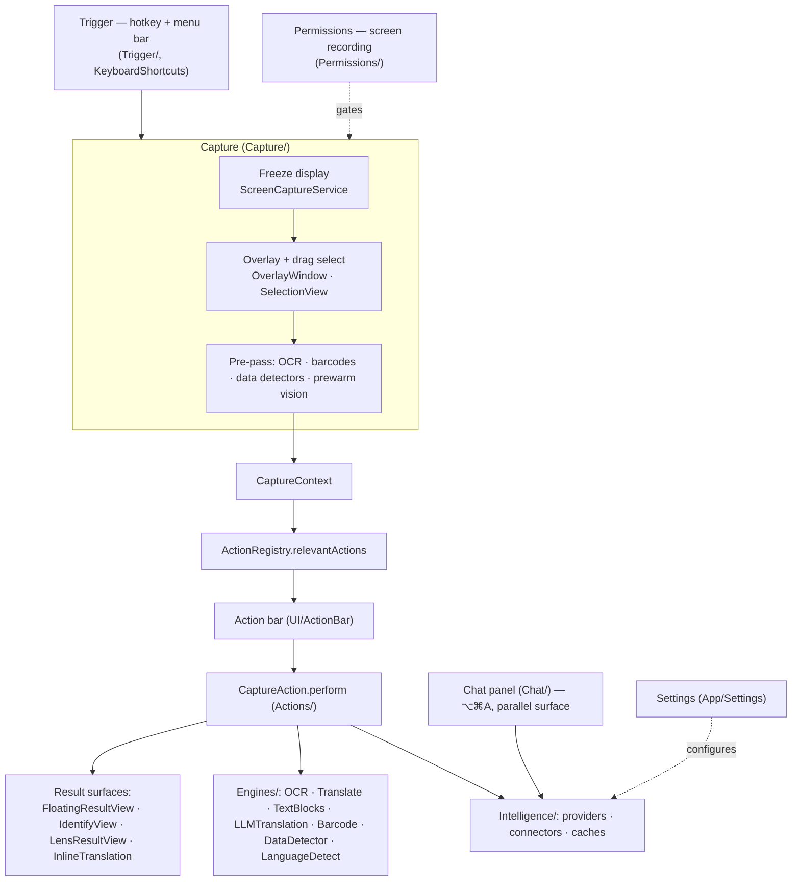
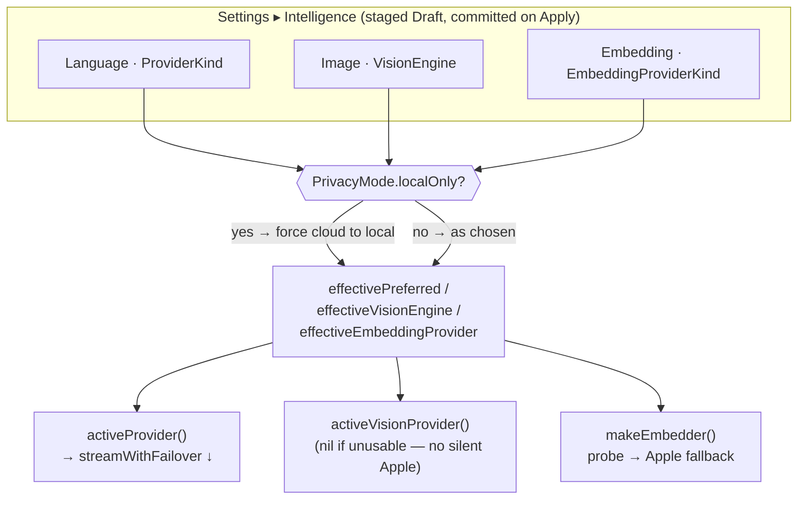
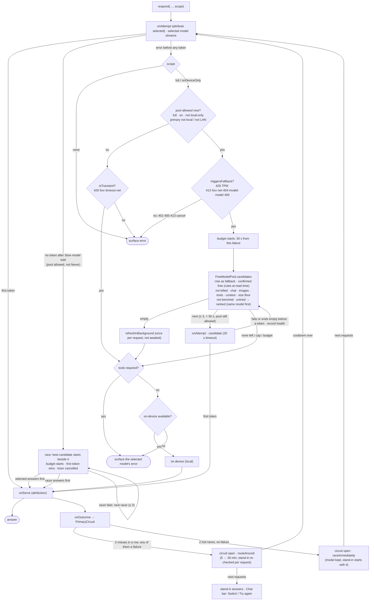
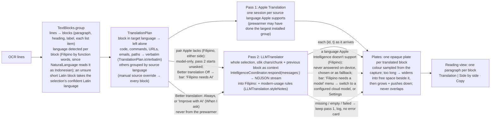
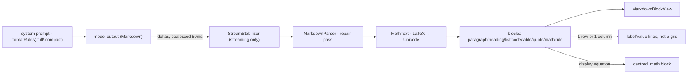
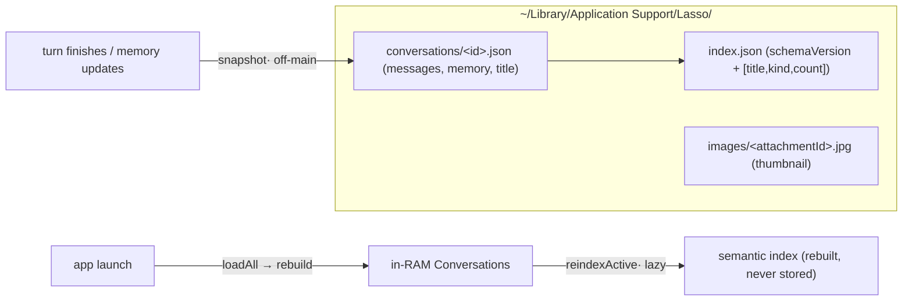
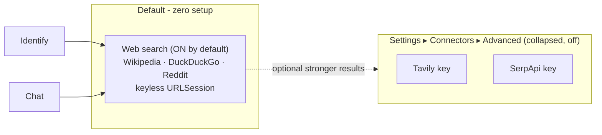

```mermaid
flowchart TD
  Start[Identify on selection] --> Cache{IdentifyCache hit?}
  Cache -->|yes| Replay[Replay cached summary + related]
  Cache -->|no| Route{"OCR text >= 40 letters<br/>&& not forceVisual?"}

  Route -->|"text-heavy (default)"| TextMode["TextActionsView:<br/>Detected text · N words<br/>Copy · Translate · Ask AI · Chat"]
  Route -->|visual| Vision[On-device vision model describes]

  Vision --> Web["Keyless web grounding (WebSearchSource):<br/>Wikipedia · DuckDuckGo · Reddit"]
  Web --> Synth[Synthesize summary + confidence + rank RELATED]
  Synth --> Card[Answer + confidence chip + RELATED links]
  Card --> LensBtn[["Search with Google Lens - one tap"]]

  %% Escape hatch: a text-heavy capture can still be a photo carrying text
  TextMode -->|"Actually a photo? · Identify anyway"| Vision
  TextMode -->|"Actually a photo? · Google Lens"| LensBtn

  LensBtn -.opt-in.-> LensWeb[Lens panel - WKWebView -> lens.google.com]

  style TextMode fill:#1e4a2e,stroke:#4b8
  style Card fill:#1e4a2e,stroke:#4b8
  style LensBtn fill:#1e3a5a,stroke:#48b
```

# Lasso — App Flow & Architecture (living document)

> **Keep this in sync with the code.** Every behavior/flow change updates the diagrams + notes here in
> the same pass. This is the canonical map of how the *whole* app works today — not a plan, the shipped
> reality. Product direction & rationale live in the planning notes; this file tracks *what is*.

Positioning: **"Screen search for your whole Mac, on-device by default."** Select anything on screen →
understand it or act on it. Zero-setup default path, privacy-preserving (local vision + keyless web),
with an opt-in Google Lens escalation for full reverse-image search.

---

## 1. Module map (layers)

---

## 2. Capture pipeline (`Capture/CaptureCoordinator.swift`)

1. **Trigger** — global hotkey (`Trigger/TriggerService`, KeyboardShortcuts) or menu bar
   (`MenuBarController`) starts a session. Screen-recording permission is gated by `PermissionsService`.
2. **Freeze** — `ScreenCaptureService` grabs the display; `OverlayWindow` shows it frozen so the user
   can drag a selection (`SelectionView`); `SubjectLift` supports object/subject lift.
   The overlay's content view accepts the first click (`FirstClickHostingView`): a hotkey only asks
   macOS to activate Lasso, and until it does, a first click that isn't accepted just activates the app
   and the drag doesn't register.
3. **Pre-pass** (`runPrePass`) on the crop: `OCREngine` (text + per-line boxes), `BarcodeEngine`
   (QR/barcode), `DataDetector` (URLs/phones/emails/dates), and `prewarmVision()`. Results populate a
   `CaptureContext` (`Actions/CaptureAction.swift`).
4. **Route** — `ActionRegistry.relevantActions(for:)` filters + sorts actions by `relevancePriority`;
   the **action bar** renders them. Direct-shortcut actions can skip the bar.
5. **Perform** — `CaptureAction.perform` returns an `ActionResult`: `.text` / `.stream` →
   `FloatingResultView`; `.custom(AnyView)`; `.inlineTranslate`; `.copiedToPasteboard`; `.openedURL`;
   `.none`. The freeze drops once a result floats (or on `.none`).

---

## 3. Feature / action catalog (`Actions/`, registered in `ActionRegistry.makeDefault`)

| Action | id | Prio | Backend / engine | Output surface |
|---|---|---|---|---|
| **Copy text** | `ocr.copy` | — | `OCREngine` (pre-pass) | pasteboard |
| **Translate** | `translate` | 20 | Apple Translation framework (pass 1), then optionally the text model (pass 2, `LLMTranslation`) | inline overlay (`InlineTranslationView`) or `TranslationResultView` |
| **Grammar fix** | `ai.grammar` | — | text provider (`GrammarFixService`) | floating card |
| **Summarize** | `ai.summarize` | — | text provider | `FloatingResultView` stream |
| **Ask AI** | `ai.ask` | 40 | text provider (+ vision for imageless text) | `AskAIView` inline |
| **QR / barcode** | `qr.open` | — | `BarcodeEngine` (pre-pass) | open URL / show payload |
| **Color picker** | `color.pick` | — | pixel sample | swatch view |
| **Identify** | `identify` | 12 | vision + keyless web + text synth | `IdentifyView` card |
| **Google Lens** | `lens.search` | 13 | WKWebView → lens.google.com (opt-in) | `LensResultView` panel |
| **Chat** (separate) | — | ⌥⌘A | text provider (+ tools/web) | `ChatView` panel |

**The bar is the user's, not the priority column's** (`Actions/ActionBarLayout.swift`). `Prio` above is
only the shipped fallback: it orders ids the user has never placed, which is all of them on a fresh
install, so an untouched bar looks exactly as it always did. Once the user reorders in Settings ▸
General ▸ Toolbar actions, their order wins outright, including over a QR code or colour swatch that
would otherwise jump the queue. The complaint this answers: "I only use Copy text and Ask AI, it always
takes time to find those icons."
- **Hidden ≠ gone.** Switching an action off moves it into the bar's overflow menu, so it stays one
  click away; the overflow control only appears when something is actually behind it. `hideUnavailable`
  still drops greyed entries from both, and a Comfortable-style cap spills the tail into overflow ahead
  of the hidden entries.
- **Storage** (`ActionBarPreferences`): `actionBar.order` / `actionBar.hidden` string arrays, plus a
  `revision` integer the bar watches (`@AppStorage` can't bind an array). An id in storage that no
  longer exists is never matched; an action shipped later is unknown, so it lands by its `Prio` at the
  end of the user's order, visible.
- **Every action has a hotkey** (`Actions/ActionShortcuts.swift`): one `KeyboardShortcuts.Name` per id,
  none with a default binding, plus the two full-screen variants (Identify, Lens). `TriggerService`
  loops the table rather than listing handlers, and a coverage test fails if a registered action has no
  name, so "added an action, forgot the hotkey" is red rather than silently missing.
- **Recording one is a staged edit** (`ShortcutStaging`, `App/Settings/ShortcutRecorder.swift`).
  Shortcuts used to write straight to storage while every other control in that window waited for
  Save & Apply, so recording one left the panel claiming "All changes saved" and Revert could not undo
  it. They are now part of the draft: the unsaved bar appears, Revert puts them back, and storage (and
  the live hotkey) is written only on Save & Apply. Clearing is the case worth the pure function: an
  emptied shortcut is a *missing* key in the draft, and that still has to reach storage as a write of
  nil. The recorder itself is a button rather than the library's `NSSearchField`: in this window the
  field editor never handed over first responder from a click in the middle of the box, and forcing it
  jammed gestures for the whole window. A clash with another Lasso shortcut is compared against what is
  staged, not what is saved, since both sides may be unsaved edits.
- **One gate for every direct run** (`Actions/DirectActionGate.swift`). The direct path skips the bar,
  and with it `isRelevant`, which is where the Lens upload opt-in and local-only mode live: this app
  has shipped that hole twice. `CaptureCoordinator.passesDirectGate` is now the single chokepoint for
  both `beginDirect` and `beginFullScreen`, and a refusal is *shown* (local-only beats "Lens is off" as
  the reason given; AI actions refuse when no model is configured) rather than a hotkey that appears
  dead. The decision itself is pure, so the privacy rules are tested without a screenshot.

---

## 4. Intelligence system (`Intelligence/IntelligenceProvider.swift`)

**Three independent roles** (Settings ▸ Intelligence: **Language model**, **Image model**, **Embedding
model** — each a `Protocol` picker + per-protocol config), staged in a `Draft` and committed on Apply:

- **Language / Text** (`ProviderKind`): `apple` on-device Foundation Models (default, text-only), `ollama`
  (local server), `mlx` (local Apple-Silicon), `openAICompatible` (cloud/local endpoint, e.g. Groq/LM
  Studio), `anthropic`. Streams deltas via `respond(prompt:context:)` / `respond(messages:)`; tool-capable
  providers also expose `respond(messages:tools:execute:)`. An `mlx` model is found in the Hugging Face
  cache or, via `MLXLocalModels`, in a plain folder on the Mac (`~/models/<org>/<name>` from
  `huggingface-cli --local-dir`, LM Studio's `~/.lmstudio/models`, or a folder picked in Settings, whose
  path is the model id); a folder loads with `ModelConfiguration(directory:)`, so nothing is fetched.
- **Image / Vision** (`VisionEngine`): `matchText` (route through the text provider if it's multimodal),
  `ollama`, `mlx`, `openAICompatible`, `anthropic`. **Apple on-device is text-only** → returns nil for
  vision (no silent fallback). Used to *describe* an image (Identify, Ask-AI-on-image, Chat attachments).
- **Embedding** (`EmbeddingProviderKind`, §7): `automatic` (Ollama embed model if reachable → Apple
  `NLEmbedding` → none), `apple`, `ollama`, `openAICompatible`. Powers Chat semantic memory only.
  Resolved by `makeEmbedder()` (probe → **always falls back to Apple**, so retrieval never breaks).
- **OpenAI-compatible = one protocol, many simultaneous connections** (`Intelligence/KeysRegistry.swift`).
  A **protocol** is the API interface (`ProviderKind` / `VisionEngine` / `EmbeddingProviderKind`); a
  **connection** is a configured endpoint under it (`RegisteredKey`: stable UUID, name, base URL,
  `keyNotRequired`, discovered models), and secrets live in the Keychain under
  `keys.registry.<id>.key`, never in the Draft or the JSON. **There is no active connection.** Every
  switched-on connection is live at once and contributes its models to one merged, capability-filtered
  list (`groups(for:)`), the user picks a *model*, and the `ModelSelection` it stores carries the exact
  **key id** — so picking the model is what routes the request, and two connections serving the same
  model name still reach the right backend. `enabled` is the Connections sheet's per-row switch: off
  hides the connection's models from every picker (Settings, chat header, translate menu), and
  routing, the free-model fallback, the daily model refresh and "Test connections" skip it; its key
  and settings stay. A selection that used one of its models heals like a removal. Capabilities are inferred
  from the model id (`inferCapabilities`), which is what filters the one list into the Language / Image
  / Embedding pickers. Speech, image-generation and guard models (`isChatModel`: Whisper, TTS, Orpheus,
  `-image`, FLUX…) are never chat models; saved lists are corrected when loaded. Editing a connection keeps its id, so renames and rotated keys don't break
  selections.

      Protocol → many Connections → aggregated Models → the user selects a Model

  The UI must not read as Protocol → Connection → Model: that implies one connection can be current.
- **Hand-typed models are the removable kind.** "Manually added" entries have no connection behind them,
  so they never leave on a refresh: the picker gives each one an ✕ (`removeManualModel`), and any card
  pointing at it heals exactly as it would if a connection had dropped the model. `apply()` commits a
  manual selection's *model* while leaving the endpoint and key alone (it rides on whichever connection
  is configured, as the chat switcher's manual group does); requiring a connection there meant Save &
  Apply stored the choice and kept sending requests to the previous model.
- **A connection carries its own transport** (`ConnectionKind`): `.openAICompatible` or `.gemini`.
  This is the *wire format*, not a second model pool — both kinds live in the same registry and their
  models merge into the one picker, so choosing a model still chooses the endpoint. `KeysRegistry`
  centralises the two protocol-dependent operations (`discoverModels(for:apiKey:)`,
  `reachable(_:apiKey:)`) so adding a transport doesn't mean hunting call sites. `RegisteredKey`
  decodes `kind` leniently — a registry written before native Gemini has no such field, and a strict
  decode would fail the *whole* registry and drop every connection.
- **`GeminiProvider` is a real native implementation** (`Intelligence/GeminiProvider.swift`), not the
  OpenAI path aimed at Google: `:generateContent` / `:streamGenerateContent?alt=sse`,
  `contents`/`parts`, `x-goog-api-key`, system prompt hoisted to `systemInstruction`, assistant role
  named `model`, images as `inlineData`. `GeminiVisionProvider` and `GeminiEmbedder` cover the other
  two roles, because Gemini connections contribute vision- and embedding-capable models to the same
  shared pool and those roles would otherwise resolve to an OpenAI-shaped request. Google's **OpenAI
  compatibility layer stays a plain `.openAICompatible` connection** (base URL
  `…/v1beta/openai/`) — the native provider is an addition, never a redirect.
- **The transport travels with the flattened config.** `apply()` writes `openAIConnectionKind` (and
  the vision/embedding equivalents) alongside the effective URL + model + key, because that config
  alone can't say which format to speak — Google serves both from the same host. `buildProvider()`,
  `activeVisionProvider()` and `makeEmbedder()` branch on it.
- **Image ← Language is one explicit link**, not a duplicated block: `VisionEngine.matchText` *is* the
  Image section's **Inherit** switch. `ModelSelection.sameAsLanguage` still resolves (old stores decode),
  but nothing produces it any more — `healSelection` never falls back to it, the model picker doesn't
  offer it, and `load()` collapses a persisted one into a concrete `.model`/`.manual`. One intent, one
  control. Turning Inherit off seeds Image from Language's current value (macOS linked-value behaviour),
  so unlinking is a starting point rather than a reset.
- **`isLocal` / local-only**: `isLocal` drives the privacy badge; **local-only mode**
  (`PrivacyMode.localOnly`) forces every cloud choice back to local via the `effective*` getters
  (`effectivePreferred` / `effectiveVisionEngine` / `effectiveEmbeddingProvider`) — cloud options are also
  hidden in the pickers — so nothing leaves the Mac regardless of what's stored (see §8).
- **Tools** (`Intelligence/Tools/`): a model-decided `web_search` tool for Chat on tool-capable
  backends; others fall back to heuristic grounding. Which tools a turn actually *sees* is chosen by
  `Harness/Toolbelt` — registration and exposure are separate, and the menu is capped at
  `maxExposed` (3), because tool-choice accuracy falls off as the menu grows.
- **Harness** (`Intelligence/Harness/`) — the app's own reasoning, kept off the answer model:
  - **`UtilityModel`** (`utilityModel()`): the model the *harness* thinks with. Apple on-device when
    available, else the user's active provider (never a third-party endpoint they didn't choose).
    Utility calls bypass `streamWithFailover`, so they never touch the attribution footer or the
    privacy badge; a non-local fallback flags `noteOffDeviceUse()`.
  - **`StructuredOutput` + `StructuredRunner`**: one typed request, four rungs, tried in order —
    **guided** (Apple `@Generable`, constrained decoding, malformed output impossible) → **jsonSchema**
    (`respondJSON`: Ollama `format`, OpenAI `response_format` with a `json_object` downgrade,
    Anthropic forced tool use) → **lineFormat** (labeled lines, parsed leniently; MLX's only rung) →
    **none** (caller applies its own deterministic fallback). The runner never throws.
  - **`ModelText`**: shared lenient reading of model output (`<think>` stripping, first balanced JSON
    object, "NONE"-aware field reads).

**Settings → resolution** (how a stored choice becomes the backend that actually runs):

- **Failover** (`streamWithFailover` → `FallbackDriver`, `Intelligence/FreeModels/`): every `respond(…)`
  streams through one wrapper. A failure **before the first token** moves the request on: selected model
  → compatible free models → on-device → the selected model's error. Never after a token (no splicing),
  never back to the cloud once on-device. The request reaches each model unchanged. The stream is only
  ever the answering model's output: a fallback is reported beside it as a `FallbackNotice` (`onFallback`,
  delivered with the answering model's first token, so a candidate that also fails leaves no trace). The
  notice carries the selected model's own failure (`reason`): a 404 reads "X wasn't found (check the model
  name and base URL)", anything else "X was temporarily unavailable". The user's selected model is never
  written.
  - **Slow selected model → race.** If no token arrives within `raceAfter` (Settings ▸ Language ▸ Slow
    model; default 15 s, "Never" = off) and the pool is allowed, the best candidate starts *beside* the
    selected model. First token wins; the loser is cancelled and nothing is recorded for it. The pool
    budget starts at the race (or at the selected model's failure, whichever is first). A racer that
    fails is replaced while the selected model is still silent; the selected model failing mid-race
    leaves the racer running; a bad key or bad request from it ends the request. The notice then reads
    "X hadn't started answering after N s". `FallbackDriver` is an event loop over concurrent attempts
    (`delta` / `finished` / `failed` / `slow`), so only that loop makes decisions.
  - **A routed request is still filtered.** The stand-in is re-chosen per request through
    `FreeModelPool.substitute` (the full `exclusion` set) or `FallbackPolicy.onDeviceCanStandIn`
    (window + no required tools); nil falls through to the normal path. Skipping the user's model must
    not skip the checks that protect the answer.
  - **Slow is not down.** A miss carries `selectedFailed`. All-lost-races open the circuit in
    `.raceImmediately`: the selected model still gets every request, with the stand-in started beside it
    (`raceAfter = 0`), so the user stops paying the wait without losing their model. Any real failure
    opens (or upgrades to) `.routeAround`, which skips it. Chat's bar reads "Racing X · Y has been slow"
    with Stop racing, or "Using X · Y isn't responding" with Try again.
  - **Routed around a model that keeps missing** (`PrimaryCircuit`, in memory): a request whose selected
    model missed (a fallback-worthy failure, or losing the race) counts; 2 misses in a row within 10 min
    open the circuit, in `.routeAround` when any of them was a real failure (requests then go straight to
    what last answered, with no race wait) or `.raceImmediately` when they were only lost races (see
    "Slow is not down" above). The selection is never written. The stand-in is re-checked against each
    request (`FreeModelPool.substitute` / `onDeviceCanStandIn`) or the request takes the normal path. Cooldown 5 min, doubling to 30 while it keeps missing; when it
    passes, the next request tries the selected model again (`route` returns nil, "probing") and one
    answer closes the circuit. A routed request judges only the stand-in: if another free model has to
    answer, routing follows it. 401/400/cancelled never count. Picking a model resets it (the circuit is
    keyed by `activePrimaryKey`). Chat shows a bar: "Using X · Y isn't responding", with Switch
    (`switchToSubstitute`) and Try again (`retrySelectedModelNow`). The driver reports
    `RequestOutcome` (`onOutcome`) and takes `routedFrom` (whose name the notice uses) + `exclude` (the
    skipped model is never a candidate).
  - **On-device as the stand-in:** it is only offered when the request fits what it can hold
    (`FallbackPolicy.onDeviceCanHold`: `OnDeviceProvider.inputBudgetTokens` = 4,096 window minus the
    2,048-token reply reserve). The prompt was sized for the user's model, so a long chat is far past
    that: trying it only reaches `exceededContextWindowSize`. When it does answer, its instructions
    carry a stand-in note (`OnDeviceProvider.standingInFor`) saying which model it is covering and to
    continue from the conversation above: without it, a 3B model handed a conversation it never took
    part in answers as though the last message opened a new one. `lastResort` therefore takes the
    request's `FallbackNeeds`.
  - **Files, one concern each:** `FreeTierRules` (A: provider-specific discovery rules, the only code
    that knows provider names) → `KeysRegistry` (B: the cache, persisted with the connections; no
    second model database) → `FreeModelPool` (C/D: free status, per-request filtering, ranking,
    `FallbackPolicy`, badges) → `FallbackDriver` (E: the loop) → `ModelHealth` + `FreeModelRefresher` (F).
  - **Callers and scope** (`FallbackScope`, a `respond(…)` parameter, default `.full`): Chat records a
    fallback in Activity (a completed step with `notice.reasonText`; the answer step names the model that
    answered). Grammar Fix's in-place HUD says "Proofreading with X…" and "Proofread by X". Ask AI and the
    Proofread card show the answering model in their existing attribution footer. Identify (synthesis and
    OCR cleanup) has no surface for a notice, so it passes `.onDeviceOnly`: never another cloud provider,
    only the on-device retry, logged. The chat summarizer passes `.none`: no pool and no on-device retry,
    since it runs unseen.
  - **Attribution:** the driver calls `onAttempt(provider, isSelected)` before each provider is tried and
    `onServe` once, at the answering model's first token. The coordinator sets `usedOffDeviceThisSession`
    for any cloud attempt, attributes the selected model at its attempt (so the footer never shows the
    previous request's model), and re-attributes at `onServe`. A candidate or the on-device last resort
    is named only at its first token, so one that fails is never named. A selected model that finishes
    with no tokens is still attributed.
  - **Who may use the pool** (`FallbackPolicy.poolAllowed`, opt-in `intelligence.fallback.freeModels`,
    Settings ▸ Language ▸ Fallback): on, not local-only, and the primary **not local**. Local means
    `provider.isLocal` (loopback, `KeysRegistry.isLocalURL`) or an OpenAI-compatible base URL on the user's
    own network (`KeysRegistry.isPrivateNetworkURL`: 10/8, 172.16/12, 192.168/16, 169.254/16, 100.64/10,
    fc00::/7, fe80::/10, loopback, a dotless single-label host such as `mac-studio`, and `*.local`,
    `*.ts.net`, `*.home.arpa`, `*.lan`, `*.internal`), via `FallbackPolicy.primaryIsLocal`. Re-checked before
    every pool attempt, so turning on local-only mid-request stops the next cloud attempt. Triggers on
    429 (and Groq's tokens-per-minute 413), 5xx / timeout, unreachable host, 404 and OpenRouter's 400
    "is not a valid model ID" (`ModelFailure.triggersFallback`); not on 401/403 or other 400/413/422. With the pool off,
    `isTransient` (429 · 5xx · timeout · unreachable, from the same `ModelFailure.classify`) → on-device.
  - **Budget:** max 3 candidates; no new one once 30 s have passed **since the selected model failed**
    (not since the request started, so a primary that times out at 60 s still reaches a candidate). The
    selected model keeps the 60 s request timeout; candidates are built with 20 s
    (`FallbackDriver.candidateTimeout`, `requestTimeout` on the OpenAI-compatible and Gemini providers).
    A candidate stream that ends with no tokens is a failure (`IntelligenceError.emptyResponse` →
    unavailable) and the next one is tried. If the caller cancels, nothing new starts and no health is
    recorded.
  - **Consent per connection:** a connection contributes only with **Use as fallback** on
    (`RegisteredKey.useForFallback`, off by default, in Manage connections for every kind, a server on
    this Mac included). "Only models Lasso can confirm are free are used."
  - **Free detection** (`RegistryModel.freeOffer`: `always` / `freePlan` / `never` / nil). OpenRouter:
    `pricing` all "0" → `always`, anything else (incl. "-1") → `never`; `openrouter/*` routers flagged
    `isRouter`. Groq: billing FAQ says the Free tier has no usage charges → every model `freePlan`;
    Compound (`groq/compound*`, `compound-*`) flagged `isRouter` (an agentic system, not a model). Google
    (native and the `/v1beta/openai/` shim): the pricing page's per-model "Free of charge" / "Not
    available" table → `freePlan` / `never`, unlisted → nil. Checked 2026-09-15. Any other provider → nil.
    Hosts match the domain or a subdomain (`groq.com`, `*.groq.com`), never a suffix. The rules run at
    discovery **and every time the pool reads the registry** (`FreeTierRules.annotate` is idempotent and
    never overwrites OpenRouter's pricing), so a rule shipped in an update applies without a refresh.
    Only a rule sets `freePlan`, so on a connection with no rule (or OpenRouter) a leftover `freePlan`
    from the provider it pointed at before is cleared; `always` / `never` from pricing are kept. Saving a
    connection whose provider has no Free tier switch saves Free tier off.
    `FreeModelDetector`: `always` → confirmed; `never` → not_free; `freePlan` → confirmed only if the
    connection's **Free tier** switch is on, else unknown; nil → confirmed for a localhost server, else
    unknown. Unknown never enters the pool. Health never changes free status.
  - **Billed Free tier keys:** when the selected model sits on a Free tier connection and is documented
    as not on the free plan (`freeOffer == never`), the key is billed, so that connection's `freePlan`
    models are excluded (`FreeModelPool.billedConnections`, exclusion `.billedKey`), get no badge, and
    aren't counted in the Settings caption. OpenRouter's zero-priced models are unaffected.
  - **Chat eligibility:** `.language`, `outputsOnlyText != false`, not a router. Classifier/guard/safety
    models, speech, TTS, image and embedding models are marked non-chat.
  - **Per-request filters** (`FreeModelPool.exclusion`, counts logged at debug level): not tried, not
    benched, not billed; images → accepts images (reported, else inferred vision); tools `.required`
    (Chat turn whose web intent is an explicit search) → excludes candidates known unable to call tools,
    including every native-Gemini candidate (no tool loop); context → estimated tokens +
    `outputReserveTokens` must fit the reported window, else the name-inferred one, else the 32K default;
    quality floor → skip a candidate two size bands below the primary (small for large).
  - **Tools:** a `.required` turn never falls back to on-device (no tool loop there): the selected
    model's error surfaces instead. A candidate whose list reports no tool support is built with
    `supportsToolCalls = false` and answers without tools. Chat memoizes the `web_search` executor per turn
    on `name + argumentsJSON` (`ChatController.ToolCallMemo`), so a retried candidate reuses the evidence
    without a second search or a duplicate "Searching…" step. Arguments are compared as JSON (re-encoded
    with sorted keys), so spacing or key order from another model still matches.
  - **Ranking** (no invented scores): the selected model itself on another connection first (ids
    normalized: lowercase, no `models/`, no vendor path, no `:free`); then size band large > medium >
    unknown > small (`ModelSize`: the parameter count in the id, else a known large family without one:
    DeepSeek V3/R1 (not distills)/chat, Kimi K2, GLM-4.5/4.6 (not Air), Qwen3 Coder, MiniMax-M1, else the
    family suffix); within a band a published parameter count before a name signal; tool support when
    tools are in play; connections not yet tried in this request; more parameters first; then alternate
    connections. Quality outranks diversity.
  - **Health** (`ModelHealth`, in memory, `availability(of:)`): 429 → model 60 s; 429s from two models on a
    connection within 2 min → connection 10 min (the selected model's own 429 doesn't count toward this:
    `countsTowardSharedCap: false`); 5xx → model 2 min; other 400 → model 2 min; unreachable → connection
    2 min; 404 or OpenRouter's 400 "is not a valid model ID" (verified live) → model, and 401/403 →
    connection, until the next refresh (Settings ▸ Refresh clears these too).
  - **Refresh** (`FreeModelRefresher`): Settings on open / add / edit / Refresh (stamps
    `modelsCheckedAt`); at launch when on and any list is >24 h old; in the background when a request
    reads a stale registry; in the background, once per request, when the pool is empty or 3 candidates
    have failed. Never awaited by a request: an empty pool goes on-device at once. Automatic refreshes
    start at most every 10 min; concurrent callers share one in-flight task. Each connection's list is
    replaced (models no longer free leave), re-read after the network so connections removed, repointed,
    or re-keyed meanwhile and the Free tier switch are untouched, and a failed fetch keeps the old list.
  - **Visible:** Settings caption "N free models across M connections · checked X ago", then which
    switches to turn on ("Turn on Use as fallback for A, and Free tier for B in Manage connections"),
    providers without a rule, and a billed Free tier key; `free` / `free tier` tags in the Settings picker
    and chat switcher from `FreeModelPool.badge(s)(…, primary:)` (describe the model regardless of Use as
    fallback, but none for a billed key's plan models);
    "N free" in each connection's subtitle.
  - **Verified:** `FreeModelFallbackTests` (63, fake providers; the key rules, including most review
    fixes, were broken on purpose to confirm their test fails) and `FreeModelLiveTests` (8, opt-in
    `TEST_RUNNER_LASSO_LIVE=1`; real
    OpenRouter free models only, plus free `/models` calls to every configured connection).
  - **Not covered:** `activeVisionProvider` (Identify's image model) and harness `respondJSON` calls;
    Anthropic is a possible primary but never a candidate; structured-output requirements.

---

## 5. Identify pipeline (`UI/IdentifyView.swift`)

OCR-first routing decides text mode vs. the visual identify path; **neither is a dead-end**.

- **Routing signal:** `hasStrongText` = `ocrText` letters ≥ 40. Escape hatch "Identify anyway" sets
  `forceVisual` (`textHeavy = hasStrongText && !forceVisual`) so a photo-that-carries-text still gets
  the visual path (on-device / local-only).
- **Text mode** (`TextActionsView`): Copy · Translate (`TranslationResultView`) · Ask AI (`AskAIView`)
  · Chat, plus opt-in "Clean up misreads with AI" → single Cleaned column, changed lines highlighted
  (`OCRDiff.changedLines` + `OCRCleanedView`); verbatim source is never silently rewritten.
- **Models:** vision role describes on-device; the text provider synthesizes the final answer +
  `Confidence: High/Medium/Low`. Ranking/caching: `rankHits` (word overlap), `IdentifyCache`.

---

## 6. OCR & Translate

- **OCR** (`Engines/OCREngine.swift`) — Apple Vision `RecognizeTextRequest`, accurate, zh-Hant+en.
  `readingOrdered(_:)` reconstructs reading order geometrically (column-aware; verbatim, never
  rewrites/drops), fixing multi-column interleaving app-wide.
- **Translate** — two surfaces: the inline overlay (`InlineTranslationView`, needs line geometry) and
  the single-pane `TranslationResultView` (source/swap/target capsule, unchanged). The overlay
  (docs/TRANSLATE_LLM.md):

  The source chip reads `Detected · X`, `Mixed · X, Y, Z +N` or `Unknown source`; the status reads
  `On-device · N blocks` (with a ✦ `sparkles` "Improve with AI" button under When I ask), then, while the
  model works, an animated ✦ `Improving n/N` and a sweep over each plate it hasn't reached yet, then
  `✦ Improved`, the answering model named in its tooltip. A failed pass shows an orange ✦ to retry. Pass 2 goes through the coordinator, so routing,
  the free-model fallback and local-only mode apply as they do for Chat.

---

## 7. Chat (`Chat/`)

Persistent top-right panel (⌥⌘A), independent of the capture overlay. The system prompt carries the
device date/time as background ("use it only when the question needs it"); calling it authoritative made
a local Qwen3.5 answer greetings with the date (`ChatDatePromptLiveTests`). **Voice input** (`Chat/Voice/`):
English speech-to-text on this Mac with Apple's `SpeechTranscriber`, no model or connection involved.
The mic in the composer streams into the message box as you talk, stops itself ~2 s after you pause
(`SpeechActivity`), and never sends; Send finishes the dictation first, and a session number keeps late
recognizer updates out of the box. Needs the `com.apple.security.device.audio-input` entitlement. Resizable down to 340×360
(set in the SwiftUI root and passed to the window via `sizingOptions = [.minSize]`; a plain
`panel.minSize` is wiped by AppKit's first layout pass). Opening it, a result card, Lens or a capture
goes through `AppActivation.bringForward`: the window becomes key *and main* before the app activates,
because activation brings the app's main window forward and an open Settings window used to jump in
front of every other app. The card is pinned to the window's size and
the header's title and model chip truncate, so nothing pushes the card past the window. Multi-turn, **multi-image**
attach (button / ⌘V / drag / capture seed; up to `maxAttachments`), two-track memory
(`ConversationMemory`, `ChatContextBuilder`). Images: `Attachment` (structured, stable id) → native
models get an image array per turn; text-only models get per-image "Image N:" captions + OCR. Grounds via the same keyless web search; reverse-image is the one-tap Lens
escalation, not a silent per-turn API call.

**Search planning:** on the heuristic route (Apple / MLX / tool-less Ollama), `planSearch` rewrites
the turn into one self-contained query with references resolved. It runs on the **utility model**, not
the chat model, through the structured ladder — so the plan is a typed `SearchPlan` on every backend,
and an MLX chat model no longer serializes a planning pass ahead of the answer it is about to stream.
`SearchPlan` (`Chat/Harness/SearchPlan.swift`) owns its own parsing for all rungs; `ChatController`
keeps `repair` / `fallbackSearchPlan` (the deterministic floor) and the entity guardrails.

**Context memory (three speeds):** recent 6 turns verbatim → two-track running summary (durable facts
+ topic trace) → **semantic retrieval** (`ChatMemoryIndex`, Phase 1). The index embeds completed
*exchanges* (user + assistant) in the background; at send it retrieves the top-K most relevant *older*
exchanges verbatim (query = current text + last 1–2 turns), deduped against the recent window, into a
bounded reserve in `ChatContextBuilder`. **Embedding backend is a user choice** (Settings ▸ Intelligence
▸ **Embedding model**, peer to Language/Image): `automatic` (Ollama `nomic-embed-text` if installed →
Apple `NLEmbedding` on-device → none), `apple`, `ollama` (any local embed model), or `openAICompatible`
(cloud, e.g. `text-embedding-3-small/-large`, with its **own** independent OpenAI-compatible service —
OpenAI/Groq/OpenRouter/Custom + Base URL + key, like the Image model; key shared per-service). Resolved by
`IntelligenceCoordinator.makeEmbedder()`; **local-only forces cloud→local** (`effectiveEmbeddingProvider`).
The **default (Automatic → Apple) needs no download** — works on any Mac immediately. Vectors from
different backends are incomparable, so changing the backend resets every session's index
(`ChatController.embeddingConfigChanged`) and it re-embeds lazily. See `docs/CHAT_MEMORY_DESIGN.md`.

**Response formatting (prompt) → rendering (`UI/MarkdownDocument.swift` + `MarkdownView.swift`):**
one contract at each end. The system prompt carries an explicit **format policy**
(`ChatController.formatRules`): prose by default, and an admission test per construct — a table only
to compare **≥2 things across ≥2 shared attributes**, ≤4 columns, never for a single thing's
properties, steps, or term/definition pairs. It also states what the surface can draw (no LaTeX, HTML,
images or footnotes), so models stop emitting syntax that renders literally. Models with a tiny window
get the `.compact` variant, picked from `contextBuilder.budget.total` rather than a model name.

**Math** (`UI/MathText.swift`): models emit `\[ … \]` and `\( … \)` for any formula question whatever
the prompt says, and the raw commands used to reach the screen. Typesetting would need a math engine —
KaTeX means a WebView (ruled out: the app avoids WebViews), a native typesetter is a large dependency — so LaTeX is
**converted to Unicode text** instead: `\frac{\mathbf{A} \cdot \mathbf{B}}{\|\mathbf{A}\| \|\mathbf{B}\|}`
becomes `(A · B)/(‖A‖ ‖B‖)`, `\sum_{i=1}^{n}` becomes `Σᵢ₌₁ⁿ`. Display regions become a centred
`.math` block; inline spans are rewritten in paragraphs, headings, list items and table cells, never
inside code. An unknown command degrades to its own name (`\coth{x}` → `coth(x)`) rather than
vanishing, and `$…$` is claimed only for real math, so currency (`$5-$10`) survives.

The renderer's rule is **repair, not rejection** — a strict GFM parser turns a small model's near-miss
into a wall of raw pipes. It recovers tables with no separator row, pads ragged rows, honours
`|--:|` alignment, and handles nested/task lists at any indent step, blockquotes, setext and
space-less headings, `~~~` fences, `---` rules, and `\|` escapes. A table with one row or one column
carries nothing to compare, so `MarkdownTable.isDegenerate` renders it as label/value lines instead of
a grid — the main cure for tables that appear out of habit. **Streaming stability**: while
`isStreaming`, `StreamStabilizer` withholds the unstable trailing line (a pipe row that has no
separator yet would draw as prose, then snap into a grid) and speculatively closes half-typed emphasis,
never inside an open code fence and never once the stream is finished. Publishes are coalesced to
~20/s in `runTurn`, since re-splitting and re-parsing the whole buffer per token is quadratic work
whose only visible effect is faster flicker. Covered by `MarkdownRenderingTests` (each case verified to
fail against the un-repaired parser).

**Persistence (`ConversationStore`):** conversations are saved to `~/Library/Application Support/Lasso/`
— **one JSON per conversation** + a lightweight `index.json`, so history survives app updates /
uninstall→reinstall (the data lives outside the `.app`, like `UserDefaults`/Keychain). **Source-of-truth
only:** messages, two-track memory, title, and the *textual* image representation (`promptText` already
folds in the vision description) + a small **thumbnail** per attachment (`images/<id>.jpg`). The semantic
index (embeddings) is **derived** — never stored; it rebuilds lazily on load/switch (`reindexActive`).
Every file carries `schemaVersion` for future migration. Saved on turn-finish / memory-update / session
lifecycle (disk I/O off the main actor); **Clear chat history** in Settings ▸ General wipes it. Restore
drops streaming/derived state and image-anchor pixels (selection anchors persist).

---

## 8. Connectors, web grounding & privacy

Reverse-image via a keyed API was **removed** — Google Lens (zero-setup, opt-in) is the only
reverse-image path now.

Files: `Intelligence/Connectors.swift`, `WebSourcesProvider.swift` (`WebSearchSource`,
`IdentifySources`), `SearchCache`, `SearchQuota`, `DomainNoise`, `Keychain`.

**Privacy invariant:** `privacy.localOnly` (PrivacyMode) gates **every** off-device path at the source
— web connectors pause, the Lens button/action hides, favicons don't load. Local-only = zero
off-device network. See memory `lasso-localonly-egress-invariant`.

---

## 9. Design system (Liquid Glass / Tahoe)

Primitives in `UI/Theme.swift`:
- `.liquidGlassPanel()` — frosted `.ultraThinMaterial` fill, continuous 26pt squircle, hard-clipped +
  hairline border. **No SwiftUI shadow** — the panel *window* uses the native macOS shadow
  (`hasShadow = true`) so it's cast outside the card's silhouette, never *through* the translucent
  corners (a SwiftUI `.shadow` did → dark "double edge"). `.regularMaterial` under Reduce Transparency.
- `.glassWell()` — recessed content blocks (dark `black 0.18` tint, continuous 16pt); not glass.
- Action pills — compact inline (icon + label, ~34pt), equal-width flex; inactive translucent white,
  active tool solid accent. Language bar — one material capsule (plain-text names + accent-glass swap).
- Requires the panel window non-opaque + clear (`FloatingPanel`, chat panel).
- Applied to: Identify card, `FloatingResultView`, `ChatView`, `LensResultView`. Action bar / Grammar
  chip / inline-translate already used material.

**Settings ▸ Intelligence — one section template** (`App/Settings/SettingsKit.swift`,
`App/Settings/ModelProviderSection.swift`, `App/Settings/ConnectionsSheet.swift`). The panel follows
macOS HIG grouped inset lists rather than `Form(.grouped)`, because the grid has to be identical
across sections:
- `SettingsMetrics` is the only place layout numbers exist (row padding 16/14, 22pt controls, 26pt
  between sections). `SettingsFont` gives three ranks — section header (13 semibold) ▸ row label
  (13 primary) ▸ sub-label (11 secondary) — so headers, labels and helper text are never confusable.
- `SettingsRow` is **space-between**: the label is pinned leading, the control trailing, with the
  sub-label directly under the label. The control is sized by its own content and takes
  `layoutPriority(1)`; the label half absorbs the slack. So control *widths* vary — a pop-up button is
  as wide as its widest option — but every control's **right edge lands on the container edge**, which
  is the alignment that actually reads. Only text inputs carry a width (`settingsFieldWidth()`, 240pt),
  because an empty field can't size to its content. Rows own their padding and draw a hairline below;
  `SettingsCard` clips, so the last one lands on the border.
- `SettingsPalette` carries the grouped-list colours, because the semantic ones don't work here:
  measured, `NSColor.controlBackgroundColor` resolves to **exactly** `windowBackgroundColor` in both
  appearances (#1E1E1E dark, #FFFFFF light), so a card painted with it is invisible against the page.
  The palette separates them explicitly — a 6% white lift on the card in dark (#1E1E1E → #2B2B2B), and
  in light a dropped page (#F2F2F2) under a white card, since a card can't get lighter than white.
  Both land at ~0.05 luminance delta, matching what `Form(.grouped)` gives the other tabs.
- `ModelProviderSection` owns the **row order** — Inherit → Protocol → Model → protocol extras →
  Context window → API Key → Connections → and is instantiated three times (Language / Image /
  Embedding). A section supplies its protocol list and the contents of the variable slots; it never
  declares spacing, widths or order. `MLXModelManager` builds from the same `SettingsRow`.
- **Connections are configuration; models are selection.** The card carries only a Connections
  *summary* row (count, models available, Test connections) plus a "Manage connections" link; adding,
  editing, removing and inspecting endpoints happens in `ConnectionsSheet`. There is deliberately no
  connection picker anywhere, and no API-key row for OpenAI-compatible — a key belongs to a connection.
  The model picker groups by connection name, which is what shows where a model will be routed.
  "Test connections" tests **every** configured endpoint, since all of them serve models.
- Anthropic is the single-endpoint protocol, so it keeps an inline **API Key** row (`SettingsKeyField`:
  masked, revealable, replaceable) and a one-shot Test row instead.
- The window's one **Unsaved changes / Revert / Save & Apply** bar stays the only commit surface; no
  section or sheet has a save of its own (`isDirty` = `draft != saved || registryKeyValues != savedRegistryKeyValues`).

---

## Future improvements (deferred — not yet built)

Framed by the three "engineerings" — prompt / context / loop. **Prompt and context are mature**
(an external review scored the memory/context work ~9.7 and advised *freezing* it); **loop engineering is
the next frontier.**

**Loop engineering — highest leverage next** (what the app *can do*, beyond a single pass + one tool call).
**Full design + phasing now lives in [`docs/HARNESS.md`](HARNESS.md)** (utility model, structured-output
ladder, toolbelt exposure policy, plan→act→check, verification, skills):
- A lightweight **plan → act → check** loop for multi-step chat requests (builds on the `web_search` tool loop).
- **Self-verification** on grounded answers — does the answer actually follow from the retrieved evidence?
- Beyond the single `streamWithFailover` hop: retry-with-correction, a small planner / task queue, agentic workflows.

**Context — frozen (resist tuning):**
- Cross-session / **global memory** (search across all saved chats) → *then* a persisted vector store earns
  its keep; the per-conversation index stays in-RAM/derived. Pairs with a "forget me" privacy surface.
- Cross-turn image gallery + full-res image persistence (today: thumbnails + `promptText` descriptions).
- Reviewer nice-to-haves left deliberately unbuilt until real usage demands them: adaptive-K retrieval,
  IDF-weighted keyword gate, Fact-vs-Conversation memory split.
- **Calibration-independent retrieval** (would let *any* embedder in, incl. BGE-base): replace the fixed
  `highSemanticBar` cosine gate with **Top-K + margin** (admit only candidates within a delta of the top
  score) or a **reranker**. Fixed cosine thresholds assume calibrated scores across models, which doesn't
  hold (BGE-base/GTE cluster ~0.9 for everything though their *ranking* is still correct). Pair with a
  **ranking benchmark** ("is the right memory ranked #1 in the top-20?") instead of the current
  above-threshold pass/fail — that measures the embedder, not the threshold fit.

**Polish / infra:**
- In-app `ollama pull` for the embedding model (today: guided caption with the command).
- Skip the `huggingface.co` update check when an MLX model is already cached (offline-when-cached).
- A cloud-embedding connection **Test** button in Settings (today: the live `probeEmbedding` status row covers most of it).

## Change log
- **The toolbar is the user's now, and every action has a hotkey.** From user feedback: "I only use
  select text and Ask AI, it always takes time to find those icons" and "a hotkey for each feature would
  be great". `ActionBarLayout` (pure, testable) puts the user's saved order first and `relevancePriority`
  second, so nothing jumps the queue any more; hidden actions move to the overflow menu rather than
  away; Settings ▸ General ▸ Toolbar actions lists every action with reorder, a visibility switch and
  its own recorder (staged like every other setting: nothing binds until Save & Apply). Every registered action now has a (default-free) shortcut name,
  derived from one table that a coverage test polices. The direct path's long-standing hole is closed
  properly: `DirectActionGate` is one chokepoint for both entry points, refuses with a visible reason,
  and puts local-only mode ahead of the Lens opt-in in what it tells the user.
- **Routing around a model no longer routes around its checks**, and slow stopped being treated as down.
  A pre-release audit found the stand-in was chosen on pool membership and health alone, so a routed
  request could reach a model that cannot read the image, cannot run the search the turn depends on, or
  (on-device) cannot hold the conversation, which failed on every message for the whole cooldown.
  `FreeModelPool.substitute` / `FallbackPolicy.onDeviceCanStandIn` now re-run the per-request filters.
  The same audit noted that losing a race counted as a miss, so a healthy-but-slow reasoning model (its
  reasoning arrives in a field Lasso doesn't yield) was set aside for up to 30 minutes: misses now carry
  `selectedFailed`, and all-lost-races open `CircuitMode.raceImmediately`, which keeps the model and
  starts the stand-in with the request instead.
- **The on-device stand-in stopped reading as lost.** Two causes, both from the prompt being built for
  the model the user picked: it was offered requests far past its ~2K input budget (a wasted turn ending
  in the selected model's error anyway), and it was never told it was standing in, so it answered a
  conversation it hadn't been part of as if it had just started. Now gated by
  `FallbackPolicy.onDeviceCanHold` and given a short stand-in note. Still open (deliberately): the
  prompt itself, including which formatting rules it gets, is sized for the selected model.
- **A model that keeps missing is routed around.** Racing fixed the wait *within* a request, but every
  new message still started on a model that was plainly down. `PrimaryCircuit` remembers across requests:
  2 misses in a row (within 10 min) send the next messages straight to what last answered, for 5 min
  doubling to 30, then one more chance for the selected model; an answer closes it. The user's selection
  is never rewritten (their rule): Chat shows "Using X · Y isn't responding" with Switch and Try again.
  Errors the user must fix (401/400) and cancelled replies never count. `FallbackDriver` gained
  `onOutcome` (who answered), `routedFrom` (the notice names the skipped model) and `exclude`.
- **Slow models are raced, not abandoned.** A fallback used to start only when the selected model failed,
  and a model that hangs takes a full timeout to fail. `FallbackDriver` is now an event loop over
  concurrent attempts: after `raceAfter` seconds with no token (Settings ▸ Language ▸ Slow model: never,
  8, 15 (default), 30, 60; `intelligence.fallback.raceAfterSeconds`), the best candidate starts beside
  the selected model and the first token decides; the other is cancelled and nothing is recorded for
  it. Racing, not switching, because a model thinking silently (reasoning sent in a field Lasso doesn't
  read) would otherwise be killed a moment before answering. Only where the pool is allowed. A bad key
  or bad request from the selected model mid-race still ends the request. The notice reads "X hadn't
  started answering after N s". `SlowModelRaceTests` drive every ordering through gated fake providers
  (deterministic, 30 consecutive runs green) with a 5 s bound so a broken race fails instead of hanging.
- **Free-model fallback, review fixes.** An independent review found the fallback worked in tests but
  not always in the app, and sent requests further than it should. Timing: the 30 s pool budget started
  with the request, so a primary that timed out at 60 s never reached a candidate; it now starts at the
  primary's failure, candidates get a 20 s timeout, and an empty pool no longer blocks on a `/models`
  refresh. Classification: `isTransient` rejected any message mentioning "api key", which every
  OpenAI-compatible 5xx and every Anthropic error does, so those never failed over; it now shares
  `ModelFailure.classify`, which also reads Groq's tokens-per-minute 413 as a rate limit (the provider's
  error message is now kept in the error). Consent and privacy: each connection needs **Use as fallback**
  (localhost too), a primary on the user's LAN never falls back to the cloud, local-only is re-checked
  before every attempt, the chat summarizer never falls back, and a Free tier key billed by a paid
  selected model contributes no free-plan models. Honesty: attribution is set at the answering model's
  first token, a 404 says "wasn't found", badges say "free tier" for plan-based models, and Grammar Fix's
  HUD names the stand-in. Quality: the same model on another connection ranks first, then more
  parameters within a band, and known large families without a count rank as large. Tools: a turn that
  needs its search never falls back to the tool-less on-device model, toolless candidates run without
  tools, and a retried search reuses its evidence. Rules now apply at read time. The timing, cancellation,
  classification, consent, ranking, tools, attribution, refresh and `</think>` fixes were each broken on
  purpose to confirm their test fails. A second pass: a dotless or `.ts.net` / `.home.arpa` / `.lan` /
  `.internal` host counts as the user's network; the footer names the selected model as soon as it's
  tried; Identify falls back on-device only; a billed key's plan models lose their badge and leave the
  caption's count; the search memo compares arguments as JSON; OpenRouter's "not a valid model ID" 400
  is a missing model; and a repointed connection drops `freePlan` labels and a Free tier switch that no
  longer applies. Each of these except Identify's call sites (UI code) has a test confirmed to fail
  without it.
- **Fallback notices left the answer text; streams from unfamiliar models are cleaned up.** The "Answered
  by…" note was yielded into the stream, so it showed in the chat bubble, would have been pasted back by
  Grammar Fix, and pushed a reasoning model's output around. It is now a `FallbackNotice` shown in Chat's
  Activity. Live streams from OpenRouter's free models also showed: an upstream failure sent *inside* a
  200 stream (`{"choices":[],"error":{"code":502}}`), which ended the reply empty and never triggered a
  fallback (now thrown with its status); a tool call written as `<tool_call><function=…>` text instead of
  `tool_calls`, which leaked markup and skipped the search (`TextToolCallExtractor` turns it into a real
  call, even on the final no-tools round, and a model that never answers is an error, not an empty reply);
  and `splitReasoning` now separates every `<think>` block and a leading close tag, not just the first block.
- **Free-model fallback, refined for quality and verified against real providers.** Free tier now means
  "this key may use the provider's free plan": which models that covers comes from each provider's
  documented rule (Groq: all; Google: its per-model pricing table), not from the switch, and the switch
  only appears where such a rule exists. Detection is normalized at discovery (`FreeOffer`), so the pool
  and loop never see provider names. Candidates must now fit the request (images, required tools on
  explicit-search turns, context plus reply room) and stay close to the selected model: size bands from
  published parameter counts, a floor two bands down, quality before provider diversity. Live runs found
  and fixed four things fake providers couldn't: OpenRouter reports a withdrawn model as HTTP 400, a
  zero-priced safety classifier and the `openrouter/free` router entered the pool, and a name-only "pro"
  outranked a published 120B. Refreshes are rate-limited, run at launch when stale, and rebuild lists
  instead of accumulating them. Code split into `Intelligence/FreeModels/`.
- **Free-model fallback.** A cloud request that fails before answering can now be retried on free
  models from the configured connections before the on-device model (§4 Failover). Opt-in, never from
  a local primary, never in local-only. Discovery keeps each model's pricing/modality/tool/context
  metadata; OpenRouter's zero prices, localhost servers, and a per-connection **Free tier** switch are
  the only sources of "free", because Groq and Gemini expose nothing that could prove it. The retry
  loop moved into `FallbackDriver` so `FreeModelFallbackTests` runs it against fake providers; the
  coalesced refresh, the no-splice guard and the pricing-beats-switch rule were each broken on purpose
  to confirm their test fails.
- **LaTeX reached the screen as markup.** Asked for the cosine-similarity formula, the model ignored
  the prompt's "no LaTeX" line (they do) and the panel showed a stray `[`, a line of `\frac{...}`, and
  every bullet full of `\mathbf{A} \cdot \mathbf{B}`. The prompt was also lying: it claimed the app
  does not render LaTeX, which is a reason for the model not to send it, not a plan for when it does.
  `MathText` converts LaTeX to Unicode instead — fractions, roots, sums, Greek, super/subscripts and
  the operator set models actually use — with display regions as their own centred block and unknown
  commands degrading to their own name. The prompt now says LaTeX is converted rather than typeset,
  which is true.
- **Response formatting: a contract at both ends.** The prompt's entire format policy was "Use
  Markdown when it helps", which is not a rule a model can apply — so structure appeared at random,
  most visibly as tables for things with nothing to compare. `formatRules` replaces it with an
  admission test per construct (prose by default; a table only for ≥2 items × ≥2 shared attributes)
  plus a statement of what the surface actually renders, and a `.compact` variant for models whose
  whole input budget is ~2K tokens. The renderer moved to `UI/MarkdownDocument.swift` and now repairs
  what weak models emit instead of rejecting it (separator-less tables, ragged rows, any-indent
  nesting, task lists, blockquotes, setext/space-less headings, `~~~` fences, `---` rules, `\|`
  escapes, column alignment), downgrades one-row/one-column tables to label/value lines, and stabilises
  streaming (withhold the unstable trailing line, speculatively close half-typed emphasis, coalesce
  publishes to ~20/s). `MarkdownRenderingTests` covers it; each case was re-run against a mutated
  parser to confirm it fails without the fix.
- **Google Gemini as a native connection type.** Added `ConnectionKind` to `RegisteredKey`, so a
  connection declares whether it speaks OpenAI-compatible or Google's native Gemini API. The
  Connections form switches on it — Gemini shows Name + API Key only, since its endpoint is built in
  and its credential mandatory, while OpenAI-compatible keeps Base URL + Authentication + API Key.
  Both kinds contribute to the **same** merged model list, so there is no second model picker and no
  new Protocol entry: the model you pick still decides the endpoint, and now also the wire format.
  `GeminiProvider` / `GeminiVisionProvider` / `GeminiEmbedder` implement the native format properly
  (`:generateContent`, `contents`/`parts`, `systemInstruction`, `role: "model"`, `inlineData`).
  Existing OpenAI-compatible connections — including Google's own `/v1beta/openai/` shim — are
  untouched. Covered by `GeminiProviderTests`; the schema-migration case was verified to fail (and
  take the whole registry down with it) without the lenient `kind` decode.
- **Disabled connections were invisible everywhere but Settings.** `groups(for:)` skips
  `enabled == false`, and the old key-pill UI let you switch a connection off — so a user with Groq
  and OpenRouter toggled off saw only one connection in the chat switcher. The redesign's healing made
  it worse by being *silent*: it re-enabled entries in the Settings `Draft` and then baselined `saved`
  to the healed value, so the panel reported "3 configured · 497 models available" with no unsaved
  changes while disk still said `enabled: false`. Healing now happens in `KeysRegistry.load()` — the
  one point every reader goes through — and is **written back**, so it's permanent and every surface
  agrees. `LassoTests/KeysRegistryTests.swift` covers it (both cases fail with the heal removed).
- **Chat's model switcher reads the connection registry.** The header menu still called
  `configuredOpenAIServices()`, which read the pre-registry `intelligence.openai.svc.<service>.*`
  defaults — the exact keys `KeysRegistry.purgeLegacyStore()` deletes. So it always returned empty and
  OpenAI-compatible vanished from the menu entirely, leaving only whatever Settings had selected. It
  now renders **one submenu per connection listing every model that connection serves**, the same
  shape as the Ollama/MLX submenus and the same aggregated list Settings offers
  (`IntelligenceCoordinator.registryGroups(for:)`). Selecting one writes exactly what Settings ▸ Save
  & Apply writes — endpoint, model, Keychain key, and the `intelligence.keys.selection.language`
  string — so the panel and the chat header can't disagree. The legacy `openAIServices` /
  `switchOpenAIService` / `activeOpenAIService` / `configuredOpenAIServices` helpers are gone.
  **Same cluster, second bug:** `openAIContextOverride` was still reading
  `intelligence.openai.svc.<service>.context` while Settings writes `intelligence.keys.language.context`,
  so the manual context-window toggle set a value nothing ever read. Repointed.
- **Settings ▸ Intelligence: connections are configuration, models are selection.** The panel had a
  "Keys" row of pills and a per-section API-key field, which read as *pick a connection, then a model
  from it* — wrong for an omni-router, where every configured endpoint is live at once and the merged
  model list is the point. The card now shows **Protocol → Model (aggregated, grouped by connection) →
  Context window → Connections summary**, with a "Manage connections" link opening `ConnectionsSheet`
  for add/edit/remove. "Test connections" tests all of them. `enabled` is gone from the UI (and forced
  back on at load) because there is no such thing as a switched-off connection now. See §4 and §9.
- **Settings ▸ Intelligence rebuilt on one shared section template.** The three model sections were
  three hand-rolled `Form` sections, so their rows drifted: different dropdown / base-URL / masked-key
  widths, different row heights, an API-key field with **no label at all**, and a registered key you
  could only toggle or delete — never rename or rotate. They're now three instances of
  `ModelProviderSection` over `SettingsKit`'s grid (see §9): one 140pt label column, one 260pt control
  width, 36pt rows, one card shape, one button style. New affordances: a ⋯ menu on every key pill
  (rename / replace key / refresh models / delete) reusing the register form, a labelled **API Key** row
  whose value can be revealed, edited or cleared, and an explicit **Inherit** switch on Image instead of
  a second block silently holding the same key and model (see §4). Adding a fourth model type means
  instantiating the template, not copying a section.
- **Summarisation waits for the answer.** `scheduleSummaryUpdate` used to fire during context
  assembly, so the summariser's own generation raced the answer for the same local model. Observed on
  Qwen2.5-7B: `respond(messages)` and `respond(prompt)` started 3ms apart, hit `join in-flight load`,
  and the turn paid an eviction cycle. The overflow is now captured during assembly and flushed after
  the stream finishes (`flushPendingSummary`, logged as `summary · scheduled after answer`), which
  also keeps a failed or cancelled exchange out of durable memory. Pending overflow is picked up by
  the next successful turn, since scheduling works from `summarizedTurnCount`.
- **System prompt: stop disclaiming conversation memory.** A tool-capable model answered "I don't
  retain information across separate conversations" to "Remember: Project = Phoenix…", then used those
  values correctly on the next turn. The disclaimer was wrong about the app (`ConversationStore` saves
  and restores conversations), and it reads as a bug to a user who just told it something. The prompt
  now says to acknowledge such statements and use them for the rest of the conversation, while staying
  accurate that nothing carries into a *separate* conversation.
- **Hybrid retrieval for web sources**: BM25 (`Intelligence/Harness/HybridRanking.swift`) runs over the
  turn's candidate pool alongside the existing vector ranking, and the two are combined with
  Reciprocal Rank Fusion (`RankFusion`, k = 60) to decide the **order** evidence reaches the model,
  which matters because `evidenceLimits.hits` truncates. Raw BM25 and cosine are never summed, only
  their ranks. Storage-free by design: no SQLite/FTS5 exists in Lasso and a pool is 10-15 short
  documents. BM25 needs no model, so it is independent of the selected embedding provider; the vector
  side reads the same resolved `ChatEmbedder` as before (Apple / Ollama / MLX / OpenAI-compatible).
  **Admission stays a vector decision** and RRF is not a substitute for it: measured, BM25 over a pool
  retrieved *for* the query has compressed IDF, and its strongest signal on "who is the CEO of
  Anthropic" excluded the document that answers it. **Zero evidence is now a valid outcome**
  (`minKeep: 0` at the call site): two irrelevant results are worse than none.
- **Web evidence is ephemeral context, not conversation history.** It used to be folded into
  `userText`, which becomes `promptText`, which is replayed as the user's own message by
  `historyTurns`, summarised into durable memory, read by the search planner, embedded for semantic
  recall, and written to disk. One grounded turn contaminated all five (observed: context growing
  3566 → 15041 chars over six turns). It now travels through `ChatContextBuilder.build(evidence:)`
  as its own **system** turn placed immediately before the question, so it is the most recent thing
  the model reads, stays distinguishable from the user's words, and is gone next turn. The
  "no results right now" note is ephemeral for the same reason. Trade-off: a follow-up turn no longer
  sees the previous turn's sources, only the assistant's answer.
- **Weak relevance is reported, not acted on.** `minKeep: 2` does guarantee two survivors even when
  nothing clears the bar, but the score cannot separate a real question from a false premise: measured
  live, "who is the CEO of Anthropic" is rescued by the floor (top 0.389, one hit clearing) while
  "first human to walk on Mars in 1987" clears it with three (top 0.357, led by an unrelated Le Guin
  story). Deleting evidence on that signal starves the real question and keeps the fake one. So
  `relevanceIsWeak` now marks the block instead: the model is told nothing scored as clearly relevant
  and that reporting no reliable information is the right answer. Logged as `WEAK, nothing cleared
  the bar`.
- **Web-evidence trust model** (hallucination hardening). Retrieved content is now framed as untrusted
  data rather than a reference: the Wikipedia abstract carries the article title it summarises and is
  dropped when that article shares no significant term with the query (`abstractIsOnTopic`); the
  "Reference summary:" label and the "prefer it over your own memory" framing are gone; both grounding
  paths share one `fencedEvidence` wrapper that marks the block as data, never instructions, permits
  saying no reliable evidence was found, and states that the user's own context outranks it. The
  system prompt keeps "best interpretation rather than declining" for ambiguity but now allows
  rejecting a false premise without inventing a replacement.
- **Plan grounding**: `repair` drops a `resolvedEntity` that appears nowhere in the user's message or
  the recent transcript. An invented entity was being prepended to the query and then enforced by the
  source gate, so the search returned material corroborating the invention (observed: `entity=Neil
  Armstrong` for a question that never mentioned him).
- **Declarative statements skip search** (`isDeclarativeContext`): a message with no question, no
  interrogative, and either a memory lead-in or a `key = value` assignment routes `.skip`. Previously
  "Remember: Project = Phoenix, Version = 7" was rewritten into a web query and answered instead of
  stored. Deliberately narrow (`=` only, never `:`) so real queries like "Swift error: cannot find
  type in scope" still ground.
- **Search cache is v2**: v1 entries predate abstract provenance and would bypass the abstract gate.
- **Plan normalization**: `repair` now drops a *non-constraining* resolved entity (a single lowercase
  token the query already contains, e.g. `entity=telescope` for query `telescope`). Gating on one
  matched every hit while reading like a working gate, and on a partial match it dropped hits for no
  reason. The source-entity log line now says `NO-OP, matched everything` when the gate constrains
  nothing, so the two cases are distinguishable in a trace.
- **Connector latency**: Tavily now starts *alongside* the free fan-out instead of after it (it reads
  none of the free results). Measured before the change: free block 1136ms, then Tavily 2605ms serial,
  on every uncached grounded turn. SerpApi stays serial because it only tops up a thin deduped set.
  `lookup ·` and `web source ·` log lines make the split visible.
- **Harness P0** (`Intelligence/Harness/`, `Chat/Harness/`): a `UtilityModel` for the app's own
  reasoning, a four-rung `StructuredOutput` ladder with `respondJSON` on Ollama / OpenAI-compatible /
  Anthropic and `OnDeviceProvider.generate` for Apple guided generation, `SearchPlan` migrated onto
  both, and a `Toolbelt` registry/exposure split around the existing `web_search`. Verified live on
  the guided rung; the query hygiene it exposed (`tidyModelQuery`: question framing and command words
  survive constrained decoding) is now part of `repair`, and `prewarmUtility()` warms the on-device
  model when the chat panel opens. Design + phasing: [`docs/HARNESS.md`](HARNESS.md).
- **MLX embedding backend**: a fourth Chat-memory embedder (`EmbeddingProviderKind.mlx`) via the
  `MLXEmbedders` library (same package as the Language/Image MLX models). `MLXEmbeddings` +
  `MLXEmbedderCache` (load-coalescing, memory-pressure eviction) load BERT-style encoders (bge / e5 /
  nomic / MiniLM) and pool → normalized `[Double]`. Downloaded **in-app** via the reused `MLXModelManager`
  (an injected `ensureDownloaded` closure routes to the embedder loader, since embedders aren't causal
  LMs). Default `multilingual-e5-small` — a strong multilingual on-device option with no Ollama. Local
  (safe in local-only, but download itself is gated like other MLX models). Symmetric embedding (no
  query/passage prefixes yet — a future refinement). Status row + honest Apple fallback until downloaded.
- **Slash-command palette**: typing `/` in the chat composer shows a filterable list of session commands
  (`/new`, `/clear`, `/copy`, `/web` when connectors exist). Arrow keys navigate, Enter/Tab runs, Esc
  dismisses, click/hover works too (`.onKeyPress` on the input; hidden once a space/non-slash text
  appears). Commands are session actions, not model prompts. `/reset` still works via the legacy path.
- **Per-message actions** (hover `⋯` menu on each bubble): Copy (folds the old standalone Copy button
  in), plus **Regenerate/Delete** (assistant) and **Edit/Resend/Delete** (user). Delete confirms; the
  rest are instant. `ChatController.deleteMessage/resendMessage/editMessage/regenerate` mutate history,
  then `historyDidChange` resets + rebuilds the semantic index and re-persists. No context-window meter
  (deliberately tokenizer-free; token counts aren't reliable across Apple/MLX/Ollama).
- **Chat UI polish pass** (`ChatView`, `MessageBubble`): assistant turns get a subtle contained card
  (was flush-left plain text); both roles get a bubble **tail** (`UnevenRoundedRectangle` — squared
  corner nearest the speaker). Header shows a **friendly** provider name (`friendlyModel`); the full
  model id moved into the model dropdown. Copy button is now **icon-only, on hover**. Attachments render
  as a **compact card** (thumbnail + dimensions) instead of a shrunken full-screenshot. Tighter
  inter-message spacing; send button is a **filled accent circle** when ready (dim when empty). Message
  text is drag-selectable + **Copy conversation** (whole transcript) in the menu.
- **§4 now tracks all three Intelligence roles** (Language / Image / Embedding) with a **Settings →
  resolution** mermaid (chosen `Provider` → `effective*` local-only enforcement → `activeProvider` /
  `activeVisionProvider` / `makeEmbedder`). Documents the per-service OpenAI-compatible key sharing and
  embedding's independent service. (Was "two roles", no resolution diagram.)
- **Embedding availability + graceful "no embedder"**: `AppleSentenceEmbedder` now falls back from
  sentence embeddings to **word-vector averaging** (bundled for ~50 languages) so Apple on-device
  resolves on nearly any Mac (no download). Settings shows a **live status row** (`probeEmbedding`) —
  Active / fell-back-to-Apple / off — so a missing embedder is visible, not silent. When truly no
  embedder exists, retrieval is a safe no-op (nothing indexed → chat falls back to the running summary).
- **Selectable embedding model** (Settings ▸ Intelligence ▸ Embedding model): `EmbeddingProviderKind`
  (automatic/apple/ollama/openAICompatible), peer to Language/Image. Cloud reuses the Language model's
  OpenAI endpoint+key (`OpenAIEmbedder`, `/embeddings`), **blocked in local-only** (forced to local via
  `effectiveEmbeddingProvider`). `IntelligenceCoordinator.makeEmbedder` owns resolution (probe →
  Apple fallback so retrieval never breaks). Default `automatic` needs no download (Apple on-device).
  Changing the backend resets all chat indexes (`embeddingConfigChanged`) — vectors are incomparable.
- **Chat persistence** (`ConversationStore`): conversations now survive app updates / reinstall — saved
  as one JSON per conversation + `index.json` in Application Support (outside the bundle). Source-of-truth
  only (messages, two-track memory, title, image thumbnails + `promptText` descriptions); the semantic
  index is derived and rebuilt lazily on load. `schemaVersion` on every file. Stable ids restored on
  `Conversation`/`Attachment`. `Kind` is now `String`-backed. Save hooks on turn-finish / memory-update /
  session lifecycle; **Clear chat history** in Settings ▸ General. See §7. (Deferred: full-res images,
  image-anchor pixels, cross-session shared memory.)
- **Provider reliability trio**: (1) transient-error **failover** — one `streamWithFailover` wrapper
  around all three coordinator `respond(…)` paths retries once on the on-device model when the active
  provider throws a transient error (429/timeout/5xx/network) before the first token; never mid-answer,
  never cloud (§4). (2) **Embedder-reason logging** + reachability-gated Ollama probe in
  `ChatMemoryIndex.pickEmbedder` — no more `api/embed` connection-refused spam when Ollama is down; logs
  why it picked Ollama/Apple/none. (3) `OllamaModels.installed` now short-circuits on cached
  reachability. (Grounding-route logging in `ChatController.runTurn` was already present.)
- Chat **multiple conversations**: `Conversation` holds one chat's state (messages, two-track memory,
  semantic index, attachments); `ChatController` is now a manager (`sessions: [Conversation]` + `active`,
  forwarding facade). "Continue in chat" / Ask AI / capture seed **spawn a new conversation instead of
  wiping** the current one; header conversations menu switches between them (in-session, cap 12).
  Background summary/index tasks capture their conversation so switching never crosses streams.
  Each `Conversation` has a `kind` (general/selection/image/askAI → menu icon), an `anchor` (the
  image/selection it's about, for future "open source" actions), and an `autoTitle` generated by the
  background summary pass (via a `TITLE:` line in the same call — no extra model call), so long chats
  read as "Trip Planning" instead of their first message.
- Chat **multi-image per turn** (Phase 2): `Attachment` model, `ChatTurn.imageBase64s` + array encoders
  in all providers, `runTurn` OCRs/encodes/describes each image (labeled), composer thumbnail row +
  multi-image bubble. Cap `maxAttachments=5`.
- Chat semantic retrieval memory (`ChatMemoryIndex`) — Phase 1: exchange-chunk index, embedder ladder
  (Ollama→NLEmbedding→none), retrieval reserve in `ChatContextBuilder`. In-session only.
- Retrieval **relevance gate** — **hybrid lexical + semantic**: a candidate must share a keyword with
  the question (or clear a high semantic bar only strong embedders reach); semantic just ranks. Fixes
  the case where NLEmbedding scored genuine recall (0.34) below topically-adjacent noise (0.36). Also
  makes retrieval work with no embedder (pure lexical). k=2. (Superseded the relative-outlier attempt.)
- Retrieval ranking/logging polish: normalized keyword signal + a single legible `final` score, and a
  glanceable log (`🧠 retrieve · kept N/M` + per-candidate `✓/•` with reason) so "why did it remember
  this?" is answerable at a glance. (Recency/importance-in-ranking deferred to persistent memory.)
- **Provider system-turn fix (latent bug):** MLX dropped ALL `.system` turns (used its own hardcoded
  prompt) and Anthropic used only the *first* — silently discarding the injected conversation-memory
  AND semantic-retrieval blocks AND the app's chat system prompt. Both now merge every system turn.
  (Ollama / OpenAI-compatible / on-device already propagated them.)
- Removed Google Vision (keyed reverse-image) connector + source; Lens is the reverse-image path.
- Web search defaults ON; Tavily/SerpApi demoted to collapsed "Advanced".
- Identify text-heavy captures show `TextActionsView` instead of a refusal; escape hatch "Google Lens"
  + "Identify anyway" (`forceVisual`).
- OCR reading-order reconstruction (`OCREngine.readingOrdered`) — geometric, verbatim.
- Opt-in AI "Clean up misreads" → single Cleaned column with changed lines highlighted.
- Translate: full width; source/swap/target as one material capsule; "already in target" hint instead
  of the framework error; shared with the standalone Translate action.
- Compact inline action pills (translucent white / solid-accent active).
- App-wide Liquid Glass rollout (`FloatingResultView`, `ChatView`, `LensResultView`).
- Corner-artifact fix: native window shadow (`hasShadow=true`) replaces SwiftUI panel shadows; material
  hard-clipped to the rounded shape.
- Expanded this doc from Identify-only to whole-app architecture (module map, capture pipeline, action
  catalog, intelligence system).
