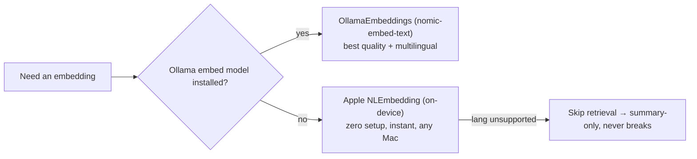
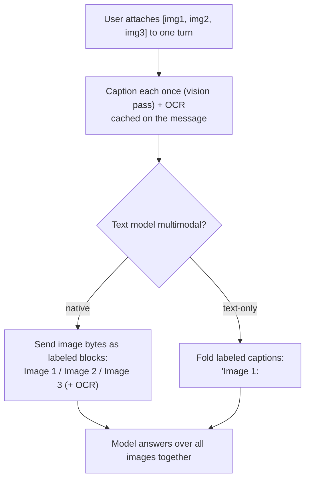

# Chat — Memory & Multi-image Design (proposal)

> Forward-looking design (not yet built). Companion to `APP_FLOW.md` §7. Captures the agreed direction
> so we build structurally. Update as decisions/implementation land; fold shipped bits into `APP_FLOW.md`.

## Decisions (locked)
- **Persistence:** in-session only — reset on `/clear`, nothing on disk. (No cross-session memory yet.)
- **Multi-image:** multiple images per **single turn** ("compare these 3"). No cross-turn gallery yet.
- **Memory:** hybrid — keep the two-track running summary **and** add in-session semantic retrieval.
- **Embeddings must be zero-setup and cheap** (works on weak machines); optional quality upgrade.

## Constraints driving the design
- Many users run **small local models** (tiny context windows, slow). Optimize for that; the strong
  setups then get it for free. → cheap retrieval, small top-K, bounded reserves, graceful skips.
- Embedding must be **readily available at install** — no mandatory heavy download.

---

## Part 1 — Memory: hybrid summary + in-session retrieval

Today (see `ChatContextBuilder`): last 6 turns verbatim; older turns → two-track summary (protected
`durableFacts` + clamped `topicTrace`). **Gap:** specific mid-conversation details that aren't "durable
facts" get lossily summarized into a 1,500-char trace and can't be recalled exactly.

Add a **retrieval reserve** that pulls the most relevant *older* turns back in **verbatim** on demand.

### Embedding ladder (zero-setup first)

- **Default:** Apple `NLEmbedding` — built into macOS, no download, negligible cost. Baseline for weak
  machines and first-run.
- **Optional upgrade:** `OllamaEmbeddings` (already exists, used by Identify ranking) with
  `nomic-embed-text` — offered in the model-setup flow alongside the vision/text models, so it's
  "install directly like the others."
- **Graceful:** no embedder / unsupported language → retrieval silently off; summary path unchanged.

### Retrieval mechanics (in-memory, no vector DB)
- A single chat is small → **brute-force cosine** over vectors (µs). `OllamaEmbeddings.cosine` already
  exists. **No SQLite / vector DB** (that's only for cross-session, which we deferred).
- **Unit = exchange chunk, not an isolated turn.** Index the (user turn + its assistant reply) as one
  embedding. A bare assistant turn ("Store it here…") retrieved without its question is fragmented —
  chunking keeps the Q with its A.
- **Index** (background, where summarization already runs): embed each completed exchange → keep
  `[(chunkRef, vector, meta)]` in memory, where **meta** is lightweight: message ids, speaker(s), a
  size estimate, and one cheap **importance** flag. (No topic tags yet.)
- **Query = question + a little recent context.** Embed the current question **plus the last 1–2 turns**
  (a small window), not the latest message alone — so "continue debugging the parser" still matches the
  parser thread even when "parser" only appears earlier.
- **At send:** cosine vs. **overflow** chunks only (those outside the verbatim window) → top-K (default
  **3**) above a threshold → inject verbatim, deduped against the recent window.
- **Importance is a cheap filter/boost, not a tuned formula.** Drop trivial turns ("thanks", "ok") from
  the index; gently boost chunks containing code / URLs / files / an explicit "remember". Recency
  weighting is skipped for now (in-session chats are short). Rank ≈ cosine, importance-gated.

### New context layout (`ChatContextBuilder`)
```
1. system prompt                              (always)
2. durable facts        (protected reserve)   ┐ two-track
3. topic trace          (clamped reserve)     ┘ summary (gist)
4. RELEVANT earlier messages (retrieved, verbatim, own reserve ~1500c, K≈3)   ← NEW
5. recent verbatim turns (last 6)
6. current user turn                          (always)
```
Weak-model tuning: K and the reserve scale down with the total budget; retrieval only runs when
overflow exists; recent-window dupes are removed so we never pay twice.

**Budget stays char-based** (deliberate: `ChatContextBuilder` is tokenizer-free — local models have
small, unknown context windows). Char budgets do misbehave across scripts (CJK ≈1 char/token vs English
≈4), so apply a **language-aware char→token *estimate*** to the reserves — cheap, no per-model tokenizer
dependency. A real tokenizer is deferred (fights the weak/simple goal).

---

## Part 2 — Multi-image per turn: how the AI organizes it

Today: one `pendingImage`; native models re-send `imageBase64`; text-only models get a single
vision **description folded into text**. Generalize to N images with a **caption-once** principle so
both paths and the context budget stay bounded.



- **Native multimodal** (Ollama VL, Qwen-VL, cloud GPT/Claude): send an **array** of images in the
  user turn as labeled blocks so the model can reference "Image 2". True cross-image reasoning.
- **Text-only:** caption each image (N vision calls — run in parallel, cache hard) + OCR each; fold as
  `Image 1: …`, `Image 2: …`. Reasons over captions, not pixels (no true visual compare — expected).
- **Every image gets a cached caption** on its message → the durable text representation, so a
  follow-up turn carries context without re-sending pixels (and bounds history growth).

### Data-model & provider changes
- Model each attachment as a **structured value**, not pre-concatenated text — so providers format it
  however their model prefers, and future fields slot in:
  ```
  struct Attachment { let id: UUID; var image: CGImage; var caption: String?; var ocr: String?
                      /* future: objects, dimensions */ }
  ```
  Keep caption and OCR **separate** (don't bake "Image 2: <caption>\n<ocr>" at capture time).
- **Stable internal IDs:** each attachment carries a UUID; the UI still shows "Image 1/2/3", but
  internal references stay valid even if the user removes or reorders images.
- `ChatController.pendingImage: CGImage?` → `pendingAttachments: [Attachment]` (cap ~4–6).
- `ChatMessage.image → attachments: [Attachment]`.
- `ChatTurn.imageBase64 → imageBase64s: [String]`; update **each provider's** encoder to send image
  arrays: `OllamaProvider`, `OpenAICompatibleProvider`, `AnthropicProvider`, MLX/vision path.
- **UI:** composer shows a row of thumbnails (append on attach, remove individually) instead of one.

---

## Phasing
1. **Retrieval memory** — ✅ **SHIPPED & VALIDATED** (MLX Qwen2.5-7B + Apple NLEmbedding).
   `ChatMemoryIndex` (embedder ladder Ollama→NLEmbedding→none, exchange-chunk index, importance filter,
   query = text + last 1–2 turns) + `ChatContextBuilder` retrieval reserve, wired into `ChatController`
   (index on turn finish, retrieve on send, reset on `/clear`). In-session, graceful skip when no
   embedder. **Gate is hybrid lexical + semantic** — NLEmbedding's cosines can't separate signal from
   noise (a real recall scored below unrelated noise), so a keyword-overlap gate provides precision and
   the embedding only ranks (with a `+0.1·kw` boost that fixes ranking where semantics can't). Test:
   exact far-back recall (steps 7/8), zero retrieval on unrelated turns (5/6/9).
2. **Multi-image per turn** — ✅ **SHIPPED**. `Attachment {id, image, caption?, ocr?}`;
   `ChatMessage.attachments`, `ChatController.pendingAttachments` (cap `maxAttachments=5`);
   `ChatTurn.imageBase64s` + array encoders in every provider (Ollama/OpenAI-compat/Anthropic/MLX).
   `runTurn` OCRs + (native) encodes all images or (text-only) describes each, folded as labeled
   "Image N:" blocks. Composer shows a removable thumbnail row; bubble renders single large / multi grid.
   *Deferred:* populating `Attachment.caption`/`.ocr` for reuse across follow-ups (currently recomputed
   per turn / carried via `promptText`), and cross-turn image eviction/retrieval.
3. **Selectable embedding backend** — ✅ **SHIPPED**. Settings ▸ Intelligence ▸ **Embedding model**
   (peer to Language/Image): Automatic (Apple→Ollama ladder, zero-setup default) / Apple (on-device) /
   Ollama (any local embed model) / OpenAI-compatible cloud (`text-embedding-3-small/-large`, reuses the
   Language model's endpoint+key). `IntelligenceCoordinator.makeEmbedder` resolves + probes, always
   falling back to Apple so retrieval never breaks. **Local-only forces cloud→local** (no text egress).
   The default needs **no download** (Apple `NLEmbedding` ships with macOS). Changing the backend resets
   every session's index (`embeddingConfigChanged`) and re-embeds lazily — vectors across backends are
   incomparable, and none are persisted. *Deferred:* in-app `ollama pull` for the embed model (currently
   guided via a caption); a cloud-embedding connection test.

## Persistence (SHIPPED — `ConversationStore`)
Conversations now persist to `~/Library/Application Support/Lasso/` (outside the `.app`, so history
survives GitHub-DMG updates/reinstall). **One JSON per conversation** + `index.json`; `schemaVersion` on
every file. **Source-of-truth only** — messages, two-track memory, title, `promptText` (carries the image
description) + a small thumbnail per attachment; the **semantic index is derived and rebuilt lazily on
load** (`reindexActive`), never stored (per "persist source, regenerate derived"). Saved on turn-finish /
memory-update / session lifecycle (off-main). **Clear chat history** in Settings ▸ General. Adopted from
review: per-file storage (not one big JSON), schemaVersion from day one, image thumbnails (not text-only),
lightweight index for the switcher. **Not adopted:** a `Workspace` root type — kept the folder nestable
and rely on `schemaVersion` to migrate if/when workspaces become real (avoids a no-behavior abstraction).
*Deferred:* full-res image persistence, image-anchor pixels, cross-session **shared** memory + search UI.

## Deferred (revisit later)
- Cross-session **shared/global** memory (search across *all* past chats → then a persisted vector store
  earns its keep; the per-conversation index stays in-RAM/derived) + "forget me" surface.
- Cross-turn image gallery + image eviction (recent-pixels/older-captions) + image retrieval.
- **Caption versioning** — regenerate cached captions when the vision model changes. Moot while
  in-session (captions die with the session); pairs with persistence.
- Refinements that add machinery for scale we don't have yet: a real tokenizer (vs. the char→token
  estimate), recency-weighted ranking, topic tags, `cosine × importance × recency` tuned scoring.

## Review feedback incorporated (external design review, ~9.3/10)
Adopted: exchange-chunk retrieval, query = question + recent context, structured attachments,
stable image IDs, lightweight metadata, importance as a cheap filter. Kept char-based budgeting with a
language-aware token estimate (full tokenizer deferred). Deferred caption versioning (in-session scope).

## Open questions
- `NLEmbedding` sentence-embedding language coverage — confirm fallback (word-vector average vs. skip)
  for unsupported languages.
- Per-provider multi-image API shapes (Ollama `images:[]`, OpenAI content array, Anthropic blocks).
- Image cap per turn + total-context image cap for follow-ups (bound token cost).
