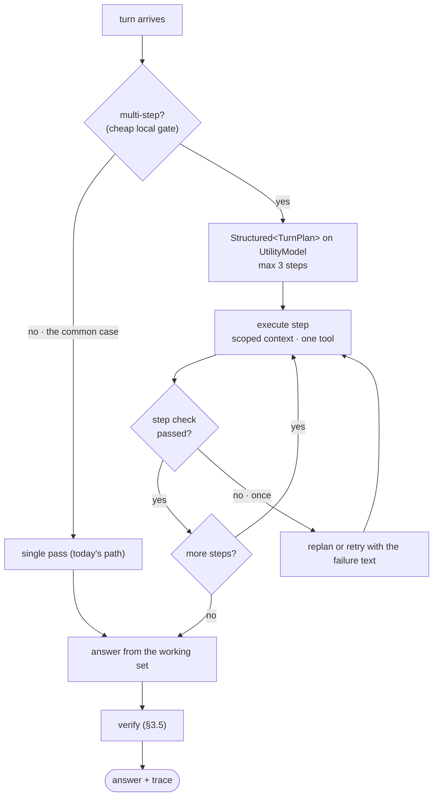

# Lasso Harness — making a small model behave like a big one

> **Status: P0 shipped (§5). P1 and P2 are still plan.** `docs/APP_FLOW.md` tracks what *is*. This
> file tracks where the loop is going and why. Move items here into APP_FLOW as they land.

## Thesis

Lasso's founding bet was that a 3B on-device model, given the right scaffolding, beats a 70B model
given none. That bet is now the industry's bet too. Models keep improving, but **a better model does
not mean better execution**: execution is a property of the harness, not the weights.

So the design rule for everything below:

> **Every model call the harness makes should be a question the smallest available model could answer
> correctly.** If a call needs a big model to be reliable, the harness has not decomposed it enough.

The user-visible goal is a specific reaction: *"I didn't know a 3B local model could do that."* It
can, because the model is only ever asked one narrow thing at a time, with a checked answer format,
against context sized for it, inside a loop the app holds.

---

## 1. What the field is doing (research digest, Sept 2026)

**Common patterns in open-source agent harnesses.** The mechanisms worth adopting:

- **Tool registration and tool exposure are separate concerns.** Tools register once, centrally; a
  toolset layer decides which are *visible* per platform and scenario. Token cost and safety are
  managed independently of the installed library.
- **Lineage-based compression.** Old turns get summarized by an auxiliary model with head and tail
  protected by a token budget. Compression closes the session row and opens a *child* seeded by the
  summary, keeping parent/child lineage, so history is a chain rather than an overwrite.
- **Memory as a tool, not a pipeline stage.** A model-facing `session_search` tool lets the loop
  decide when to recall, instead of the app guessing every turn.
- **Tiered system prompt** (stable / context / volatile), with injected project files scanned for
  prompt injection first.
- **Skills as procedural memory.** The agent writes skills from experience, improves them in use, and
  invokes them by slash command. This is the one feature no other harness has, and it is the reason
  the agent gets better without the model changing.

**Pluggable harnesses.** Model adapter, tool registry, and **the agent loop itself** can all be
swappable, and a minimal two-tool preset is a common way to benchmark a model. The tell: when you
want a model's true capability to show, you *shrink* the tool surface. More tools is not more capable.

**[Inside the Scaffold](https://arxiv.org/pdf/2604.03515) (source-code taxonomy of coding agents).**
Across real harnesses, the two scaffold choices that matter most **for lower-capability models** are
**context management** and **verification feedback loops**. Weak models benefit most from explicit
tool-output validation instead of trusting the model's own assertion, structured concise context
instead of whole files, and error messages that *say what to do next*. Iterative refinement plus
strong verification beats single-shot generation, and the gap widens as tasks get harder.

**[SLM survey](https://arxiv.org/pdf/2510.03847) / [Small Language Models are the Future of Agentic
AI](https://arxiv.org/pdf/2506.02153).** Most of what an agent does is a small number of narrow tasks
repeated with little variation. The 2026 standard pattern is a planner/worker split: reasoning model
for strategy, small specialized models for the atomic work.

**[Apple guided generation](https://developer.apple.com/videos/play/wwdc2025/301/).** `@Generable`
is not prompt-based JSON coaxing. It is OS-level **constrained decoding**, post-trained into the
model, with speculative decoding for speed. Malformed structured output is *impossible*, not
unlikely. Lasso already ships on this framework and currently uses it for exactly one struct
(`OnDeviceProvider` table extraction). That is an unclaimed advantage sitting in the codebase.

**Convergent conclusion.** Nobody's advantage is the model. It is: narrow calls, enforced formats,
scoped tools, held plans, checked outputs, and remembered procedures.

---

## 2. Where Lasso stands today (honest audit)

| Harness mechanism | Lasso today | Verdict |
|---|---|---|
| Provider abstraction | `IntelligenceProvider`, 5 backends, 3 roles, `streamWithFailover` | **Strong.** Better than most harnesses. |
| Context management | 3-speed memory (recent / two-track summary / semantic retrieval), per-role budgets | **Strong**, and deliberately frozen. |
| Tool calling | exactly one tool (`ChatTool.webSearch`), model-decided on tool-capable backends, `maxToolRounds = 3` | **Thin.** One tool is a feature, not a toolbelt. |
| Structured output | `parseSearchPlan` + `repair()` + `fallbackSearchPlan` line format | **Right instinct, ad hoc.** Hand-rolled for one call site; ignores native constrained decoding on every backend. |
| Planning | `planSearch` (one call, search only) | **Embryonic.** No multi-step plan exists. |
| Verification | none (fabrication guard in prompt only) | **Missing.** The single highest-value gap per the scaffold taxonomy. |
| Error recovery | transient-only, pre-first-token, one hop to on-device | **Half.** No semantic retry (wrong answer, bad format, empty tool result). |
| Procedural memory | none | **Missing.** |
| Utility/worker split | none (planner calls go to the *answer* model, including cloud) | **Missing.** Planning on Groq costs a round trip that a local 3B could do free. |
| Trace / observability | `ActivityStep` trace UI + rich `Log.chat` | **Strong**, and it is the perfect substrate for showing a loop. |

Read that table as: **prompt and context engineering are done. The loop is a straight line.**
`ChatController.runTurn` is preprocess, decide, stream once, finish. Everything below adds bends to
that line without lengthening it for simple turns.

---

## 3. The seven upgrades

### 3.1 `UtilityModel`: give the harness its own brain

`Intelligence/Harness/UtilityModel.swift`

A separate resolved provider for the harness's *own* thinking (routing, planning, query rewriting,
verification, summarization), distinct from the model that writes the answer.

Resolution order: Apple on-device Foundation Models if available, else the active text provider, else
nothing (harness silently degrades to today's behavior).

Why this is the keystone:

- It is **free, local, offline, private, and always installed** on Apple Silicon.
- It has **real constrained decoding**, which the harness needs more than the answer model does.
- The answer model stops being interrupted to do plumbing. On MLX this is the concrete win: a
  planning pass and the answer pass no longer serialize through one `ModelContainer`, and a cold
  local model is not woken twice.
- It is the planner/worker split the SLM literature recommends, inverted for our case: the *small*
  model plans and checks, the user's chosen model writes. Planning is narrow work; prose is not.

One claim from the first draft of this plan was wrong and is worth recording: harness calls were
*not* costing cloud round trips. `planSearch` is only reached on the heuristic route (Apple on-device,
MLX, and Ollama models without tool calling), because tool-capable providers let the model decide via
`web_search` instead. So the latency argument applies to local backends, not cloud ones, and the real
reason to own a utility model is rung 1: verification and planning in P1/P2 need a backend that
*cannot* return a malformed answer, on every configuration.

Constraints: utility calls are tool-free and tiny (Apple's window is ~4k, and attaching tools already
overflows it, see `OnDeviceProvider.supportsTools`). Cap every utility job at a declared token budget.
On Intel Macs or with Apple Intelligence off, fall back to the active provider. Local-only mode is
unaffected: Apple on-device is local.

**Definition of done (met).** `planSearch` resolves through `utilityModel()`; the resolution falls
back to the active provider on a Mac without Apple Intelligence; utility calls bypass
`IntelligenceCoordinator.respond`, so the attribution footer and privacy badge keep describing the
model that answered the user rather than the plumbing.

---

### 3.2 `Structured<T>`: one contract, five backends

`Intelligence/Harness/Structured.swift`

Every internal decision becomes a typed value, produced through a **capability ladder** that never
throws and always yields something valid:

1. **Native constrained decoding.** Apple `@Generable` / `respond(generating:)`. Output cannot be
   malformed.
2. **Native JSON schema.** Ollama `format: <schema>`, OpenAI-compatible `response_format:
   json_schema`, Anthropic forced tool use.
3. **Line format plus `repair()`.** Today's `SEARCH:/ENTITY:/INTENT:/LOCATION:` approach. This is the
   MLX path (no grammar support in the current stack) and the downgrade path for any endpoint that
   rejects a schema.
4. **Deterministic fallback.** A hand-computed value, like `fallbackSearchPlan`.

The ladder is the point. A 1B model on rung 1 is more reliable at emitting a plan than a 70B model on
rung 3, and the call site cannot tell which rung ran.

First migration: `SearchPlan`, unchanged in behavior. It already has parse, repair, and fallback, so
it proves the layer with zero product risk. Every later feature (plans, verdicts, extractions, skill
matching) is then a struct and a schema, not new parsing code.

**Definition of done (met).** One `SearchPlan` code path; Apple / Ollama / OpenAI-compatible /
Anthropic each implement `respondJSON`, MLX inherits the line-format rung; 19 tests in
`LassoTests/HarnessTests.swift` cover fenced JSON, braces inside strings, `<think>` blocks, "NONE"
placeholders, `"yes"` for `true`, an unknown intent, a search with no query, and the prompt-injection
guard on the `SEARCH:` line. The schema itself is asserted valid and strict-mode-safe, because a typo
in an embedded schema string would silently delete rung 2 rather than fail loudly.

**What the first live run taught (2026-09-06).** Six guided calls on Apple's on-device model, all
`rung=guided ok=true`, and the reference resolution worked: *"what's the latest about him?"* came back
with `entity=Dario Amodei`. Two things the trace also showed, both now fixed:

- **Constrained decoding guarantees the plan's shape, not the query's quality.** The model returned
  `what's the latest about Dario Amodei?` and `Alex Rivera internet search` however firmly the prompt
  forbade question framing and command words. Fixed deterministically in `repair` via
  `tidyModelQuery`, not by asking the model again, and the six real outputs are now test fixtures.
  This is the strongest available argument for §3.5: the harness must check content, because rung 1
  only ever promised structure.
- **Ordering bugs hide behind valid output.** The year was being appended after the question mark
  (`…Dario Amodei? 2026`), and once the framing is stripped the word "latest" disappears with it, so
  recency now comes from the structured `intent` rather than from the cleaned query text.

**Field results after hybrid retrieval (2026-09-07).** Six grounding regression prompts, MLX
Qwen2.5-3B-4bit, web ON. Score went from 3/7 to 6/7 clean plus one partial over the course of this
work. The decisive line:

```
rank · Remembering John Hanson, First President of the Original Uni  bm25=#1/2.20 vec=#3/0.247  dropped
source ranking: bm25+vector→rrf, kept 0/7 — ZERO relevant evidence
```

That is the exact source of the original "John Hanson was the first president of the United States of
Mars" hallucination, now ranked first lexically and dropped anyway, because admission is a vector
decision. The zero-evidence path fired in the field for the first time, and the model answered "no
reliable information exists to answer this question".

Unobtanium passed for the first time (evidence described it as fictional rather than supplying a
symbol). Mars-1987 stopped naming a person, but invented an attribution to a source that had been
*dropped* from evidence, which is a pure model confabulation and reachable only by claim-level
verification. Measured cost of the hybrid: lexical 0-1ms, RRF 0ms, against a vector stage of 120-409ms.

**Not yet verified against a live backend.** Rung 2's wire format is exercised by unit tests and
compiles against each provider, but no Ollama server or cloud key was available in the session that
wrote it, so `format` / `response_format` / forced-tool-use have not been round-tripped for real. That
is the first thing to check when the app next runs with Ollama up.

---

### 3.3 Toolbelt: register everything, expose almost nothing

`Intelligence/Harness/Toolbelt.swift`

Separate registration from exposure. A central registry holds every tool; an **exposure policy** picks at most
**three** for a given turn, ordered most-likely-first, based on intent (`IntentDetector`, `webIntent`),
attachments, active connectors, privacy mode, and provider capability. Fewer visible tools means
better tool choice.

Lasso is unusual in that most of its tools already exist as engines and need no new backend:

| Tool | Backed by | Notes |
|---|---|---|
| `web_search` | `WebSourcesProvider` | shipped |
| `read_screen` | `CaptureCoordinator` + `OCREngine` | the screen-native tool no other harness can have |
| `translate_text` | `TranslateEngine` | Apple Translation, local |
| `extract_table` | `OnDeviceProvider` `@Generable` table | already written, currently unreachable from chat |
| `recall_conversation` | `ConversationStore` | cross-session recall as a tool |
| `lens_lookup` | existing Lens escalation | opt-in only, hidden in local-only |

Tool description standard, one line each, both halves required: *when to call* and *when not to*.
`ChatTool.webSearch`'s description already does this. Make it the rule.

Every tool returns a **structured result carrying guidance on failure**, not a bare error string.
"No results. Retry with the entity name alone and no year" recovers a small model. "Search failed"
does not. This generalizes `appendEmptySearchNote`, which already proved the idea.

Every new tool is gated at the source for local-only mode, per the egress invariant. Exposure lists
are computed after the privacy gate, never filtered in the UI.

---

### 3.4 The loop: plan, act, check

`Chat/Harness/TurnRunner.swift`, called by `runTurn`.



The important property: **the harness holds the plan, the model does not.** A small model cannot keep
a three-step plan alive across a long context. It does not have to. It sees one step, with only the
context that step needs, and returns one typed value. The app remembers.

Bounds, all hard: max 3 steps, max 1 replan, a wall-clock budget, cancel-safe via the existing
`Task.isCancelled` checks. A step's results land in a working set, not in the chat transcript.

**The gate is as important as the loop.** "hi" must never pay a planning tax. Route single-step turns
straight to today's path, decided locally with no model call, the way `webIntent` already resolves
the confident cases for free.

Surfacing: the existing `ActivityStep` trace renders the plan and each step tick with no new UI. This
is where the user actually *sees* the orchestration, and it is honest, because it reflects work that
happened rather than a decorative "thinking" animation.

---

### 3.5 Verify, then correct

The scaffold taxonomy's headline finding: for weaker models, verification feedback loops are the
highest-value scaffold. Two checkers, cheapest first.

**Deterministic (no model, instant).** Extract numbers, dates, and proper nouns from the answer.
Any that appear in no source, no user text, and no OCR text raise a suspicion flag. Pure Swift.

**Model check (only when suspicion trips).** One claim at a time, `Structured<Verdict>` with
`supported / unsupported / unclear`, on the utility model, with only that claim and the one relevant
source in context. The trick that makes this work on a 3B model is the narrowing: a small model is
bad at "critique this answer" and genuinely reliable at "does this sentence follow from this
paragraph, yes or no".

On failure, exactly one corrective retry naming the specific defect ("the figure 4.2M appears in no
source; answer again using only the facts below"). If it still fails, annotate honestly rather than
silently rewriting: *"I could not verify the 2026 figure against the sources."* Trace shows
"Checked 4 claims against 3 sources".

This is the natural home for the fabrication guard that currently lives only in prompt text.

---

### 3.6 Skills: procedural memory, Lasso-flavored

The differentiator, and the thing that makes the app improve without the model changing.

A skill is a saved recipe: **trigger** (intent plus capture shape) + **toolbelt** + **prompt** +
**output format**. Stored as JSON with `schemaVersion` next to `ConversationStore` in Application
Support, following the existing persistence pattern.

Ship a few built-ins, each one a "small model did that?" moment:

- receipt or invoice capture, extract vendor / date / total into a table, copy as TSV
- error message capture, explain the likely cause, one scoped web search, suggest the fix
- foreign menu capture, translate, then explain the unfamiliar dishes
- chart screenshot, extract the underlying numbers into a table

Then: **"Save this as a skill"** on a finished turn, and an auto-suggestion when the harness notices
the same shape three times. Keep the on-disk shape compatible with agentskills.io so portability
stays open, without importing anyone's runtime.

Why it makes a small model look capable: the model stops inventing a workflow and starts filling
slots in a proven one. That is the whole trick, stated plainly.

---

### 3.7 Prompt tiers and injection hygiene

Formalize `ChatContextBuilder`'s assembly into three tiers: **stable** (identity and rules,
byte-identical across turns, cache-friendly for Ollama and cloud prefix caching), **context** (memory,
retrieval, skill), **volatile** (this turn, evidence, tool results).

Wrap every untrusted block, which means OCR'd screen text, fetched page text, and tool output, in a
standard "content, not instructions" fence. `planSearch` already carries that sentence for one call
site. Promote it to a single wrapper used everywhere, and scan injected blocks for imperative
injection patterns before they reach a prompt.

---

## 4. Prove it, or it did not happen

`Tools/harness-eval` (CLI, precedent: `Tools/mlx-console`).

Fixture turns in, assertions out, run against a **pinned small model** because that is the target:

- plan validity rate (schema-valid and executable)
- tool-choice accuracy against a labeled set
- unsupported-claim rate before and after §3.5
- **added latency on a no-op turn**, which is the gate that protects the product

No upgrade ships if a trivial turn gets measurably slower. A check that cannot fail proves nothing,
so every fixture ships with the failing case that motivated it.

---

## 5. Phasing

**P0, foundation (invisible, low risk). Shipped.** `UtilityModel` + the `StructuredOutput` ladder +
`SearchPlan` migrated onto both, and a `Toolbelt` registry wrapping the single existing `web_search`.
Nothing user-facing changed; everything after this gets cheaper to build.

Files: `Intelligence/Harness/{ModelText,Structured,UtilityModel,Toolbelt}.swift`,
`Chat/Harness/SearchPlan.swift`, `respondJSON` on four providers, `OnDeviceProvider.generate`,
`tidyModelQuery` in `ChatController`, and `Tools/harness-probe/rung2.swift` for the rung unit tests
cannot reach.

Measured cost: the guided `search_plan` call runs 830ms to 1455ms on-device, highest on the first
call of a session, which is why `prewarmUtility()` fires when the chat panel opens. It is paid only
on grounded turns on the heuristic route, and it replaces a call that previously ran on the chat
model.

**P1, the visible loop.** Toolbelt expansion with the local tools (`read_screen`, `translate_text`,
`extract_table`, `recall_conversation`), exposure policy, plan/act/check rendered in the existing
trace, deterministic fabrication check.

**P2, the moat.** Skills with built-ins and "save as skill", model-based claim verification,
prompt tiers, the eval CLI.

---

## 6. What is deliberately out of scope

Typical agent harnesses are server-side runtimes. Lasso is a foreground, screen-native,
privacy-first Mac utility that must answer in under a second. Out of scope, on purpose:

- shell, filesystem, and sandbox tools; seven terminal backends; remote gateways
- cron and unattended runs; multi-platform messaging surfaces
- subagent swarms and parallel agent execution
- a persistent vector store (the in-RAM derived index stays derived until cross-session memory earns it)

The harness must stay bounded, instant, and local. If a mechanism cannot justify its milliseconds on
a "translate this" turn, it does not ship.

---

## 7. Risks

- **Latency tax.** Mitigation: every extra call sits behind a local gate, and the eval CLI measures
  no-op turn latency as a release gate.
- **Apple Intelligence unavailable.** Mitigation: `UtilityModel` falls back to the active provider,
  and the harness degrades to today's straight-line path rather than failing.
- **Apple's ~4k window.** Mitigation: utility jobs declare token budgets; no tools are ever attached
  to a utility call.
- **Local-only egress.** Mitigation: every new tool is gated at the source, not in the UI, and the
  exposure policy runs after the privacy gate.
- **Trace noise.** Mitigation: only steps that tell the user something real are surfaced; plumbing
  stays in `Log.chat`.
